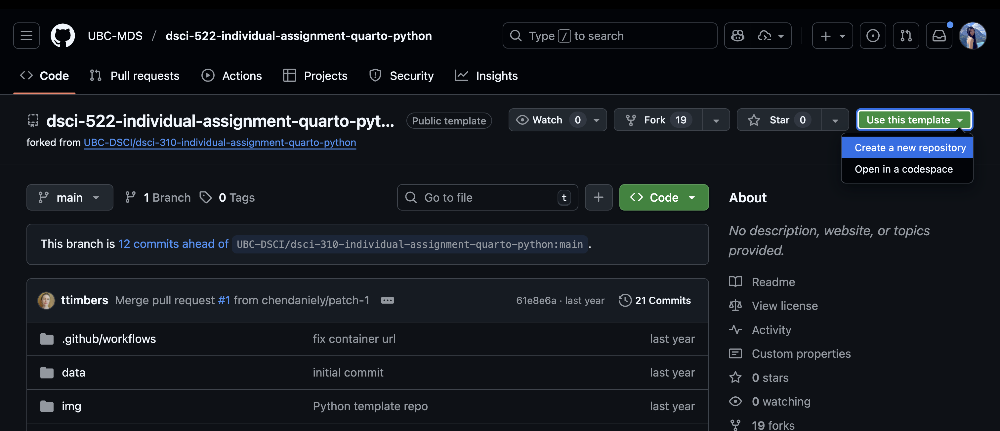
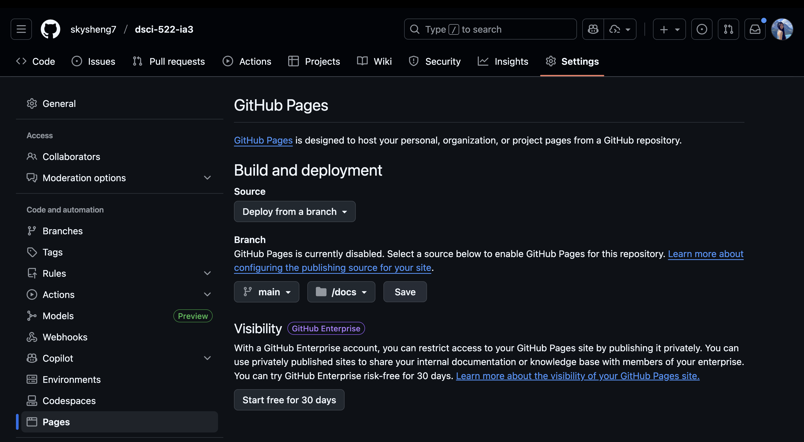
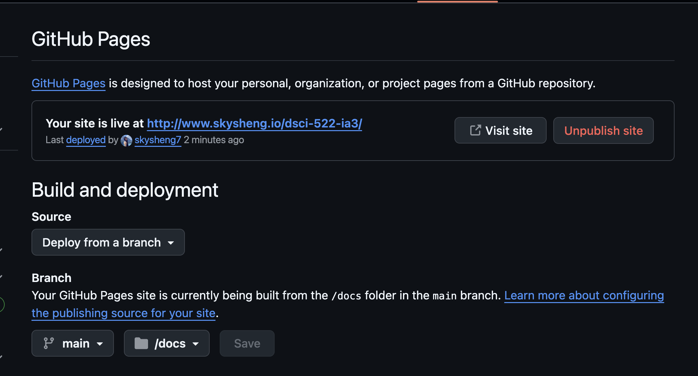

## Instructions

The purpose of this assignment is to ensure that everyone gains hands-on practice creating reproducible reports using [Quarto](https://quarto.org/).

Throughout the pre-requisites for DSCI 522, you have become familiar with using Jupyter Notebooks to interweave narration and runnable code into a single document. This allowed you to pass your analysis over to a co-worker or reviewer, who could reproduce your work by running your notebook from top to bottom.

But is Jupyter Notebook the best we can do to create reproducible data analysis? Not entirely... For example, Jupyter Notebooks struggle with organization and configuration. Imagine you have an extremely long and complicated report packed into a single Jupyter Notebook. Writing out a table of contents, formatting a bibliography, and adding labels to figures can become extremely cumbersome, especially as they evolve with your analysis during the review process.

Imagine you have 25 figures and tables labelled 1 to 25 and you decide to add a new figure at the very start of your report; figure 1 now needs to be renamed to figure 2, table 2 now needs to be renamed to table 3, figure 3 now needs to be renamed to figure 4...

This is where Quarto (and related tools) can come in handy. Although they have their own set of disadvantages, they are certainly an improvement over plain Jupyter Notebooks. They allow for the automatic creation and formatting of a table of contents, a bibliography, and those pesky figure labels, among many other features. During this individual assignment, you will start to familiarize yourself with Quarto reports, start to understand their advantages and disadvantages, and begin to recognize their similarities and differences from basic Jupyter notebooks.

### Exercise instructions - Quarto

We suggest you read through the instructions first before doing them in sequence.

#### 1. Create a new repository

1.1  Create a copy of either the [Python template repository](https://github.com/UBC-MDS/dsci-522-individual-assignment-quarto-python) or the [R template repository](https://github.com/UBC-MDS/dsci-522-individual-assignment-quarto-r) on GitHub.com under **your personal username**

Click on "Use this template" button, and then click "create a new repository" button to create a public repository using default settings under your own GitHub account.




::: callout-note
-   Do not create it under the UBC-MDS organization
-   We, the teaching team, also need to be able to see this repository in order to grade it so we strongly suggest making it public.
:::


1.2  Clone the repository and `cd` into the repository.

``` bash
git clone <repository_url>
cd <repository_name>
```

#### 2. Get familiar with the repository

Inside the the [Python template repository](https://github.com/UBC-MDS/dsci-522-individual-assignment-quarto-python) or the [R template repository](https://github.com/UBC-MDS/dsci-522-individual-assignment-quarto-r), there are several directories and files. Here is a quick rundown of each:

-   `data`: contains data used in the analysis **(do not edit)**
-   `reports`: contains the Quarto report file (ends in `qmd_example.qmd`) that contains the narrative of the analysis report and the code to display the analysis artifacts (tables and figures) **(incomplete - you will need to edit this)**, and the BibTeX references file (`references.bib`) for the report **(do not edit)**
-   `README`: documents how to run the analysis **(do not edit**)
    -   This file has all the commands you need to do this assignment.
-   `results`: output of the script in `scripts`
-   `scripts/generate_figures.py` or `scripts/generate_figures.R`: a script that performs the analysis and outputs various plots and a table that are to be used in the report **(do not edit)**

#### 3. Pythoon scripts and README file

3.1 Familiarize yourself with the script, its outputs and the qmd_example.qmd\` file.

-   The `README` has all the instructions needed to render the final Quarto report.
-   You will likely want to use the Docker environment provided to run the analysis and complete the assignment.

::: callout-note
-   The HTML version of the report is saved to `docs/qmd_example.html`
-   The PDF version will be saved to `docs/qmd_example.pdf`
-   The `README` commands will help you
:::

3.2  Launch the Docker container using the following command:

``` bash
docker compose up
```

3.3  Copy and open the URL that starts with `http://127.0.0.1:8888/lab?token=` in your browser, to launch jupyter lab docker container.

3.4  Run the python script in the terminal to generate the plots and tables in the results folder.

``` bash
python scripts/generate_figures.py --input_dir="data/00030067-eng.csv" \
    --out_dir="results"
```

You will see the results folder now has new plots and csv files saved.

#### 4. Update quarto report

The goal here is to create the example report so that it is a polished academic manuscript.

Edit `reports/qmd_example.rmd` (using either Python or R Quarto syntax, the choice is yours) following the instructions below. The instructions used python project as an example:

##### 4.1 Header formatting & table of contents

> **TODO**: Add header formatting to sections (e.g., "Aim", "Data", "Methods", "Results", "References") and Quarto configuration so that a table of contents that is automatically generated from the document headers will be created when the document is rendered ([docs on how to do this](https://quarto.org/docs/output-formats/html-basics.html#table-of-contents))

We will update the `yml` header to add table of contents. We will add table of content (toc) with depth 3 for both html and pdf formats. Your `yml` header at the begining of the file (i.e., `qmd_example.qmd`) should be updated to look like this:

``` yaml
title: "DSCI 310: Historical Horse Population in Canada"
author: "Tiffany Timbers & Jordan Bourak"
format: html
editor: source
format:
  html:
    toc: true
    toc-depth: 3
  pdf:
    toc: true
    toc-depth: 3
```

You will format header sections using `#`, `##`, `###`, etc. For example, I've added the following header sections to the `qmd_example.qmd` file:

``` markdown
# Aim
...
# Data
...
# Methods
...
# Results
...
# References
```

##### 4.2 References

> **TODO**: Add correctly formatted inline BibTeX references so that a nicely formatted reference list will be present at the end of the document
> 
>    -   [Citations in Jupyter Lab](https://quarto.org/docs/manuscripts/authoring/jupyterlab.html#citations)
>    -   [Citations in RStudio](https://quarto.org/docs/manuscripts/authoring/rstudio.html#citations)
>    -   [Citations in VSCode](https://quarto.org/docs/manuscripts/authoring/vscode.html#citations)

You already have a `references.bib` file in the repository under the `reports` folder. We will point `bibliography` to look for references in this file in the `yml` header as follows:

``` yaml
title: "DSCI 310: Historical Horse Population in Canada"
author: "Tiffany Timbers & Jordan Bourak"
format: html
editor: source
format:
  html:
    toc: true
    toc-depth: 3
  pdf:
    toc: true
    toc-depth: 3
bibliography: references.bib
```

::: callout-note
## ⚠️ High bug zone: indentation & missing colon:

-   Quarto's yaml uses 2 whitespaces to indent the yaml fields (not 4 whitespaces!! not tab!!).
-   Please use `:` to separate the field name and the field value.
:::

Let's render what we have so far to see the result. In your terminal, please run the following commands:

``` bash
# go to the reports directory if you are in the root directory
cd reports

# render the html file
quarto render qmd_example.qmd
```

::: callout-note
## 😵 No references listed in the rendered report??

You will notice that no references are listed in the rendered pdf or html file. This is because we have not added in-text citations to the `.qmd` file. You can list as many BibTex references as you want in your `references.bib` file. However, only the references that are cited in the `.qmd` file will be listed in the rendered pdf or html file under "References" section.
:::

Let's add in-text citations to the `.qmd` file. We will use the `[@reference_key]` syntax (or `[@reference_key1; @reference_key2]` when you have more than 1 reference) to cite references. Please note the `reference_key` is the first phrase after `{` in the BibTex entry. For example, for this entry in the `references.bib` file:

``` bibtex
@Manual{click,
    title           = {Click Python Package},
    author          = {Pallets Team},
    year            = {2020},
    url             = {https://click.palletsprojects.com/},
}
```

The `reference_key` is `click`. We will use `[@click]` to cite this reference in the `.qmd` file.

For example, I've added the following in-text citations to the `.qmd` file. Please complete all other in-text citations yourself:

``` markdown
Horse population data were sourced from the 
[Government of Canada's Open Data website](http://open.canada.ca/en/open-data) [@horses1; @horses2]...
```

##### 4.3 Figure formatting

> **TODO**: Edit the figure formatting ([docs on how to do this](https://quarto.org/docs/authoring/figures.html#figure-basics)) so that Quarto:
>
>    -   automatically numbers them
>    -   has a label for easy cross referencing
>    -   controls the figure sizes so the figures are not too big (in particular the second figure in the report should be only 60-70% of the default width)

We use the syntax `{#fig-label width=950%}` to format the figure. For example, I've added the following figure to the `.qmd` file, and I use `@fig-label` to refer to it in the text. This will be rendered as `Figure 1` in the rendered pdf or html file. You will do so for both Figure 1 + 2.

``` markdown
# Results

{#fig-horse-pop width=60%}

We can see from @fig-horse-pop that Ontario, Saskatchewan and Alberta 
```

::: callout-note
## ⚠️ High bug zone: Pay attention to using `fig-label`

-   You have to name your figure with starting with a `fig` prefix (sorry for my mistakes in class!).
-   You have to use `-` instead of `_` in the figure label.
-   Example: `fig-horse-pop` instead of `horse_pop`.
:::

##### 4.4 Table formatting

> **TODO**: add a table description argument so that they are automatically numbered by Quarto and use cross referencing to link to the table if/when it is discussed in the text ([docs on how to do this](https://quarto.org/docs/authoring/tables.html#cross-references))

We use the syntax below inside of python code block to format the table:

``` markdown
#| label: tbl-label
#| tbl-cap: Table description
```

For example, I've added the following table to the `.qmd` file. `@tbl-horse-sd` will be rendered as `Table 1` in the rendered pdf or html file.

```` markdown
We present the standard deviations in @tbl-horse-sd.

```\{python}
#| label: tbl-horse-sd
#| tbl-cap: Standard deviation of historical (1906-1972) horse populations for each Canadian province.

horses_sd_table = pd.read_csv("../results/horses_sd.csv")
largest_sd = horses_sd_table['Province'].values[0]
Markdown(horses_sd_table.to_markdown(index = False))
```
````

::: callout-note
## ⚠️ High bug zone: Pay attention to using `tbl-label`

-   You have to name your table with starting with a `tbl` prefix (sorry for my mistakes in class!).
-   You have to use `-` instead of `_` in the table label.
-   Example: `tbl-horse-sd` instead of `horse_sd`.
:::

##### 4.5 Cross-referencing

> **TODO**: Edit the narrative so it uses cross-referencing to refer to the figures and tables instead of having their reference hardcode the figure and table numbers.

In the steps above, we have already used cross-referencing to refer to the figures and tables (e.g., `@fig-horse-pop` and `@tbl-horse-sd`).

##### 4.6 Inline Quarto code

> **TODO**: replace the `???` in the Quarto report narrative text with inline Quarto code, so that the text will be automatically updated with the correct value ([docs on how to do this](https://quarto.org/docs/computations/inline-code.html))

We use the syntax below to do inline Quarto code. It will execute the python / R code inside of the code block and resulting value will be displayed in the text.

``` markdown
`{python} <python_code>`
```

For example, I've added the following inline Quarto code (i.e., `{python} largest_sd`) to the `.qmd` file:

```` markdown
```\{python}
#| label: tbl-horse-sd
#| tbl-cap: Standard deviation of historical (1906-1972) horse populations for each Canadian province.


horses_sd_table = pd.read_csv("../results/horses_sd.csv")
largest_sd = horses_sd_table['Province'].values[0]
Markdown(horses_sd_table.to_markdown(index = False))
```

...

In @fig-horse-largest we zoom in and look at the province of `{python} largest_sd`, which had the largest spread of values in terms of standard deviation.
````

##### 4.7 No code chunk visible

> **TODO**: change the code chunk options so that no code is viewable in the rendered report, just the code outputs where needed (e.g., figures and tables) ([docs on how to do this](https://quarto.org/docs/computations/execution-options.html))

We will set `echo: false` in the `yml` header to hide the code chunk in the rendered report.

``` yaml
title: "DSCI 310: Historical Horse Population in Canada"
author: "Tiffany Timbers & Jordan Bourak"
format: html
editor: source
format:
  html:
    toc: true
    toc-depth: 3
  pdf:
    toc: true
    toc-depth: 3
bibliography: references.bib
execute:
  echo: false
```

##### 4.8 GitHub Pages

> **TODO**: (optional/bonus) Turn on GitHub pages so that it serves up the `docs` directory so that the report is viewable on the web.

4.8.1. At the **root directoy** of your repository, please create a new file called `_quarto.yml` and add the following content:

``` yaml
project:
  type: website
  output-dir: docs
```

This file will tell Quarto to output the rendered report to the `docs` folder, as a website.

4.8.2.  At the **root directoy** of your repository, please run the following command to render the report in the terminal:

``` bash
quarto render
```

You will see that the rendered report is now all in the `docs` folder. There is a `index.html` file in the `docs` folder, you can open it in your browser to view the report.

::: callout-note
## 😵 No image showing in Jupyter lab??

It is normal to not see figures being rendered inside of Jupyter lab. You will need to go to local folder, and double click on the `index.html` file to view the report in a browser.
:::

4.8.3. **Clean up**: After you are sure that you have completed everything. Close the jupyter lab docker container. In your terminal, press `Ctrol + C` to stop the container. Then run `docker compose rm` to remove the docker container.

4.8.4.  Push your changes to github as usual.

4.8.5. **Hosting on GitHub Pages**: After you pushed all changes to your github pages, please follow these steps:

    -   Go to your github repository
    -   Click on "Settings" gear icon
    -   Click on "Pages" on the left panel
    -   Under "Source", select "Deploy from a branch"
    -   Under "Branch", select "main"
    -   Then select "docs" folder from the dropdown menu
    -   Click on "Save" button



4.8.6.  Wait a few minutes, and refresh the page. You will see that github now says something like the message shown below:



##### 🎊 Congratulations!

You have successfully fixed the Quarto report and hosted it on GitHub Pages!


### Submission instructions

Follow the instructions for submission on Gradescope.
We only need URLs, entered into Gradescope directly: there is no PDF to make.
You will submit:

1.  A link to the GitHub.com repository that you create for this assignment.

2.  (optional/bonus) link to the HTML report served on GitHub pages.

## Rubric

This assignment will be graded for completion as follows:

| Grade | Description |
|-------------------------|-----------------------------------------------|
| 110% | All 7 of the required edits to the `.qmd` document above were met and the HTML version of the report was served up on GitHub pages |
| 100% | All 7 of the required edits to the `.qmd` document above were met *and* the report generates a working PDF and HTML file. |
| 85% | 6/7 of the required edits to the `.qmd` document listed above were met. |
| 70% | 5/7 of the required edits to the `.qmd` document listed above were met. |
| 55% | 4/7 of the required edits to the `.qmd` document listed above were met. |
| 40% | 3/7 of the required edits to the `.qmd` document listed above were met. |
| 25% | 2/7 of the required edits to the `.qmd` document listed above were met. |
| 10% | 1/7 of the required edits to the `.qmd` document listed above were met. |
| 0% | The assignment was not attempted. |

-   You will only get the extra points for serving up the HTML version of the report on GitHub pages if all of the main assignment components were completed.