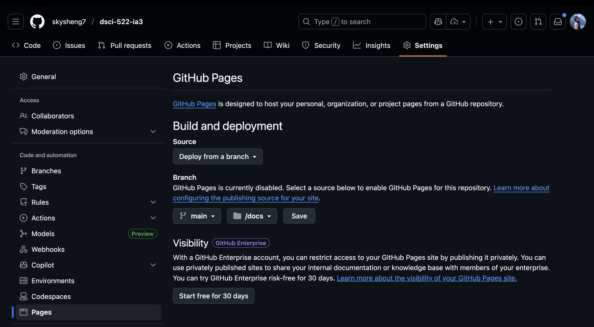

## Summary

This assignment is hands-on practice with Quarto reports, which you will use for your project report.
You get a short, messy report and turn it into a polished one:
Quarto numbers the figures and tables, builds the table of contents and the reference list,
and fills in numbers from your code, so you never update them by hand.

- [ ] Copy the template repository and run its script to make the figures and table
- [ ] Make the **7 edits** to the report (listed below)
- [ ] Render the report to HTML and PDF, then push
- [ ] Optional bonus: publish the HTML report on GitHub Pages

::: {.callout-tip collapse="true"}
## Readings for this assignment

-   Textbook: [Reproducible reports with Quarto](https://ubc-dsci.github.io/reproducible-and-trustworthy-workflows-for-data-science/lectures/reproducible-reports-quarto.html)
-   [Quarto cheatsheet](../cheatsheets/quarto.qmd): the code we ran in class for this assignment, step by step
-   For the bonus: [Quarto and GitHub Pages](https://ubc-mds.github.io/DSCI_521_platforms-dsci_book/lectures/quarto-github-pages.html) (DSCI 521 notes)
:::

## Instructions

1.  **Make the repository.**
    Open the [Python template](https://github.com/UBC-MDS/dsci-522-individual-assignment-quarto-python)
    or the [R template](https://github.com/UBC-MDS/dsci-522-individual-assignment-quarto-r),
    click **Use this template** \> **Create a new repository**,
    and make a **public** repository under your personal account (not under UBC-MDS).
    Clone it and `cd` into it.

2.  **Start the container.**
    Open Docker Desktop, then run `docker compose up` in the repository folder.
    It gives you JupyterLab (Python) or RStudio (R) with everything installed (see below).

3.  **Make the figures and table.**
    In the terminal *inside* JupyterLab or RStudio, run the script (command below).
    New plots and a `.csv` file appear in `results/`.

4.  **Make the 7 edits** to `reports/qmd_example.qmd`.
    The **Syntax you need** section below has an example of each.

    1.  **Headers and table of contents:** turn the plain section names (Aim, Data, Methods, Results, References)
        into `#` headers, and add a table of contents to the [YAML header]{.term tabindex="0" data-tip="The YAML header is the block between the two --- lines at the top of a .qmd file. It holds settings for the whole document, such as the title, the output formats and the table of contents. Each setting is a name, a colon and a value."}.
    2.  **References:** point the YAML header at `references.bib`, and replace each hand-typed citation
        (e.g. "Van Rossum and Drake 2009") with a [citation key]{.term tabindex="0" data-tip="A citation key is the short name of a reference in a BibTeX (.bib) file: the word right after the opening { of each entry. Here, @Manual{click, ...} has the key click. You cite it in the text as [@click], and Quarto writes the full reference at the end."}.
    3.  **Figures:** give both figures a caption and a `#fig-` label, and make the second one 60 to 70% wide.
    4.  **Table:** give the table a `tbl-` label and a caption.
    5.  **Cross-references:** replace every hard-coded "Figure 1", "Table 1" and so on in the text
        with a [cross-reference]{.term tabindex="0" data-tip="A cross-reference is a link to a figure or table by its label, like @fig-horse-pop. Quarto turns it into Figure 1 (with the right number) when it renders. Add a new figure at the top, and every number updates by itself."} such as `@fig-horse-pop`.
    6.  **Inline code:** replace the `???` in the text with [inline code]{.term tabindex="0" data-tip="Inline code is a bit of code written inside a sentence. Quarto runs it when it renders and puts the result in the text. Here it prints the province name stored in largest_sd, so the sentence stays right if the data change."} that prints `largest_sd`.
    7.  **Hide the code:** set `echo: false` so the rendered report shows figures and tables, but no code.

5.  **Render** the report to HTML **and** PDF (commands below) and open both to check your edits.
    Then commit and push.

6.  **Optional bonus: GitHub Pages.**
    Publish the HTML report on the web (steps below).

7.  **Clean up.**
    Press `Ctrl + C` in the terminal where you ran `docker compose up`, then run `docker compose rm`.

::: {.callout-tip collapse="true"}
## Commands to run (steps 2, 3 and 5)

Start the container from your repository folder:

```bash
docker compose up
```

::: panel-tabset
## Python

Open the link that starts with `http://127.0.0.1:8888/lab?token=` from the terminal output.
Then open a terminal in JupyterLab and run:

```bash
python scripts/generate_figures.py --input_dir="data/00030067-eng.csv" \
    --out_dir="results"

quarto render reports/qmd_example.qmd --to html
quarto render reports/qmd_example.qmd --to pdf
```

## R

Go to <http://localhost:8787> and log in with username `rstudio` and password `password`.
Then open a terminal in RStudio and run:

```bash
Rscript scripts/generate_figures.R --input_dir="data/00030067-eng.csv" \
    --out_dir="results"

quarto render reports/qmd_example.qmd --to html
quarto render reports/qmd_example.qmd --to pdf
```
:::

The rendered files appear next to `qmd_example.qmd` in `reports/`.
JupyterLab may not show the figures inside the HTML file: open it from your own file browser instead.
:::

::: {.callout-tip collapse="true"}
## Syntax you need (step 4)

**YAML header** (edits 1, 2 and 7), at the top of `qmd_example.qmd`.
This is what it looks like when you're done:

```{.yaml}
---
title: "DSCI 310: Historical Horse Population in Canada"
author: "Tiffany Timbers & Jordan Bourak"
editor: source
format:
  html:
    toc: true
    toc-depth: 3
  pdf:
    toc: true
    toc-depth: 3
bibliography: references.bib
execute:
  echo: false
---
```

Delete the old `format: html` line: a setting can only appear once.

**Headers** (edit 1): `# Aim`, `# Data`, `# Methods`, `# Results`, `# References`.

**Citations** (edit 2): put the key in square brackets after `@`. Separate several keys with `;`.

```markdown
Horse population data were sourced from the
[Government of Canada's Open Data website](http://open.canada.ca/en/open-data) [@horses1; @horses2].
```

Only references you cite show up in the reference list.

**Figures** (edits 3 and 5): caption in the square brackets, label and width in the curly brackets, then refer to the label in the text.
Delete the old "Figure 1: ..." line under the image.

```markdown
{#fig-horse-pop width=80%}

We can see from @fig-horse-pop that Ontario, Saskatchewan and Alberta ...
```

**Table** (edits 4 and 5): add a label and caption as the first lines of the code cell that makes the table,
and delete the old "Table 1. ..." line above it.

::: panel-tabset
## Python

````markdown
We present the standard deviations in @tbl-horse-sd.

```{{python}}
#| label: tbl-horse-sd
#| tbl-cap: Standard deviation of historical (1906-1972) horse populations for each Canadian province.

horses_sd_table = pd.read_csv("../results/horses_sd.csv")
largest_sd = horses_sd_table['Province'].values[0]
Markdown(horses_sd_table.to_markdown(index = False))
```
````

## R

````markdown
We present the standard deviations in @tbl-horse-sd.

```{{r}}
#| label: tbl-horse-sd
#| tbl-cap: Standard deviation of historical (1906-1972) horse populations for each Canadian province.

horses_sd_table <- read_csv("../results/horses_sd.csv")
largest_sd <- horses_sd_table$Province[1]
knitr::kable(horses_sd_table)
```
````
:::

**Inline code** (edit 6): a single backtick, the language in curly brackets, then the code.

::: panel-tabset
## Python

```markdown
we zoom in and look at the province of `{python} largest_sd`, which had ...
```

## R

```markdown
we zoom in and look at the province of `{r} largest_sd`, which had ...
```
:::

Quarto docs if you want more detail:
[table of contents](https://quarto.org/docs/output-formats/html-basics.html#table-of-contents),
[citations](https://quarto.org/docs/authoring/citations.html),
[figures](https://quarto.org/docs/authoring/figures.html),
[tables](https://quarto.org/docs/authoring/tables.html#cross-references),
[inline code](https://quarto.org/docs/computations/inline-code.html),
[execution options](https://quarto.org/docs/computations/execution-options.html).
:::

::: {.callout-tip collapse="true"}
## Optional bonus: publish on GitHub Pages (step 6)

1.  In the **root** of your repository, create `_quarto.yml` with:

    ```{.yaml filename="_quarto.yml"}
    project:
      type: website
      output-dir: docs
    ```

2.  Also in the root, create an empty `.nojekyll` file (`touch .nojekyll`).
    It tells GitHub Pages to serve your files as they are.
3.  From the root, run `quarto render`. The rendered site lands in `docs/`.
    Check that `docs/` contains `index.html` and `.nojekyll` (`ls -a docs`).
4.  Commit and push, including `docs/`.
5.  On GitHub, go to **Settings** \> **Pages**.
    Under **Source** pick **Deploy from a branch**, then pick the `main` branch and the `/docs` folder, and click **Save**.

    {width=70%}

6.  Wait a few minutes and refresh: the page shows the link to your live report.
:::

::: {.callout-tip collapse="true"}
## Troubleshooting

-   **A YAML error when you render:** indent with **2 spaces** (not 4, not a tab), and put a `:` after every setting name.
-   **A setting seems ignored:** check it appears only once in the YAML header (e.g. no leftover `format: html`).
-   **The reference list is empty:** you haven't cited anything yet. Add `[@key]` citations in the text.
-   **`@fig-...` or `@tbl-...` shows as "?@fig-...":** labels must start with `fig-` or `tbl-` and use `-`, not `_`
    (`fig-horse-pop`, not `horse_pop`).
-   **The PDF fails but the HTML works:** read the error message for the line number, and check special characters in your captions.
:::

## Submission instructions

On Gradescope, enter (there is no PDF to make):

1.  the URL of your GitHub.com repository for this assignment
2.  optional bonus: the URL of your report on GitHub Pages

See the [syllabus](../index.qmd) for the due date.

::: {.callout-tip collapse="true"}
## Rubric

This assignment is graded for completion:

| Grade | Description |
|-------|-------------|
| 110%  | All 7 edits are done, the report renders to a working PDF and HTML file, and the HTML report is served on GitHub Pages |
| 100%  | All 7 edits are done, and the report renders to a working PDF and HTML file |
| -15%  | For each of the 7 edits that is missing |
| -15%  | The report does not render to a working PDF and HTML file |
| -100% | The assignment was not attempted |
:::
