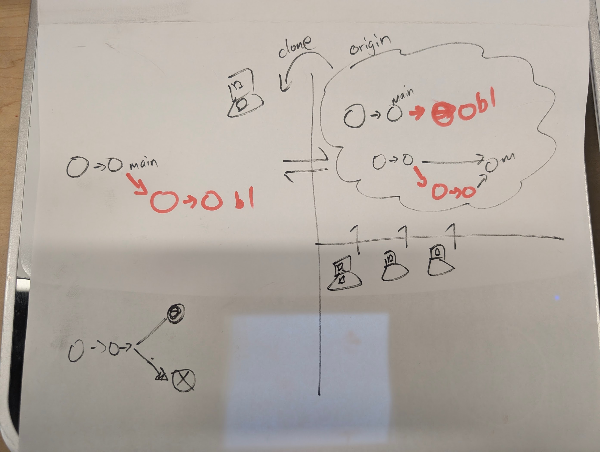
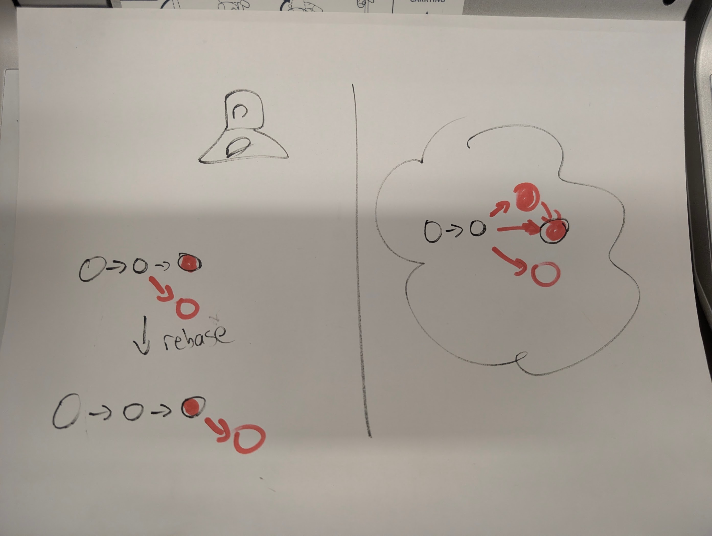

# Git Branches, Pull Requests, Code Review and Rebasing to Fix Conflicts

Date: 2026-11-17

Instructor: Daniel Chen

## Summary

This first DSCI 522 lecture began with logistics for the group project: where to find your lab group, why lab attendance is now mandatory, and the new seven-minute "interview week" chats about your Git skills and your group's code base. The rest of the session built on the Git you learned in DSCI 521. After a quick recap of the local–remote cycle of clone, add, commit, push and pull, Daniel introduced **branches**. A branch is a separate line of commits, so each teammate can work in parallel without fighting over `main`.

Working in a demo repository ([chendaniely/2026-11-17-git](https://github.com/chendaniely/2026-11-17-git)), he showed the whole branch workflow. He created a branch with `git switch -c`, committed on it, pushed it with `git push origin <branch>`, and opened a pull request on GitHub. He then walked through code review in the "Files changed" tab, updated the pull request by pushing more commits to the same branch, and showed draft pull requests and merging. After the merge he cleaned up: he deleted the branch on GitHub, then ran `git pull origin main`, `git fetch --prune` and `git branch -d` locally.

The session ended with merge conflicts between branches. Daniel opened two pull requests that edited the same line of `README.md` and merged one of them. That left the other one conflicting. He resolved it locally with `git rebase main`, fixed the conflict markers, ran `git rebase --continue`, and force-pushed with `--force-with-lease`, because a rebase rewrites the branch's history.

From now on, your group project should follow this branch → pull request → review → merge → clean up workflow. Individual assignment 1 also asks you to practise resolving merge conflicts again.

## Key takeaways

- Work on your own branch (`git switch -c <name>`) so teammates can push in parallel, and treat `main` as the stable, working version of the project.
- Before creating a branch, run `git pull origin main` so your starting point includes everything your team has already pushed.
- Push a branch with `git push origin <branch-name>`, not `git push origin main`; the last word names what you are pushing.
- To update an open pull request, add, commit and push to the same branch; never close it and open a new one.
- After a merge, delete the branch on GitHub, then run `git pull origin main`, `git fetch --prune` and `git branch -d <branch>` locally.
- To fix a conflicting pull request locally, update `main`, switch to your branch, run `git rebase main`, fix the markers, `git add`, `git rebase --continue`, then force-push.
- Resolving a conflict means the code works from top to bottom again, not just that the `<<<<<<<`/`=======`/`>>>>>>>` markers are gone.

## Knowledge Points

### 1. Course logistics: lab groups, attendance and interview week

*00:00:01–00:04:04*

- **Group assignments**: a lab sections repository on UBC's GitHub lists every student by lab section and group number. Find your section, then your group number column; everyone with the same number is your group.
- **Why GitHub usernames mattered**: the usernames you submitted build a master list that is used as metadata throughout the program. That is why getting them right was important.
- **Lab attendance is mandatory**: because this is a group project, TAs visit every group during lab, and you should be there when they come to your group.
- **Interview week**: a column marks the week each student will be pulled aside for a roughly seven-minute conversation, run like a technical interview.
  - It covers your Git knowledge and your group's actual code base. Anything in the code base is fair game, "especially in the world of AI": you should know the code you are working in, as you would at work.
  - It is not graded in a way that affects your mark. If the TAs fall behind, your interview may move by about a week, and some students may not be called.
  - This format "might actually be the exam next year."

### 2. Git recap: setting up the demo repository

*00:04:07–00:06:49*

- **Demo repository**: Daniel created a GitHub repository named for the day, [chendaniely/2026-11-17-git](https://github.com/chendaniely/2026-11-17-git). He initialised it with a README rather than leaving it empty, and noted that you can also add a Python `.gitignore` and a licence.
- **Clone**: he cloned it into `~/git` and opened it in Positron.
- **The change**: he added a line to `README.md` saying the class will review 521 Git basics and then go into branches, plus a link to the textbook's Git branches chapter.
- **The familiar cycle**: `git status` showed `README.md` modified, `git diff` showed the change, and then he ran `git add README.md`, `git commit -m "intro and review"` and `git push origin main`. Nothing here is new; it is what you have done for ten weeks in 521.

### 3. Why branches: escaping the 521 push/pull friction ([8 Git branches](https://ubc-dsci.github.io/reproducible-and-trustworthy-workflows-for-data-science/lectures/git-branches.html))

*00:06:49–00:09:43*

- **The 521 problem**: in the week 3 shared slide-deck exercise, even without a conflict, you often could not push because someone else had pushed first. You had to pull before pushing again, which is annoying.
- **Projects start serially**: early in a project, everyone is blocked on one or two people getting the basics in place, so not every piece of work can start in parallel. That friction will exist somewhere in every project.
- **Then move to parallel streams**: eventually each person owns a self-contained part. On their own branch, each person can push and pull freely without caring what others are doing.
- **Coordinating at review time**: for example, you work on your part from Tuesday to Friday, and then on Friday the group reviews and merges everyone's work.

### 4. Review: the local–remote picture

*00:09:46–00:11:47*

- **Two places work lives**: your computer (the local repository) and the cloud (the GitHub remote). With teammates, each person's computer also has to coordinate with that same remote.
- **The remote is what counts**: GitHub is what gets graded and published. Work that exists only on your laptop "effectively doesn't really exist" for grading or project purposes, just as an unshipped product at work.
- **The verbs**:
  - `clone` is a one-time command that brings the repository down.
  - `push` sends your commits up to GitHub.
  - `pull` brings down commits that teammates pushed.
- This diagram, drawn many times in 521, is the starting point for branches.



### 5. What a branch is: `main`, `HEAD` and `origin/main` ([8 Git branches](https://ubc-dsci.github.io/reproducible-and-trustworthy-workflows-for-data-science/lectures/git-branches.html))

*00:12:03–00:17:54*

- **`main`**: the default branch. Until now you could ignore why it is called `main`, but with collaboration you will no longer do most of your work on it.
- **`HEAD`**: marks where you are. When `HEAD` is attached to `main`, each `git add` and `git commit` moves `main` forward.
- **`origin/main`**: what your computer *thinks* the state of `main` on GitHub is. If you commit without pushing, your local `main` gets ahead of `origin/main`.
- **A branch**: a name that you choose (drawn as `b1`). Your commits move that name forward instead of `main`. The `git add`/`git commit` workflow does not change.
- **`main` as production**: treat `main` as the stable version, where at least the code works even if the project is unfinished.
  - For example, the cleaned dataset sits on `main`, and someone's exploratory data analysis stays on their branch until it is ready.
- **Branches help solo work too**: Daniel uses branches even in repositories where he is the only contributor.
  - He made textbook edits on branches while another instructor was teaching from it, so pages would not shift mid-lecture. He merged them only after reviewing and testing.
- **Easy to throw away**: if an idea fails, you can switch back to `main` or delete the branch. Untangling one 20-change commit from history is much harder. `git reset`/`git revert` from 521 also work, but branches make this easier.
- These skills work in "single person mode" but scale to multiple people.

### 6. Creating and switching branches ([8.1 Creating a branch using the command line](https://ubc-dsci.github.io/reproducible-and-trustworthy-workflows-for-data-science/lectures/git-branches.html#creating-a-branch-using-the-command-line))

*00:17:54–00:26:29*

- **Check where you are first**: run `git status` and confirm you are `On branch main`.
- **Sync before branching**: if your work builds on coordinated work, run `git pull origin main` first. Daniel has wasted time branching from an out-of-date computer when half the work was already done on another laptop.
- **`git switch`**: moves `HEAD` around the repository. `git switch -c <name>` (`-c` for create) creates a new branch and moves `HEAD` to it.
  - In class: `git switch -c dan-b1`. In shared repositories, Daniel starts branch names with his own name, so others know whom to ask when something looks odd.
- **Nothing else changes**: `git status` now says `On branch dan-b1`, and `git log --oneline --graph --decorate --all` shows `HEAD -> dan-b1` on the same commit as `main`. No new commit was made.
- **Commit as usual**: he documented the command in `README.md`, then ran `git diff`, `git add README.md` and `git commit -m "define swtich -c"`. The log now shows `dan-b1` one commit ahead of `main` and `origin/main`.
- **IDE view**: the Git tab's graph view in VS Code and Positron shows the same picture as the terminal log, with `origin/main`, local `main` and the `dan-b1` commit.
- **Switching back**: `git switch main` moves `HEAD` back to `main`, and the files on disk return to `main`'s version. The branch you left stays where it was.
- **You need `--all`**: without the `--all` flag, `git log --oneline` may not show your other branches.
- Branches are cheap. Create one to try something, then merge it if it works, or switch back and leave it behind if it doesn't.

### 7. `git checkout` and `git branch` versus `git switch` ([8.1.3 Useful command line Git branching commands](https://ubc-dsci.github.io/reproducible-and-trustworthy-workflows-for-data-science/lectures/git-branches.html#useful-command-line-git-branching-commands))

*00:26:40–00:28:26*

- **`git checkout`**: the older command, used before about 2019–2020, and still what Daniel uses day to day. He uses `switch` when teaching.
- **Why it was split**: `checkout` moved `HEAD` *and* did much of what `git restore` (introduced in 521) and `git revert` do. The newer commands were carved out of it, although `checkout` still has all those behaviours.
- **Equivalents**: `git checkout -b <name>` is the old form of `git switch -c <name>`.
- **`git branch <name>`**: creates a branch but does not move you to it, so you still need `switch` or `checkout` afterwards.
- **AI advice**: Copilot or ChatGPT may tell you to run `checkout`. If you do not know exactly what that command will do, ask for the `switch` version instead, especially when you are worried about losing work.

### 8. Pushing a branch and viewing it on GitHub ([8.2 Useful things you can do with branches on GitHub](https://ubc-dsci.github.io/reproducible-and-trustworthy-workflows-for-data-science/lectures/git-branches.html#useful-things-you-can-do-with-branches-on-github))

*00:28:31–00:33:40*

- **Merging through review**: the easiest way to get a branch into `main` is not to merge locally. Push the branch and merge it through a pull request (called a merge request on some platforms).
- **No new command**: `push` is still the only link from local to remote, but now *where* and *what* you push matter.
  - On `main`, a bare `git push` printed `Everything up-to-date`. It did not send `dan-b1`.
  - Switch to the branch, then run `git push origin dan-b1`. If you have typed `git push origin main` for ten weeks, the last word is the branch you are pushing.
- **After the push**: the log shows `origin/dan-b1` beside `dan-b1`, but `origin/main` has not moved.
- **On GitHub**: the repository's main view still shows only `main`'s content. Use the branch dropdown at the top left to view `dan-b1`, and the branch button next to it to list all branches.
- **Why that's useful**: you can check that your work really reached GitHub. You can also read a teammate's pushed code, such as how they made a figure, without running it and before it is merged.
- The branch list grows over a project (one branch per person or feature) unless you delete merged branches.

### 9. Opening a pull request ([9.1 Creating a pull request](https://ubc-dsci.github.io/reproducible-and-trustworthy-workflows-for-data-science/lectures/github-pull-requests.html#creating-a-pull-request))

*00:33:40–00:41:16*

- **"Compare & pull request"**: after you push a branch, GitHub shows a pop-up with this green button.
  - The pop-up disappears after about a day. You can get the same page from the Branches tab: find your branch, open its menu, and choose "New pull request".
  - Daniel opens a pull request right away, even after one tiny commit, so he never loses the pop-up.
- **Check the base and compare branches**: the top line should name your branch and the branch it merges into, which is `main` in this course. In DSCI 524 the target will not always be `main`. With forks of open-source projects you must also check that the code is going to the right repository.
- **Title and description**: the pull request is a report of what changed and why. Daniel used the title "Learning about branches and PRs" and the description "We are learning about Git switch and creating PRs." For small group-project changes, the title and description may be nearly the same. Pull requests written by AI agents can "read like a novel."
- **Review your own work here**: the bottom of the page lists every changed file and diff relative to `main`. This is your second line of defence, after reviewing on your own computer.
  - Check that all the files you worked on are there. If any are missing, you probably forgot to add, commit or push.
  - Check that no junk is there: `.ipynb_checkpoints`, macOS `.DS_Store`, Word backup files and the like. Your `.gitignore` still matters.
- **Create pull request**: it then appears under the Pull requests tab for everyone with access, and teammates can discuss it in the conversation. The result in class was [#1](https://github.com/chendaniely/2026-11-17-git/pull/1).
- **Edit the first comment**: when the pull request grows, edit the opening description rather than adding "now I'm also doing…" comments. People read the first comment.

> [!WARNING]
>
> Files that don't belong in the repository — checkpoint files, `.DS_Store`, hidden backup files — lose you points even if the instructions don't explicitly mention them. Check the file list before creating the pull request.

### 10. Code review and updating a pull request ([10 Code review on GitHub](https://ubc-dsci.github.io/reproducible-and-trustworthy-workflows-for-data-science/lectures/github-code-review.html))

*00:41:16–00:45:41*

- **Files changed tab**: this is what "code review" means. You read the diff between the original file and the new one.
- **Inline comments**: hover over a line and click the `+` to comment on it. Daniel's example was "why are you using switch and not checkout?" These comments also appear in the main Conversation tab.
- **Who fixes it**: the author of the pull request fixes the code. The reviewer's job is to point out problems ("rewrite this", "this doesn't look right"), not to fix them. The author can also simply reply to a comment.
- **Updating a pull request**: do not close it and open a new one. Go back to the same branch locally, then add, commit and push, and the pull request updates.
  - In class he added the `git log --oneline --graph --decorate --all` command to `README.md`, then ran `git commit -m "show you the long git log command"` and `git push origin dan-b1`. The second commit appeared in [#1](https://github.com/chendaniely/2026-11-17-git/pull/1), sometimes only after a page refresh.
- **Outdated comments**: if you change a line someone commented on, GitHub may collapse that comment as outdated, because it no longer applies.

### 11. AI reviewers and draft pull requests ([9.2 Draft pull requests](https://ubc-dsci.github.io/reproducible-and-trustworthy-workflows-for-data-science/lectures/github-pull-requests.html#draft-pull-requests))

*00:52:11–00:55:41*

- **The progression so far**: you can review your own work, so you don't bother a human, and then teammates can review it too.
- **Copilot review**: GitHub lets you request a Copilot review. More eyes are not a bad idea, but you do not have to keep every comment an LLM makes. You can push back, reject it or accept it.
- **Convert to draft**: Daniel opens a pull request early and keeps pushing to it, so he signals that it is unfinished with "Convert to draft" at the top right.
  - A draft shows a grey bar instead of green, which tells everyone "you can look, but it's not ready."
  - The merge button is greyed out, so nobody can merge it by accident. Daniel believes this also stops an agent from merging everything that's green.
  - He has kept drafts open for three or four months on long pieces of work.
- **Ready for review**: at the bottom of the pull request ("This pull request is still a work in progress"), click "Ready for review" to make it an open pull request again, with green merge buttons.

### 12. Merging and deleting the branch on GitHub ([8.2 Useful things you can do with branches on GitHub](https://ubc-dsci.github.io/reproducible-and-trustworthy-workflows-for-data-science/lectures/git-branches.html#useful-things-you-can-do-with-branches-on-github))

*00:55:41–00:59:07*

- **Merge**: clicking the merge button closed [#1](https://github.com/chendaniely/2026-11-17-git/pull/1), and the open pull request count went down by one.
- **Delete the branch afterwards**: Daniel clicks "Delete branch" after a merge, so the branch dropdown does not become a giant list of stale branches. In the demo, the branch count went from two to one.
- **Team norms decide**: some workplaces cannot delete anything for compliance reasons. Otherwise, at least clean up your own branches.
- **Nothing is lost**: deleting the branch label does not delete commits. `main`'s history shows the branch's two commits plus a merge commit ("Merge pull request #1 from chendaniely/dan-b1"), so you can still find and undo a feature later.

### 13. Syncing and cleaning up locally after a merge ([8.1.3 Useful command line Git branching commands](https://ubc-dsci.github.io/reproducible-and-trustworthy-workflows-for-data-science/lectures/git-branches.html#useful-command-line-git-branching-commands))

*00:59:07–01:03:51*

- **Conflicts still happen with branches**: even when people split the work, someone, or an agent, may fix a typo in your part. That is why individual assignment 1 has you practise merge conflicts again.
- **Local `main` doesn't update itself**: after `git switch main`, run `git pull origin main`. In class this fast-forwarded `main` and added 6 lines to `README.md`, which were the merged pull request's changes.
- **`git branch -a`**: lists the local branches (with `*` on the current one) and the remote-tracking branches such as `remotes/origin/dan-b1`.
- **`git fetch --prune`**: syncs history with `origin` without changing your files. It also removes local references to branches deleted on GitHub; the output showed `[deleted] (none) -> origin/dan-b1`.
  - `git pull` is `git fetch` followed by a merge. Run `fetch` alone when you don't want your working files to change.
- **`git branch -d <branch>`**: lowercase `-d` deletes a local branch only if it has been merged. Git makes it harder to lose unmerged work.
- **`git branch -D <branch>`**: capital `-D` force-deletes the branch even if it has not been merged.

> [!WARNING]
>
> Use lowercase `git branch -d`. Capital `-D` force-deletes a branch even if it was never merged, which can throw away commits you're still working on. It's a one-character difference — be very careful when copying commands from ChatGPT, which may hand you `-D`.

### 14. Setting up two conflicting pull requests ([8.3 What happens when my feature branch falls behind main?](https://ubc-dsci.github.io/reproducible-and-trustworthy-workflows-for-data-science/lectures/git-branches.html#what-happens-when-my-feature-branch-falls-behind-main))

*01:04:00–01:10:00*

- **What causes a conflict**: two changes to the same line of the same file. Daniel created two branches from `main` that both added text at the same spot in `README.md`.
- **First branch, `dan-fetch`**: he documented `git fetch --prune`, committed with `git commit -m "define fetch --prune"`, pushed, and opened [#2](https://github.com/chendaniely/2026-11-17-git/pull/2). He did **not** merge it straight away; that is the key to practising conflicts on your own.
- **Second branch, `dan-delete`**: he switched back to `main`, created `dan-delete`, and documented `git branch -d` and `-D`. Because he branched from `main`, the fetch line was not in this version of the file. He committed with `git commit -m "branch -d and -D"` and opened [#3](https://github.com/chendaniely/2026-11-17-git/pull/3).
- **The split is visible**: `git log --oneline --graph --all --decorate` shows two lines leaving the same `main` commit, which means two parallel pieces of work.
- **GitHub hides it at first**: each pull request on its own looks fine and mergeable into `main`. Nothing warns you that both edit the same line.

### 15. When a merge creates the conflict: resolving on GitHub

*01:10:00–01:12:44*

- **How it appears**: when one pull request merges, `main` changes, and GitHub rechecks every other pull request that targets `main`. Once [#2](https://github.com/chendaniely/2026-11-17-git/pull/2) was merged, [#3](https://github.com/chendaniely/2026-11-17-git/pull/3) showed a conflict.
- **Web editor**: simple conflicts can be resolved in GitHub's web editor. Find the conflict markers (`<<<<<<<`, `=======`, `>>>>>>>`) and fix them.
- **What "fixed" means for prose**: the remaining report text must be English that makes sense.
- **What "fixed" means for code**: the code must run from top to bottom again. A conflict on line 13 can break line 50, for example if a variable was renamed, and that is still your problem.

> [!WARNING]
>
> Resolving a conflict doesn't just mean deleting the conflict markers. Your code has to work again from top to bottom — a change made at the conflicting line can break code elsewhere in the file.

### 16. Resolving the conflict locally with rebase ([8.3.2 Using rebase](https://ubc-dsci.github.io/reproducible-and-trustworthy-workflows-for-data-science/lectures/git-branches.html#using-rebase))

*01:12:44–01:20:42*

- **Many valid ways**: Daniel uses `rebase` and noted that people who know Git well will have opinions about it.
- **The idea**: replay your branch's commits on top of the updated `main`. The conflict then surfaces on your own computer, where you can fix it.
  - In the demo, `dan-delete`'s parent was `3851b00`. It needed to sit on top of the merge that contains `157c3cd` (the fetch commit).
- **Step 1, sync `main`**: `git switch main`, then `git pull origin main`.
- **Step 2, rebase your branch**: `git switch dan-delete`, then `git rebase main`. Git stops on the conflict.
- **Step 3, fix the file**: open `README.md` in your editor and resolve the markers. Here he kept both definitions and tidied the whitespace. This is the same skill as week 3 of 521; only the trigger differs (`git rebase main` instead of `git pull origin main`).
- **Step 4, let `git status` guide you**: it tells you to `git add` the file to mark it resolved, and then to run `git rebase --continue`, which asks you to confirm the commit message. If you are scared, `git rebase --abort` gets you back to where you started.
- **Step 5, force-push**: the rebased commit has a new parent, so the branch's history has changed and a normal push is rejected. Daniel used `git push --force-with-lease origin dan-delete`. GitHub then records that a force push happened, and the pull request shows a green merge button again.
- **Finish up**: merge, delete the branch on GitHub, and clean up locally with `git fetch --prune` and `git branch -d`.

> [!WARNING]
>
> Rebasing rewrites your branch's history, so you can't avoid a force push afterwards — and it shows up on GitHub as a force push ("you've mangled history", which matters in compliance settings). Only do this to your own branch.



## Commands from class

### Clone the demo repository and make a review commit

```bash
cd ~/git
git clone git@github.com:chendaniely/2026-11-17-git.git
cd 2026-11-17-git
positron .                                # open the project in Positron
git status
git diff
git add README.md
git commit -m "intro and review"
git push origin main
git log --oneline --graph --decorate --all
```

### Create a branch and commit on it

```bash
git status                                # confirm you're on main
git pull origin main                      # sync before branching
git switch -c dan-b1                      # create the branch and move HEAD to it
git log --oneline --graph --decorate --all
git diff
git add README.md
git commit -m "define swtich -c"
git log --oneline --graph --decorate --all
git switch main                           # files return to main's version
git log --oneline --graph --decorate --all
```

After the commit, the branch is one commit ahead of `main`:

```
* 4a14a64 (HEAD -> dan-b1) define swtich -c
* 145ff16 (origin/main, origin/HEAD, main) intro and review
* 1360d7f Initial commit
```

### Push the branch and update its pull request

```bash
git push                                  # on main: "Everything up-to-date", sends nothing
git switch dan-b1
git push origin dan-b1                    # name the branch you're pushing
git add README.md
git commit -m "show you the long git log command"
git push origin dan-b1                    # same branch, so the open PR updates
git switch main
```

The first push prints a link to open the pull request. That became [#1](https://github.com/chendaniely/2026-11-17-git/pull/1).

### Sync and clean up after merging #1

```bash
git pull origin main                      # bring the merge into local main
git branch -a                             # local and remote-tracking branches
git fetch --prune                         # drop refs to branches deleted on GitHub
git log --oneline --graph --decorate --all
git branch -d dan-b1                      # lowercase -d: only deletes merged branches
```

```
*   3851b00 (HEAD -> main, origin/main, origin/HEAD) Merge pull request #1 from chendaniely/dan-b1
|\  
| * b90e441 (dan-b1) show you the long git log command
| * 4a14a64 define swtich -c
|/  
* 145ff16 intro and review
```

### Create two conflicting branches

```bash
git pull origin main
git switch -c dan-fetch
git add README.md
git commit -m "define fetch --prune"
git push origin dan-fetch                 # becomes PR #2
git switch main
git switch -c dan-delete                  # branch again from main
git add README.md
git commit -m "branch -d and -D"
git push origin dan-delete                # becomes PR #3
git log --oneline --graph --all --decorate
```

The two branches split from the same `main` commit, giving [#2](https://github.com/chendaniely/2026-11-17-git/pull/2) and [#3](https://github.com/chendaniely/2026-11-17-git/pull/3):

```
* cb810d5 (HEAD -> dan-delete, origin/dan-delete) branch -d and -D
| * 157c3cd (origin/dan-fetch, dan-fetch) define fetch --prune
|/  
*   3851b00 (origin/main, origin/HEAD, main) Merge pull request #1 from chendaniely/dan-b1
```

### Rebase the conflicting branch onto main and force-push

```bash
git switch main
git pull origin main                      # brings in the merge of PR #2
git switch dan-delete
git rebase main                           # stops on the conflict
git status                                # explains the next steps
# fix the conflict markers in README.md in your editor
git add README.md                         # mark the conflict as resolved
git status
git rebase --continue
git log --oneline --graph --all --decorate
git push --force-with-lease origin dan-delete   # history changed, so force-push
```

This is where the rebase stops:

```
Auto-merging README.md
CONFLICT (content): Merge conflict in README.md
error: could not apply cb810d5... branch -d and -D
hint: Resolve all conflicts manually, mark them as resolved with
hint: "git add/rm <conflicted_files>", then run "git rebase --continue".
hint: To abort and get back to the state before "git rebase", run "git rebase --abort".
```

The push output confirms the forced update: `+ cb810d5...0e16503 dan-delete -> dan-delete (forced update)`. That cleared the conflict on [#3](https://github.com/chendaniely/2026-11-17-git/pull/3).

### What went wrong live

- **Plain `git push` from `main` did nothing**: it printed `Everything up-to-date` because the new commit was on `dan-b1`. The fix was `git switch dan-b1` followed by `git push origin dan-b1`.
- **`git pull main`**: failed with `fatal: 'main' does not appear to be a git repository`, because the first argument must be the remote. The fix was `git pull origin main`.
- **`git switch -b dan-delete`**: failed with ``error: unknown switch `b'``, because `-b` belongs to `git checkout`. The fix was `git switch -c dan-delete`.
- **`git push --force-with-leasse origin dan-delete`**: a typo gave ``error: unknown option `force-with-leasse'``. Re-running it as `git push --force-with-lease origin dan-delete` worked.

## Questions

- **Q:** (question inaudible) Is it fine to use `git checkout` instead of `git switch`?
  **A:** Yes, `checkout` is fine and won't be tested. It is the pre-2019/2020 command, and Daniel uses it himself outside teaching. `checkout` also does what `restore` and `revert` do, so if an AI suggests a `checkout` command you don't understand, ask for the `switch` version. `git checkout -b` is the equivalent of `git switch -c`.
- **Q:** (question inaudible) Should you always delete branches after merging, for example in workplaces with compliance requirements?
  **A:** If there is a legal or compliance requirement, don't delete them; some places don't allow it, and the branch list just gets long. Otherwise your team's workflow decides, but at least clean up your own branches.

## Assignments

- [ ] Individual assignment 1: practise resolving merge conflicts. See the [student repository](https://github.com/UBC-MDS/DSCI_522_dsci-workflows_students) for the instructions and due date.
- [ ] Attend your lab section; attendance is mandatory, and TAs will meet each group.

---

- prompt: prompt-notes.md @ 8bcc190
- prompt-hash: a00c660964b7
- model: claude-opus-5-5 (requested: opus)
- backend: claude
- inputs: transcript-plaud.md, terminal.txt, materials.md
- generated: 2026-11-20
