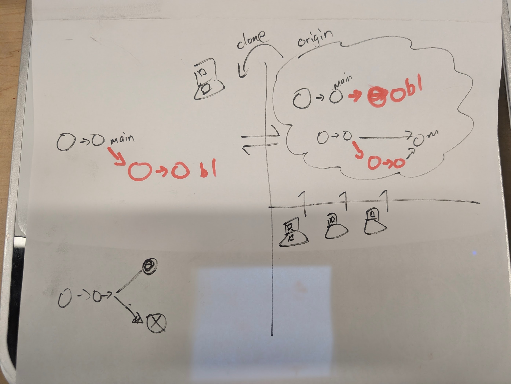
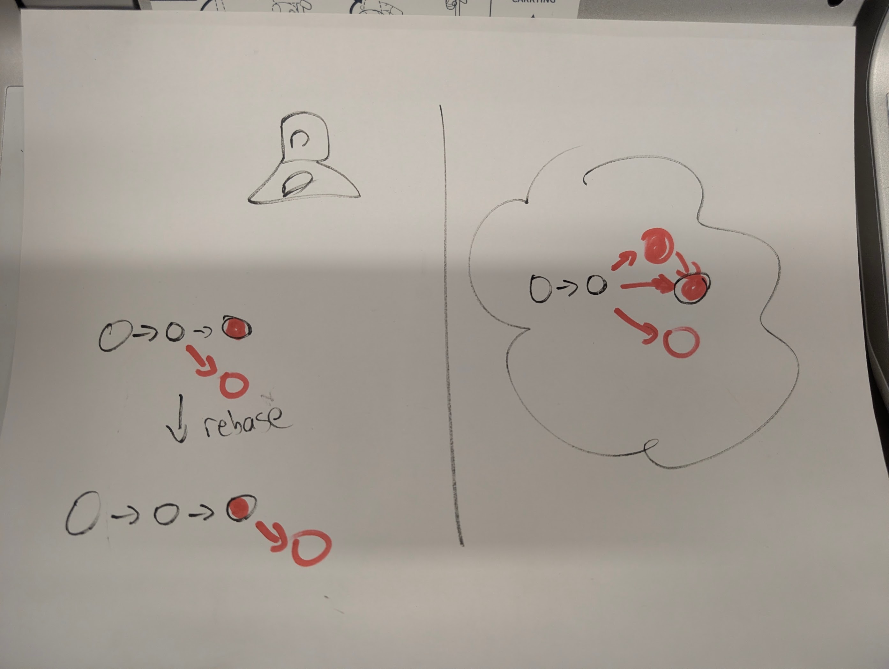

# Branches, Pull Requests, and Conflict Resolution

Date: 2026-11-17

> Generated by qwen3.6-35b-a3b, a local model, from the class recording, logs and readings. It can be wrong, or say things the class didn't cover.

Location: 

Instructor: Daniel Chen

## Summary

This session bridged the gap between individual Git workflows practiced in DSCI 521 and the collaborative demands of the group project in DSCI 522. The instructor reviewed the friction students encounter when multiple contributors push directly to the `main` branch, introducing Git branches as the solution for parallel development. Using a demo repository, the class walked through the complete feature workflow: creating isolated branches with `git switch`, pushing them to a remote repository, and initiating Pull Requests (PRs) for peer review. 

The lecture emphasized GitHub-specific collaboration tools, such as Draft PRs to signal work-in-progress and the standard review process on the "Files Changed" tab. The session concluded with branch cleanup strategies, including local and remote deletion, and a hands-on demonstration of resolving merge conflicts. The instructor showed how to use `git rebase` to replay local commits onto an updated `main` branch, fix conflict markers, and safely force-push the rewritten history back to GitHub.

## Key takeaways

- Branches isolate work from the stable `main` branch, preventing push/pull friction and enabling parallel development.
- Always sync with `git pull origin main` before creating a new branch to ensure you are building on the latest coordinated code.
- Use `git switch -c <name>` to create and move to a branch, keeping `main` clean for stable, working code.
- Create Pull Requests to initiate code review; use Draft PRs to signal work-in-progress and prevent accidental merging.
- Clean up repositories after merging by deleting remote branches via GitHub and using `git fetch --prune` locally.
- Resolve merge conflicts by rebasing onto `main`, editing conflict markers, and force-pushing with `--force-with-lease`.
- Fixing a conflict marker requires ensuring the entire codebase still runs correctly, as dependencies may have shifted.

## Knowledge Points

### 1. Course logistics and project structure (*00:00:01–00:04:04*)

- Lab attendance is mandatory because the course centers on a large group project; TAs will circulate to check group progress.
- Students are organized into lab sections and group numbers within a shared GitHub repository to streamline coordination.
- Interview weeks involve informal, non-graded 7-minute technical interviews conducted by TAs to assess individual understanding of the group's code base.
- GitHub usernames are collected as essential metadata that feeds into program-wide tracking systems.

### 2. The problem with parallel work on `main` (*00:04:04–00:09:43*)

- In single-developer or uncoordinated workflows, pushing directly to `main` causes constant pull-before-push friction and frequent merge conflicts.
- Group projects inherently have phases where work cannot be fully parallelized, but branches allow individual responsibilities to proceed independently once isolated.
- Branches act as isolated playgrounds for exploration, testing, and feature development, keeping the `main` branch stable and ready for integration.
- The instructor uses the metaphor of house construction: the foundation (`main`) must be stable before parallel work (walls, floors) can happen on separate branches.

> [!WARNING]
>
> If your code exists only on your local machine and has not been pushed to the remote repository, it effectively does not exist for grading or project purposes.



### 3. Creating and managing branches locally ([8 Git branches](https://ubc-dsci.github.io/reproducible-and-trustworthy-workflows-for-data-science/lectures/git-branches.html)) (*00:09:43–00:25:12*)

- Before starting new work, run `git pull origin main` to sync your local repository with the remote, ensuring you branch off the most up-to-date coordinated code.
- Use `git switch -c <branch_name>` to create a new branch and immediately move the `HEAD` pointer to it, detaching it from `origin/main`.
- `git log --oneline --graph --decorate --all` provides a visual map of the commit history, clearly showing how the `HEAD` advances on the new branch while `origin/main` remains static.
- In group settings, prefix branch names with your username (e.g., `dan-b1`) so teammates know who is responsible for that specific line of development.
- `git checkout` is a legacy command that handles both branch switching and file restoration; `git switch` is the modern, specialized alternative. Use `switch` to avoid accidental data loss.

### 4. Pushing branches and initiating Pull Requests ([9 Pull requests](https://ubc-dsci.github.io/reproducible-and-trustworthy-workflows-for-data-science/lectures/github-pull-requests.html)) (*00:25:12–00:46:00*)

- Push a new branch to the remote using `git push origin <branch_name>`. GitHub typically prompts you to create a Pull Request immediately after the push.
- A Pull Request initiates the code review workflow, presenting a diff of all changes in the "Files Changed" tab for peers to inspect and comment on.
- Reviewers should verify that all intended work is present, check for stray temporary files (like `.DS_Store` or `.ipynb_checkpoints`), and ensure the `.gitignore` is functioning.
- You can update a PR dynamically by making new commits and pushing them to the same branch; the GitHub interface automatically reflects the new state.
- Use the "Convert to Draft" option to open a Pull Request as work-in-progress. Draft PRs display a gray bar, disable the merge button, and signal to the team that the code is not yet ready for review.

### 5. Merging, cleanup, and local synchronization ([8 Git branches](https://ubc-dsci.github.io/reproducible-and-trustworthy-workflows-for-data-science/lectures/git-branches.html)) (*00:52:17–01:03:51*)

- Once a Pull Request is approved, click "Merge Pull Request" to integrate the branch's commits into `main`. This automatically closes the PR on GitHub.
- After merging, delete the branch on GitHub via the UI dropdown menu to prevent the repository from accumulating a cluttered list of inactive branches.
- Switch back to your local `main` branch and run `git pull origin main` to fetch and fast-forward the local history to include the newly merged commits.
- Run `git fetch --prune` to remove local tracking references for remote branches that were deleted on GitHub, then use `git branch -d <branch_name>` to delete the local branch.
- Use lowercase `-d` for safe deletion (it refuses to delete unmerged work to prevent data loss); uppercase `-D` forces deletion but carries a high risk of losing commits.

> [!WARNING]
>
> Blindly copying force-deletion commands from AI tools can permanently destroy unmerged work. Always verify the branch state before using `-D`.

### 6. Resolving merge conflicts via rebase ([8 Git branches](https://ubc-dsci.github.io/reproducible-and-trustworthy-workflows-for-data-science/lectures/git-branches.html)) (*01:03:51–01:21:43*)

- Merge conflicts occur when two branches independently modify the same lines of the same file. The conflict becomes apparent when a second PR attempts to merge after the first has already updated `main`.
- To resolve conflicts locally, switch to the affected branch and run `git rebase main`. This replays your branch's commits sequentially on top of the updated `main` branch, triggering the conflict resolution process locally.
- Git halts at the conflicting commit and inserts markers (`<<<<<<<`, `=======`, `>>>>>>>`) into the file. Edit the file to keep the correct content, run `git add <file>` to mark the resolution, and finish with `git rebase --continue`.
- Because rebasing rewrites commit history, a standard push will fail. You must force-push the updated branch using `git push --force-with-lease origin <branch_name>`, which safely updates the remote only if no new, untracked commits were added by others.

> [!WARNING]
>
> Fixing a conflict marker at a specific line does not guarantee the code will run. You must verify that the entire file functions correctly after the merge, as variable names, imports, or logic dependencies may have shifted elsewhere.



## Commands from class

### Reviewing Git basics & syncing main

```bash
git clone git@github.com:chendaniely/2026-11-17-git.git  # Clone the demo repository
git status                                               # Check working tree state
git diff                                                 # View unstaged changes
git add README.md                                        # Stage changes
git commit -m "intro and review"                         # Commit locally
git push origin main                                     # Push to remote
```

### Creating and switching branches

```bash
git switch -c dan-b1                                     # Create and switch to a new branch
git log --oneline --graph --decorate --all               # Visualize commit history and HEAD movement
git switch dan-b1                                        # Switch to an existing branch
```

### Pushing branches & initiating a Pull Request

```bash
git push origin dan-b1                                   # Push local branch to remote GitHub
git switch main                                          # Return to main
git pull origin main                                     # Sync local main with remote
git branch -a                                            # List all local and remote branches
```

### Cleanup & Resolve conflicts

```bash
git fetch --prune                                        # Remove tracking refs for deleted remote branches
git branch -d dan-b1                                     # Delete local branch (safe)
git switch -c dan-delete                                 # Create branch to demonstrate conflict
git rebase main                                          # Replay commits onto updated main
git add README.md                                        # Mark conflict as resolved
git rebase --continue                                    # Finish the rebase
git push --force-with-lease origin dan-delete            # Force-push rewritten history
```

## What went wrong live

- **Incorrect push flag**: Typed `git push --force-with-leasse` instead of `--force-with-lease`. Fixed by correcting the spelling to `lease`.
- **Missing remote name**: Ran `git pull main` instead of `git pull origin main`, resulting in a `fatal: 'main' does not appear to be a git repository` error. Fixed by explicitly specifying the `origin` remote.
- **Legacy switch syntax**: Attempted `git switch -b dan-delete`, which failed with `error: unknown switch 'b'`. Corrected by using the proper `-c` (create) flag: `git switch -c dan-delete`.

## Assignments

- [ ] Individual Assignment 1: Review merge conflicts (upcoming)

---

- prompt: prompt-notes.md @ 8bcc190
- prompt-hash: a00c660964b7
- model: qwen3.6-35b-a3b (requested: qwen3.6-35b-a3b)
- backend: local (llama-swap)
- inputs: transcript-plaud.md, terminal.txt, materials.md
- generated: 2026-11-20
