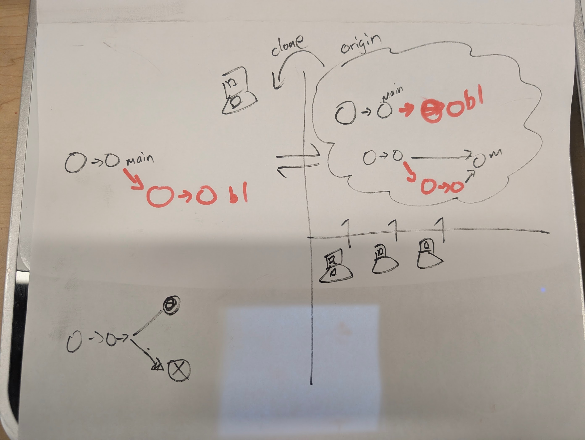
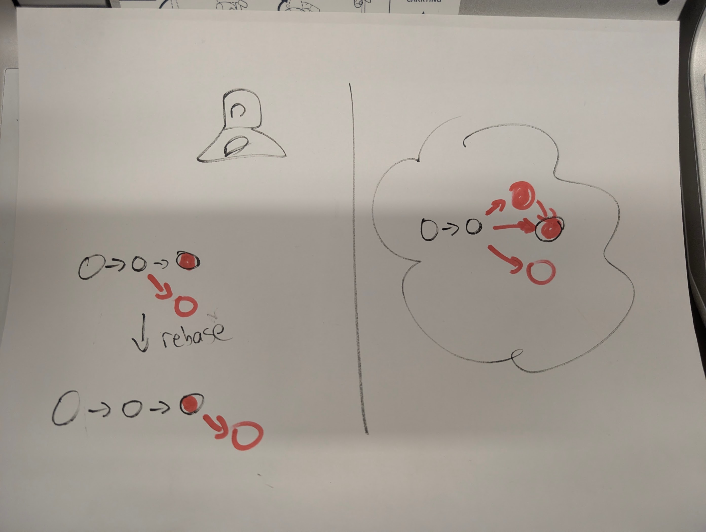

# Git branches, pull requests, and merge conflicts

Date: 2026-11-17

> Generated by qwen3.8-27b-sglang, a local model, from the class recording, logs and readings. It can be wrong, or say things the class didn't cover.

Instructor: Daniel Chen

## Summary

This was the first DSCI 522 lecture of the term. Daniel Chen reviewed the basic Git cycle from DSCI 521—editing a file, checking `git status` and `git diff`, staging with `git add`, committing with `git commit`, and pushing to `origin`—and then moved to the collaboration model used in the group project: branches, remote tracking branches, pull requests, draft pull requests, code review, merging, and cleanup. The live demonstration used the class demo repository, <https://github.com/chendaniely/2026-11-17-git>, and the main teaching point was that work on a local computer is not the same as work available on the remote.

The lecture showed how to create a branch with `git switch -c`, commit on that branch, push the branch with `git push origin <branch>`, open a pull request, review the changed files, add follow-up commits to the same branch, convert a pull request to a draft, merge it, and then clean up both remote and local branch references. Daniel Chen stressed that pull requests are a review workflow, not just a merge button: the author of a pull request is responsible for addressing review comments by committing and pushing to the same branch.

The final part of the session used two branches to create a merge conflict. After one pull request was merged into `main`, the other branch was no longer based on current `main`; `git rebase main` replayed its commit onto the updated `main`, stopped on a conflict, and was continued after resolving the file. Because rebase rewrote the pushed branch’s history, the branch had to be updated on GitHub with `git push --force-with-lease origin <branch>`. The lecture also connected this workflow to group-project expectations, lab attendance, interview-week conversations, and individual assignment 1’s merge-conflict review.

## Key takeaways

- Work that exists only on your local computer is not the graded or project-shippable state; push it to the remote.
- `git switch -c <branch>` creates a new branch and moves `HEAD` to it, while `git switch <branch>` moves `HEAD` to an existing branch.
- A branch commit moves that branch, not `main`; `origin/main` stays where it is until you push or pull.
- Push a branch with `git push origin <branch>`, then use GitHub’s pull-request workflow to review and merge it.
- A pull request updates automatically when you commit and push more work to the same branch.
- Use `git fetch --prune` and `git branch -d <branch>` for safe local cleanup after a branch has been merged.
- To catch up after a merge conflict, rebase onto `main`, resolve the conflict, run `git rebase --continue`, and then use `git push --force-with-lease origin <branch>`.

## Knowledge Points

### 1. Course logistics: lab groups, GitHub usernames, lab attendance, and interview week

*00:00:01–00:04:04*

- **522 project model**: DSCI 522 is described as the students’ first big, bigger project-based class, where they work with the people in their lab section.
- **Lab-sections repository**: Students were told to find their lab section in a GitHub lab-sections repository; the transcript referenced it but did not provide a clean URL.
- **Group number**: Within a lab section, students were sorted by group number; the group number determines who is working together on the project.
- **GitHub usernames**: The instructor collected GitHub usernames because that metadata is used “everywhere else under the hood” in the program.
- **Lab attendance**: Lab attendance is mandatory for the group project; TAs go around and talk to every group, and students should be present when a TA is with their group.
- **Interview week**: Some students have an “interview week” marker next to their name. The instructor will pull students aside for a roughly seven-minute technical-interview-style conversation about their Git knowledge and their actual group codebase.
- **Interview grading**: The interview conversation is “not graded” in the sense that it is not supposed to affect the course grade, even though a grade may still be recorded.

### 2. Review Git basics in the demo repository ([8 Git branches](https://ubc-dsci.github.io/reproducible-and-trustworthy-workflows-for-data-science/lectures/git-branches.html))

*00:04:07–00:06:49*

- **Demo repository**: The session worked in the live demo repository, <https://github.com/chendaniely/2026-11-17-git>, which was cloned to the instructor’s machine.
- **First README change**: The initial change added a link in `README.md` to the Git branches chapter, framed as “we will review 521 git basics and then go into branches.”
- **Standard Git cycle**: The instructor used `git status`, `git diff`, `git add README.md`, `git commit -m "intro and review"`, and `git push origin main`.
- **Review framing**: Daniel Chen emphasized that nothing had changed from DSCI 521 up to this point; the new material starts when branches enter the picture.

### 3. Why branches exist: escaping the “I have to pull before I push” friction ([8 Git branches](https://ubc-dsci.github.io/reproducible-and-trustworthy-workflows-for-data-science/lectures/git-branches.html))

*00:06:49–00:09:43*

- **DSCI 521 shared slide deck**: In week 3 of 521, students collaborated on a shared slide deck and often had to pull before they could push, even when there was no actual conflict.
- **Collaboration friction**: If two people are editing the same thing, there is constant friction around coordinating updates; this problem exists in every project.
- **Parallel streams**: The goal is to reach a part of the project where a student owns a self-contained piece of work and can work on it without constantly waiting for others.
- **Branch benefit**: A branch gives a person “their own little world” where they can commit, push, and pull until their work is ready for team review.

### 4. Local repository versus remote `origin` ([8 Git branches](https://ubc-dsci.github.io/reproducible-and-trustworthy-workflows-for-data-science/lectures/git-branches.html))

*00:09:46–00:11:11*

- **Two places work happens**: Git work happens locally on a computer and remotely on the cloud/remote, called `origin` in this session.
- **Coordination**: With teammates, everyone coordinates through the remote; the remote is the shared source of truth.
- **One-time clone**: `git clone` is a one-time command that brings the repository down to the computer.
- **Push and pull**: Local commits are sent upward with `git push`; work created by others is brought down with `git pull`.

> [!WARNING]
>
> Daniel Chen stressed that if your work exists only on your local computer, it “effectively doesn’t really exist” for grading or project purposes. The remote repository is what matters.

### 5. `main`, `origin/main`, `HEAD`, and what a branch is ([8 Git branches](https://ubc-dsci.github.io/reproducible-and-trustworthy-workflows-for-data-science/lectures/git-branches.html))

*00:11:11–00:16:05*

- **`main`**: `main` is the default branch and the place that often represents the stable, final, or production state of the project.
- **`origin/main`**: `origin/main` is the local computer’s record of what the remote `main` branch is at.
- **`HEAD`**: `HEAD` is the current pointer into the Git history; when it points to `main`, you are on the `main` branch.
- **Branch as a name**: A branch is essentially another name that moves forward when you commit, instead of moving `main`.
- **Stable main**: In larger projects, `main` should be stable and working; exploratory work, unfinished analysis, or plots that are still being tested should live on a branch until ready.



### 6. Branches are useful even when working alone ([8 Git branches](https://ubc-dsci.github.io/reproducible-and-trustworthy-workflows-for-data-science/lectures/git-branches.html))

*00:16:05–00:17:54*

- **Solo branching**: Branches are not only for collaboration; many single-person Git repositories also use branches.
- **Section off work**: A branch lets you test a large set of changes without changing `main` until you have reviewed and confirmed that everything works.
- **Easy abandonment**: If a branch was a bad idea, it is much easier to abandon or delete the branch than to undo a tangled set of commits on `main`.
- **Textbook example**: Daniel Chen described working on the course textbook by making a sequence of branch-based changes and merging them after lectures and testing.

### 7. Creating a branch with `git switch -c` ([8.1 Creating a branch using the command line](https://ubc-dsci.github.io/reproducible-and-trustworthy-workflows-for-data-science/lectures/git-branches.html#creating-a-branch-using-the-command-line))

*00:17:54–00:23:46*

- **Check starting state**: Before creating a branch, run `git status` and confirm you are on `main`.
- **Sync before coordinated work**: If you are building on shared project work, first synchronize with the remote, for example with `git pull origin main`, so you do not start from an old local state.
- **Create and move**: `git switch -c dan-b1` creates a new branch named `dan-b1` and immediately moves `HEAD` to it.
- **Visible state**: After switching, `git status` says `On branch dan-b1`, and `git log --all` shows the new branch at the same commit as `main` before any new branch-specific commits exist.
- **Branch naming**: In group repositories, Daniel Chen sometimes prefixes branch names with the owner’s name so teammates know who to talk to when something looks odd.
- **Commit moves the branch**: After committing on `dan-b1`, the branch moves forward while `main` and `origin/main` remain where they were.

### 8. Switching between branches and seeing the repository state ([8.1.1 Switching to branches that already exist](https://ubc-dsci.github.io/reproducible-and-trustworthy-workflows-for-data-science/lectures/git-branches.html#switching-to-branches-that-already-exist))

*00:23:46–00:28:26*

- **Editor Git view**: In VS Code or Positron, the Git graph shows local `main`, `origin/main`, and branch-specific commits; this graph corresponds to the terminal log.
- **Switch back to `main`**: `git switch main` moves `HEAD` back to `main`, and the working files return to the state stored at `main`.
- **Seeing all branches**: If branch names do not appear in `git log --oneline --graph --decorate`, use the `--all` flag.
- **`switch` vs `switch -c`**: `git switch <branch>` switches to an existing branch; `git switch -c <branch>` creates and switches to a new branch.
- **Older `checkout` command**: `git checkout` is the older equivalent. `git checkout -b <branch>` created a branch; `git branch <branch>` creates a branch without moving to it. Daniel Chen uses `switch` in teaching and suggests that, if you are unsure about `checkout`, ask tools to use `switch` instead.

### 9. Pushing a branch to `origin` and viewing it on GitHub ([8.2 Useful things you can do with branches on GitHub](https://ubc-dsci.github.io/reproducible-and-trustworthy-workflows-for-data-science/lectures/git-branches.html#useful-things-you-can-do-with-branches-on-github))

*00:28:31–00:33:40*

- **Remote review process**: Instead of merging locally, the class workflow is to push the branch and use a GitHub review process.
- **Check the current branch**: Before pushing, confirm which branch you are on; a plain `git push` while on `main` may simply report that everything is up to date.
- **Push the branch**: From `dan-b1`, the command is `git push origin dan-b1`; this is the same push behavior as before, but the final branch name changes from `main` to the branch being pushed.
- **Remote branch appears**: After the push, `git log --all` shows `origin/dan-b1`, meaning the local computer now knows that GitHub has that branch.
- **GitHub branch dropdown**: On the GitHub repository page, the branch selector can be used to view another branch without merging it into `main`.
- **Pre-merge inspection**: Teammates can inspect pushed branch code on GitHub even before a pull request is merged.

### 10. Opening a pull request and reviewing the changed files ([9.1 Creating a pull request](https://ubc-dsci.github.io/reproducible-and-trustworthy-workflows-for-data-science/lectures/github-pull-requests.html#creating-a-pull-request))

*00:33:40–00:39:56*

- **Compare and pull request**: When GitHub recognizes a newly pushed branch, it often shows a “Compare and Pull Request” button or popup.
- **If the popup disappears**: Daniel Chen said the popup can disappear after a day or so; to start the same process later, go to the branches tab, find the branch, and choose the option to create a new pull request.
- **Open the pull request early**: He recommended opening the pull request right away, even while work is in progress, so the process exists and updates as commits are pushed.
- **Check the base branch**: In DSCI 522, the target is usually `main`, but in 524 the target may not always be `main`; forks and large open-source projects also require checking that the pull request goes to the right repository and branch.
- **Title and description**: The first pull-request comment should explain the whole set of changes; later edits should update that first comment rather than just appending new notes.
- **Review the Files Changed tab**: Confirm that all intended files are present and that no unwanted files are included.

> [!WARNING]
>
> Check the pull request’s changed files for things that do not belong in the repository, such as `.ipynb_checkpoints`, `.DS_Store`, Word backup files, or other hidden/temporary files. Daniel Chen said that, in this course, visible unwanted files in a repository can cost points.

The demo pull request created from branch `dan-b1` was [#1 Learning about branches and PRs](https://github.com/chendaniely/2026-11-17-git/pull/1).

### 11. Pull request conversation, code review, and updating the same branch ([10 Code review on GitHub](https://ubc-dsci.github.io/reproducible-and-trustworthy-workflows-for-data-science/lectures/github-code-review.html))

*00:39:56–00:45:41*

- **Pull requests tab**: Once created, the pull request appears under the repository’s Pull Requests tab and can be revisited later.
- **Conversation tab**: The conversation area is where people discuss the pull request; the original post can be edited, and Daniel Chen recommended keeping the first comment as the definitive explanation.
- **Files Changed tab**: This is where code review happens: GitHub shows the diff between the original file and the proposed new file.
- **Inline comments**: Hovering over diff lines gives a plus button that allows line-specific review comments, which are tracked in the conversation.
- **Author fixes the code**: If it is your pull request, it is your job to fix the issues; reviewers point out problems, but the author updates the codebase.
- **Push to the same branch**: To address review comments, go back to the branch, make the change, commit, and push to the same branch; the pull request updates automatically, though the page may need refreshing.
- **Outdated comments**: If you edit a line that has a comment, GitHub may collapse the comment as outdated.

### 12. Draft pull requests, merging, and deleting the remote branch ([9.2 Draft pull requests](https://ubc-dsci.github.io/reproducible-and-trustworthy-workflows-for-data-science/lectures/github-pull-requests.html#draft-pull-requests))

*00:52:11–00:58:51*

- **Draft workflow**: For work that may take more than a day, open the pull request early and then use “Convert to Draft” to signal that it is not ready for merge.
- **Visual cue**: A draft pull request shows a gray bar instead of a green one, and the merge button is disabled so nobody accidentally merges it.
- **Ready for review**: When the work is ready, use “Ready for review” to turn the draft back into an open pull request.
- **AI review**: Daniel Chen mentioned that you can request AI/Copilot review, but AI comments are not automatically mandatory; a person still reviews and decides whether to accept or reject them.
- **Merging**: After merging, the pull request counter decreases because the pull request is closed.
- **Remote branch cleanup**: He recommended deleting the remote branch after merging so the branch dropdown does not become a long list of finished branches.
- **Commits remain**: Deleting the branch does not delete the commits; they remain in history, including the separate merge commit created by the pull-request merge.

### 13. Local cleanup after a merge: `git pull`, `git branch -a`, `git fetch --prune`, and `git branch -d` ([8.1.3 Useful command line Git branching commands](https://ubc-dsci.github.io/reproducible-and-trustworthy-workflows-for-data-science/lectures/git-branches.html#useful-command-line-git-branching-commands))

*00:58:53–01:03:51*

- **Group-project warning**: Even when teams use branches, merge conflicts can still happen because agents or teammates may edit the same line, file, or typo.
- **Individual assignment 1**: Daniel Chen noted that individual assignment 1 has students review merge conflicts again, because they still need to know how to recover from them.
- **Local `main` is not automatic**: After a branch is merged on GitHub, local `main` does not update by itself; run `git switch main` and then `git pull origin main`.
- **List branches**: `git branch -a` shows local branches and remote-tracking branches; the current branch has a star.
- **`git fetch --prune`**: This fetches remote state and removes local references to branches that were deleted on GitHub, such as `origin/dan-b1`.
- **Safe local branch deletion**: `git branch -d dan-b1` deletes a local branch only if it has been merged; lowercase `-d` protects you from deleting unmerged work.
- **Force local branch deletion**: `git branch -D <branch>` force-deletes a local branch even if it has not been merged.

> [!WARNING]
>
> Use lowercase `git branch -d <branch>` for normal cleanup. A capital `-D` can permanently delete unmerged work. Daniel Chen specifically warned that copied-and-pasted AI advice might say to use `-D`, and that can delete commits you were still working on.

### 14. Creating a merge-conflict scenario with two branches ([8.3 What happens when my feature branch falls behind main?](https://ubc-dsci.github.io/reproducible-and-trustworthy-workflows-for-data-science/lectures/git-branches.html#what-happens-when-my-feature-branch-falls-behind-main))

*01:03:51–01:10:51*

- **Two competing branches**: Daniel Chen created two branches from the same `main` state: `dan-fetch` and `dan-delete`.
- **Conflicting edits**: Both branches made changes to the same region of `README.md`, so they would conflict if both were merged.
- **Two pull requests**: The two branches produced two open pull requests: [#2 define fetch --prune](https://github.com/chendaniely/2026-11-17-git/pull/2) from `dan-fetch` and [#3 branch -d and -D](https://github.com/chendaniely/2026-11-17-git/pull/3) from `dan-delete`.
- **First merge changes `main`**: When one pull request is merged, `main` moves forward.
- **Other pull requests are rechecked**: GitHub rechecks open pull requests against the new `main`; a pull request that looked mergeable before can become conflicted afterward.
- **Conflict is not always obvious side by side**: Looking at the two pull requests separately did not clearly show that they would conflict; the conflict appears after one branch is merged.

### 15. Resolving the conflict locally with `git rebase main` and `git push --force-with-lease` ([8.3.2 Using rebase](https://ubc-dsci.github.io/reproducible-and-trustworthy-workflows-for-data-science/lectures/git-branches.html#using-rebase))

*01:10:51–01:20:42*

- **Local versus web resolution**: Simple conflicts can be resolved in GitHub’s web editor, but Daniel Chen showed local resolution because the command-line process is more general.
- **What “fix the conflict” means**: Fixing the conflict markers is not enough. In this course, “fixed” means the resulting report or code works from top to bottom again.
- **Sync `main` first**: Switch to `main` and run `git pull origin main` so the local `main` includes the already-merged pull request.
- **Rebase the conflicting branch**: Switch to `dan-delete` and run `git rebase main`; this replays the branch’s commit on top of the updated `main`.
- **Resolve and continue**: When Git stops with a conflict, edit the file, run `git add README.md`, check `git status`, and then run `git rebase --continue`.
- **Force-with-lease push**: Because rebase rewrites the commit history of a branch that was already pushed, a normal push is no longer enough; the session used `git push --force-with-lease origin dan-delete`.
- **Merge and cleanup**: After the force push, the pull request could be merged, and the usual branch cleanup could be done.



> [!WARNING]
>
> Resolving the visible conflict markers does not mean the work is done. Daniel Chen stressed that, if changing the conflict affects later code, the student is still responsible for making the whole thing work. Also, after rebase has changed pushed history, use `git push --force-with-lease origin <branch>`, not a plain push.

## Commands from class

### Set up the demo repository

```bash
git clone git@github.com:chendaniely/2026-11-17-git.git   # clone the class demo repository
cd 2026-11-17-git
```

### Make and push the first `main` commit

```bash
git status
git diff
git add README.md
git commit -m "intro and review"
git push origin main
git log --oneline --graph --decorate --all
```

This commit added the README link to the Git branches chapter and was the review step from DSCI 521.

### Create `dan-b1`, commit on it, and inspect the state

```bash
git pull origin main          # synchronize before starting coordinated branch work
git switch -c dan-b1          # create dan-b1 and move HEAD to it
git status
git log --oneline --graph --decorate --all
git add README.md
git commit -m "define swtich -c"
git log --oneline --graph --decorate --all
```

After the commit, `dan-b1` was ahead of `main` and `origin/main`.

### Switch back to `main`, then push the branch

```bash
git switch main
git log --oneline --graph --decorate --all
git push
git switch dan-b1
git push origin dan-b1
git log --oneline --graph --decorate --all
```

`git push` while on `main` reported that everything was up to date. `git push origin dan-b1` created the remote branch that became [#1 Learning about branches and PRs](https://github.com/chendaniely/2026-11-17-git/pull/1).

### Add a follow-up commit to the open pull-request branch

```bash
git add README.md
git commit -m "show you the long git log command"
git push origin dan-b1
git switch main
```

This second commit appeared in the same pull request after the push.

### Clean up local references after merging `dan-b1`

```bash
git pull origin main
git branch -a
git fetch --prune
git log --oneline --graph --decorate --all
git branch -d dan-b1
git log --oneline --graph --decorate --all
```

After the remote branch was deleted on GitHub, `git fetch --prune` removed the `origin/dan-b1` reference. `git branch -d dan-b1` then removed the merged local branch.

### Create two competing branches for a merge conflict

```bash
git switch -c dan-fetch
git add README.md
git commit -m "define fetch --prune"
git push origin dan-fetch
git switch main
git switch -c dan-delete
git add README.md
git commit -m "branch -d and -D"
git push origin dan-delete
git log --oneline --graph --all --decorate
```

These two branches produced [#2 define fetch --prune](https://github.com/chendaniely/2026-11-17-git/pull/2) and [#3 branch -d and -D](https://github.com/chendaniely/2026-11-17-git/pull/3). The `dan-fetch` pull request was merged first, making `dan-delete` fall behind `main`.

### Rebase the conflicting branch onto updated `main`

```bash
git switch main
git pull origin main
git log --oneline --graph --all --decorate
git switch dan-delete
git rebase main
git status
git add README.md
git status
git rebase --continue
git log --oneline --graph --all --decorate
git push --force-with-lease origin dan-delete
```

The rebase stopped with the expected conflict:

```text
CONFLICT (content): Merge conflict in README.md
error: could not apply cb810d5... branch -d and -D
```

After resolving the file and continuing the rebase, `git push --force-with-lease origin dan-delete` updated [#3 branch -d and -D](https://github.com/chendaniely/2026-11-17-git/pull/3) with the rebased commit.

### What went wrong live

- **`git switch -b dan-delete`**: The terminal reported `error: unknown switch 'b'` because `git switch` uses `-c` to create a branch. It was fixed with `git switch -c dan-delete`.
- **`git pull main`**: The terminal reported `fatal: 'main' does not appear to be a git repository`. It was fixed by using the remote name: `git pull origin main`.
- **`git push --force-with-leasse origin dan-delete`**: The terminal reported `error: unknown option 'force-with-leasse'` due to a typo. It was fixed with `git push --force-with-lease origin dan-delete`.

## Questions

- **Q:** (question inaudible) — The answer concerns whether the older `git checkout` command is acceptable when creating or switching branches.
  **A:** `git checkout` is the older equivalent of the modern `switch` workflow: `git checkout -b <branch>` created a branch, and `git checkout <branch>` switched branches. Daniel Chen said he uses `switch` when teaching and that the class would not be tested on that particular older phrasing. He also advised that, if you are not comfortable with `checkout`, you should ask tools to use `git switch` instead.

## Assignments

- [ ] Review merge conflicts, as required for individual assignment 1; no due date was stated in class.

---

- prompt: prompt-notes.md @ 8bcc190
- prompt-hash: a00c660964b7
- model: qwen3.8-27b-sglang (requested: qwen3.8-27b-sglang)
- backend: local (SGLang)
- inputs: transcript-plaud.md, terminal.txt, materials.md
- generated: 2026-11-20
