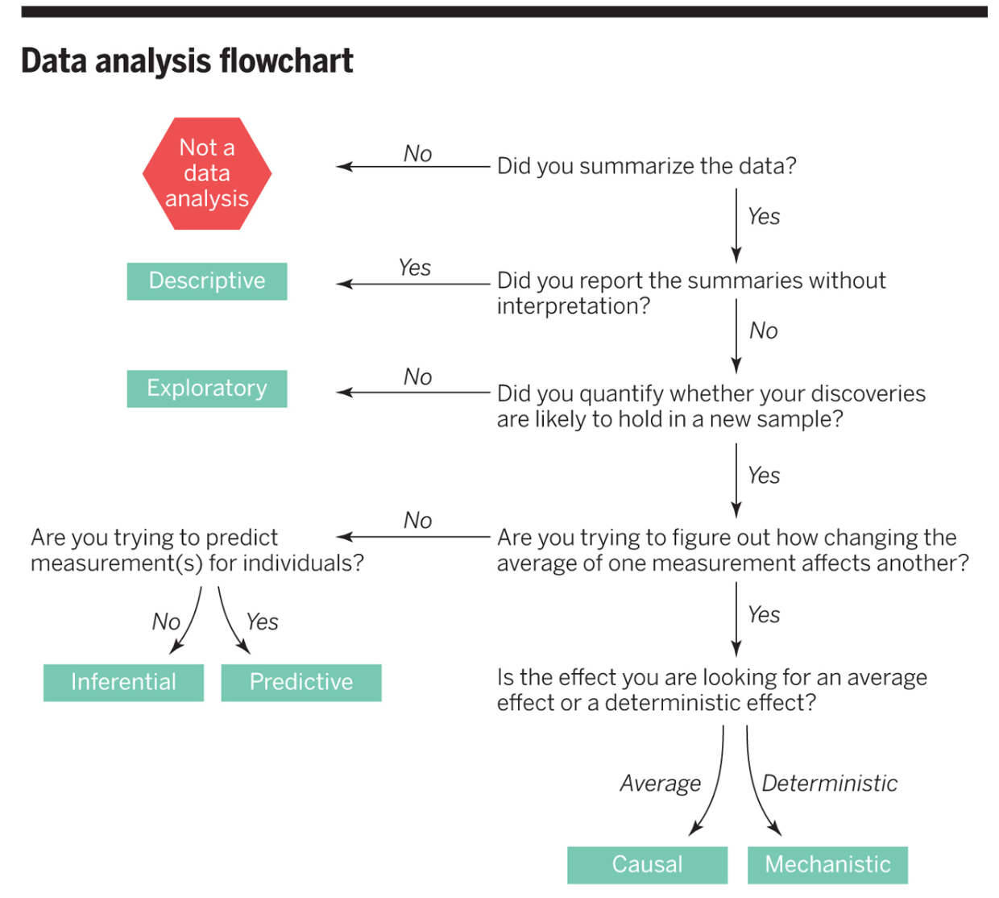

```{r setup, include=FALSE}
options(htmltools.dir.version = FALSE)
library(knitr)
opts_chunk$set(echo = TRUE)
```

```{r xaringan-themer, include=FALSE, warning=FALSE}
library(xaringanthemer)
style_duo_accent(
  primary_color = "#9F999C",
  secondary_color = "#FFE5F3",
  inverse_header_color = "#8F8C8E",
  link_color = "deeppink",
  title_slide_text_color = "#3d3d3d",
  title_slide_background_image = "img/title-slide-background-light.png",
  title_slide_background_position = "left",
  header_font_google = google_font("Josefin Sans"),
  text_font_google   = google_font("Montserrat", "300", "300i"),
  code_font_google   = google_font("Fira Mono")
)
```

## What is the question?

```{r what-is-the-q, out.width = "50%", echo = FALSE, fig.cap = "What is the question? by Roger Peng and Jeff Leek"}

```

---

### So you know the type of question, now what?

.pull-left[
This helps narrow down the possibilities 
of the kind of analysis you might want to do!

--

For example, if you have the question: **"How many viral illnesses will someone have next year?"**
and you identify that it is **predictive.**
You could narrow down that some kind of statistical or machine learning model 
might help you answer that.

--

Then you need to go a step deeper and look at the data that you have, 
and see which kind of statistical 
or machine learning model is most suitable for your data.
]

.pull-right[


Source: [scikit-learn algorithm cheat sheet](https://scikit-learn.org/stable/tutorial/machine_learning_map/index.html)
]
---

## Another example 

.pull-left[
For example, if you have the question: "Is the gestational length of first born babies the same as that of non-first borns?"
and you identify that it is inferential. 
You could narrow down that some kind of statistical inference approach 
might help you answer that.

--

Then again, you need to go a step deeper and look at the data that you have, 
and see which kind of statistical inference approach is most suitable for your data.
]

.pull-right[


Source: https://onishlab.colostate.edu/summer-statistics-workshop-2019/

Or for another, see this website: http://www.biostathandbook.com/testchoice.html
]

---

## Practice

---

### Case 1

Question: *Is a yet undiagnosed patient's breast cancer tumor malignant or benign?*

Data:

```{r, echo = FALSE, message = FALSE, warning = FALSE}
library(tidyverse)
read_csv("data/wdbc.csv") %>%
    select(ID, Radius:Smoothness, Class) %>%
    tail() %>%
    kable()
```

Data reference: https://archive-beta.ics.uci.edu/ml/datasets/breast+cancer+wisconsin+diagnostic

---

### Case 2

Question: *Is inhalation of marijuana associated with lung cancer?*

Data:

```{r, echo = FALSE, message = FALSE, warning = FALSE}
tibble(ID = c(round(runif(6, 50000, 60000))),
       sex = c("male", "male", "male", "female", "female", "male"),
       gender = c("fluid", "male", "male", "female", "female", "male"),
       age = c(35, 43, 29, 54, 37, 51),
       smoker = c(1, 0, 0, 0, 0, 0),
       marijuana_use = c("never", "frequent", "sometimes", "frequent", "never", "never"),
       bmi = c(22.3, 18, 32.5, 20, 26.1, 29.8),
       lung_cancer = c(0, 0, 1, 0, 0, 1)) %>%
    kable()
```

*Note: this is simulated data.*

---

### Case 3

Question: *Does a truncation of the BRCA2 gene cause cancer?*

Data:

```{r, echo = FALSE, message = FALSE, warning = FALSE}
tibble(ID = c(round(runif(6, 20000, 30000))),
       sex = c("male", "male", "male", "female", "female", "male"),
       gender = c("fluid", "male", "male", "female", "female", "male"),
       age = c(35, 43, 29, 54, 37, 51),
       smoker = c(1, 0, 0, 0, 0, 0),
       bmi = c(22.3, 18, 32.5, 20, 26.1, 29.8),
       brca2_truncation = c(1, 0, 1, 0, 0, 0), 
       cancer = c(1, 1, 1, 0, 0, 0)) %>%
    kable()
```

*Note: this is simulated data.*

---

## Some key notes:

- identifying whether there even is a response variable is important!

- the kind of response variable/target is critical for narrowing down the method

- the explanatory variables/predictors/features are also important, but I consider these after the response variable

---

## How to approach your analysis for this course

1. Identify the kind of question

2. Look at the data

3. Identify a **suitable** statistical method for your question and data

4. Create a visualization

5. Apply your statistical method

6. (maybe create another visualization)

7. Interpret and communicate your assumptions and results (in the context of the question you originally asked)

---

## Questions?