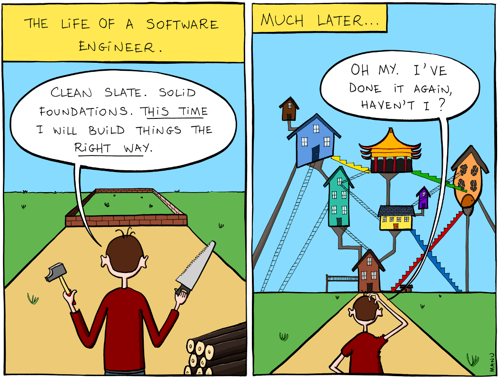
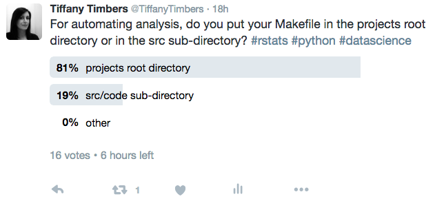

# DSCI 522


## Lecture 1 - Project and file management 101 + Version control via RStudio


### 2016-09-27

# Learning Objectives

## By the end of the lecture, students should be able to:

- Create a well-organized data analysis project directory structure
- Write appropriate documentation (*e.g.,* README.md)
- Set-up an R project
- Set-up a project with distributed version control and remote servers (*e.g.,* GitHub) through RStudio

## How to organize a data analysis project

- how to organize projects?
- how to set-up your project's directory structure?
- what files to include in the project directory?
- what files to put under version control?

Must read: [Good Enough Practices in Scientific Computing](https://swcarpentry.github.io/good-enough-practices-in-scientific-computing/)

Want to do even better? Read: [Best Practices for Scientific Computing](http://journals.plos.org/plosbiology/article?id=10.1371/journal.pbio.1001745)


*Source: http://www.bonkersworld.net/building-software/*

### Put each project in its own directory, which is named after the project

- Divide your work/research into distinct projects
    - For example, create a separate project for each product, tool or manuscript you are working on
    - As a rule of thumb, divide work/resarch into projects based on the overlap in data and code files.
- Each project should be housed in its own directory
- This directory should be under version control (*e.g.*, have a `.git` directory in the project's root directory and exist on a remote server, such as Github)


### What to put in the project's root directory

#### Files
The project's root directory MUST contain the following files:
- `README.md` 
- `LICENSE.md`

We recommend the project's root directory also contain the following files:
- `CITATION.md` 
- `CONTRIBUTING.md` 
- `CONDUCT.md`

#### Directories
The project's content should be organized into the following directories:
- `data`
- `doc`
- `results`
- `src`
- `bin`

*Each of these directories may also contain sub-directories as deemed necessary for each project.*

### Put text documents associated with the project in the doc directory 

Put all written/text files associated with the project in the `doc` directory. This could include:

- manuscripts
- documentation for source code
- documentation of data coding
- electronic lab notebook recording your experiments

### Put raw data and metadata in a data directory

This directory is for raw data and meta data only. No data generated from your computations should go in here. 

##### What is metadata?

Metadata is information about other data. For example, metadata of an animal drug trial/experiment may include:

- dates the experiments were performed on 
- who handled the animal or administered the drug
- temperature of the room during the experiment
- time of day the experiment was performed
- device/method used to administer the drug
- device/method used to assay the effect of the drug
- *etc.*

### Put files generated during cleanup and analysis in a results directory 

Files to go in the results directory:
- intermediate results
- cleaned data sets
- simulated data sets
- final results (such as figures and tables)

Given the heterogeneity of things that can be classified as results, the results directory will usually require additional subdirectories.

### Put project source code in the src directory

Project source code belongs in the `src` directory. This is all code written for the project, from both interpreted (*e.g.,* R or Python) and compiled (*e.g.,* Fortran, C++, or Java) languages, as well as shell scripts, snippets of SQL used to pull information from databases, and other code used in the project.

Example of file types that belong in `src`:
- `.R`
- `.py`
- `.Rmd`

### What about controller/driver scripts?

Controller/driver scripts are scripts which combine the core analytical functions with particular parameters and data input/output commands in order to reproducibly execute the entire project analysis from start to finish.

Example of a Shell controller script for a simple project:

```
#!/bin/sh
# runall.sh takes no aruguments

# calculate wordcount for all books
python src/wordcount.py data/isles.txt > results/isles_count.csv
python src/wordcount.py data/abyss.txt > results/abyss_count.csv
python src/wordcount.py data/last.txt > results/last_count.csv

# combine results
python src/zipf_test.py results/*_count.csv > results/all_wordcounts.csv
```
*example from [Software Carpentry's Make Lesson](http://swcarpentry.github.io/make-novice/)*

### Where should controller/driver scripts live?

[Good Enough Practices for Scienific Computing](https://swcarpentry.github.io/good-enough-practices-in-scientific-computing/) suggests these should also live in the `src` directory. There are reasons that this could be a good idea, but I and many others (see Twitter poll below) believe they are better off in the project's root directory.

**Why root?** Putting these in root makes it much easier to think about how to build paths or set the working directory. You only have to think "downwards" instead of "upwards and then downwards". 



### Naming controller/driver scripts

Regardless of where you put the controller/driver scripts, they should be named something clear and obvious, such as `runall.sh`.

In later lectures we will learn about other tools for creating controller/driver scripts, namely using the build tool Make. When Make is used as the build-tool, the controller/driver script is named `Makefile`.

### Put external scripts, or compiled programs in the bin directory

- External scripts or compiled programs should be put in the `bin` directory.
- External scripts are ones brought in from elsewhere.
- Compiled programs are executables compiled from code in the src directory.
- Some projects will have neither, and thus will not require a `bin` directory.

### Name all files to reflect their content or function

- Use descriptive names such as `bird_count_table.csv`, `manuscript.md`, or `sightings_analysis.py`
- Avoid capitals and white space in your file names (more about file naming in a later lecture...)
- DO NOT use sequential numbers or a location in a final manuscript (*e.g.,* `result1.csv`, `result2.csv`, `fig_3_a.png`)  (e.g., fig_3_a.png) - these will change as the project evolves!

## How to document your data analysis project

The main `README.md` file in the root directory of your project should contain sufficient information so that someone unfamiliar with your project could: 
- understand the overall aim of the project 
- be able to take your repository and reproduce your analysis on their machine.

Thus, at a bare minimum, your `README.md` file should include:
- aim of the project
- authors/contributors
- source of the data 
- software and all dependencies necessary to run the analysis
- description of how the project is organized
- instructions on how to reproduce the analysis

*note - having a good `README.md` file does not preclude documenting your code. Your scripts may be used for other purposes/projects in the future, and they need to be able to be interepreted and understood on their own.*

## Example of a well-organized project

```
.
|-- CITATION
|-- README
|-- LICENSE
|-- data
|   -- birds_count_table.csv
|-- doc
|   -- notebook.md
|   -- manuscript.md
|-- results
|   -- summarized_results.csv
|-- src
|   -- sightings_analysis.py
|   -- runall.py
```

## Setting up R projects

We will do a hands-on example in class from Stat545: http://stat545.com/block002_hello-r-workspace-wd-project.html#rstudio-projects.

## Using Git & Github through RStudio

We will do a hands-on example in class from [Happy Git with R Chapters 13, 16-18](http://happygitwithr.com/).

# Concept map wrap-up

- Well-organized data analysis project directory structure
- Appropriate documentation
- Setting-up R projects
- Setting-up a project with distributed version control and remote servers (*e.g.,* GitHub) through RStudio
