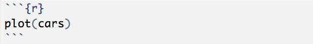
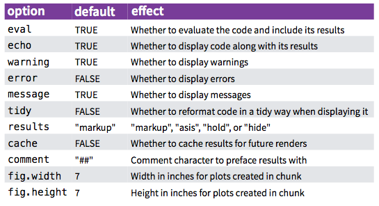
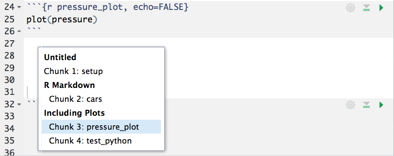
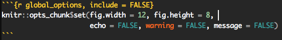
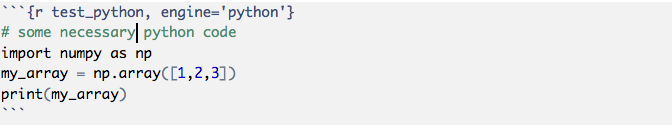

# DSCI 522


## Lecture 3 - Scaling up cont'd: Create reproducible reports and workflows in R

### 2016-10-04

# Learning Objectives

## By the end of the lecture, students should be able to:

- Describe situations where they would choose to write a script versus a R Markdown report
- Use R Markdown to create reports that runs simple analysis, the displays code outputs as stdout, tables and figures
- Describe the situations when they would want to use R Markdown outputs of html_document, pdf_document, and github_document
- Run R Markdown files from the command line
- Write scripts that are documented so that reports can be generated from them (via `knitr::spin`)

## All the things about reports using R Markdown

### Anatomy of a R Markdown document

- YAML Header
- Markdown formatted text
- Code chunks
    - Local & Global code chunk options
    - Naming code chunks

### YAML Header

- Sets some general global parameters, including:
    - title
    - author
    - output
    - etc
    
Most important from a workflow perspective is **output**. Possible output options include:
    - `output: github_document`
    - `output: html_document`
    - `output: pdf_document`
    - `output: word_document`
    - `output: beamer_presentation (beamer slideshow - pdf)`
    - `output: ioslides_presentation (ioslides presentation - html)`
    
##### Example YAML Header

```
---
title: "Reproducible Research"
author: "Tiffany Timbers"
date: "October 4, 2016"
output: github_document
---
```

### Markdown formatted text

- Text below the YAML header, and outside of the code chunks can be formatted with Markdown.

### Code chunks

- Code inside code chunks is executed when the document is rendered (unless an option not to do so is specified)
- Errors in code chunks prevent the document from being rendered (unless an option is specified to ignore erros )

#### Example R code chunk:



### Local options for code cells

- Chunk options can be specified for cell
- These are specified within the braces `{}` at the top of the cell
- There are many useful options, the default options for a code chunk are listed in the table below


*Source: https://rstudio-pubs-static.s3.amazonaws.com/105639_5c0a8f83c268447d8e9ea334e37e3ce1.html

### Naming your chunks helps you navigate the R Markdown document

When you create a chunk, it is advisable to give it a meaningful name. This is very useful as your document grows in size and complexity and helps you navigate and find code chunks:



*note - your markdown formatted headers also show up in this drop down menu!*

### Global options for code cells

What if you want to re-use the same options for all chunks? What is the most efficient way to do this? Global chunk options!



### Using other languages inside R Markdown

Through setting the chunk options you can use other languages inside you R Markdown document. For example, what if we wanted to run a bit of Python code? Well we could set the `engine` to `python` in the chunk option. We can do this locally or globally, depending on your needs!



#### Possible language engines:

- python
- bash
- c
- fortran
- sql
- awk
- ruby
- haskell
- perl
- dot
- and many more! For examples see links here: http://yihui.name/knitr/demo/engines/

#### Limitations of using other languages inside R Markdown

- All other non-R chunks are executed in separate sessions, so the variables cannot be directly shared between chunks
- If we want to make use of objects created in previous chunks, we usually have to write them to file in the chunk they were created in, and then read them in again in subsequent chunks

## Rendering R Markdown via the "knit" button and via commands

Inside RStudio, there are two ways to render/knit your R Markdown file. The most obvious is the "Knit" button at the top of RStudio:


This is handy and useful in a REPL/interactive framework, but there may be other situations where we want to use typed commands to render the document. This can be done via:

```
rmarkdown::render("src/Filename.Rmd", output_dir = "results")
```

### Running R Markdown files from the command line

Similar to an R script, you can call a R Markdown file from the command line/terminal/Git bash. This is done by echoing a command to R:

```
Rscript -e 'rmarkdown::render("src/Filename.Rmd", output_dir = "results")'
```

#### Parameters with R Markdown

Insterested in how you can make your R Markdown docs flexible? Not exactly, but kind of more like a script? 

Checkout this overview on parameterized reports: http://rmarkdown.rstudio.com/developer_parameterized_reports.html

## Creating reports from scripts using `knitr::spin`

In addition to R Markdown, there is special kind of formatting/documentation in R where you can turn a R script (`.R` file) into a beautifully formatted analytical report. This capability is enabled by `knitr`'s `spin` function.

Here is a table of the key formatting syntax for reports generated via `knitr::spin`:

| Function | Syntax | Example |
|----------|--------|---------|
| Markdown line | `#'` + Markdown syntax | `#' # Report Title` |
| Code chunk option | `#+` + code chunk options| `#+ r_chunk_name, eval = FALSE`  |
| Code | No special formatting required, simply write your code | `x  <-  13 + y` |


Here is an [example of a R script that uses this formatting](https://github.com/daattali/UBC-STAT545/blob/master/hw/hw12_web-scraping-api/hw12_web-scraping-api.R), and the [resultant `.md` file generated via "spinning" it](https://github.com/daattali/UBC-STAT545/blob/master/hw/hw12_web-scraping-api/hw12_web-scraping-api.md).

## 2 ways to spin!

1. Directly call `knitr::spin` to generate a `.md` and `.html` (by default)

```
knitr::spin("script_name.R")
```

2. Call `rmarkdown::render` (which calls `knitr::spin` under the hood) to generate a `.html` (by default)

```
rmarkdown::render("script_name.R")
```

## Why I choose `rmarkdown::render` over  `knitr::spin`

In addition to using `knitr::spin` under the hood, when you call `rmarkdown::render` you have more available output options at your finger tips because `rmarkdown::render` also calls Pandoc, thus using the `output_format` parameter of `rmarkdown::render`, you can choose any of the formats available to you through R Markdown (*e.g.,* 'pdf_document', 'word_document', 'beamer_presentation'). Whereas when you use `knitr::spin` on its own, your only output options are `.md` and `.html` unless you call another function afterwards.

# Concept map wrap-up

- Scripts versus reports
- Reports with R Markdown
- Creating reports using `knitr::spin`
