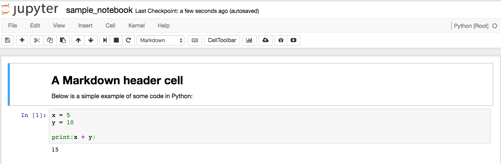
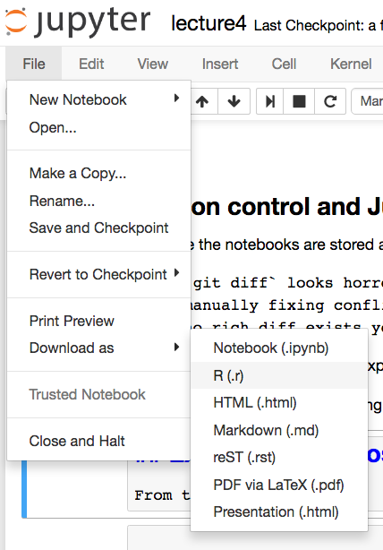

# DSCI 522


## Lecture 4 - Scaling up cont'd: Create reproducible reports and workflows in Python


### 2016-10-06

# Learning Objectives

## By the end of the lecture, students should be able to:

- Create reports in the Jupyter notebook
- Working with/running Jupyter notebooks non-interactively (batch, scheduling, and reports)
- Write scripts in Python that are documented so that reports can be generated from them (via `Pweave`) to various outputs (e.g., html, pdf, Markdown)

# Creating reports using Jupyter notebook

- An interactive multi-language IDE 
- We will be using it primarily to create reports in Python
- Can think of it as the equivalent to R Markdown

## Anatomy of a Jupyter notebook

Cells can be of type:
- Code
- Markdown
- Raw NBConvert
- ~~Heading~~ (deprecated)

*note - Raw NBConvert are only of interest/useful for reStructuredText (reST) to be parsed by Sphinx. If this means nothing to you, then you can happily ignore this note :)*

## A bit about what a Jupyter notebook is made up of

- `.ipynb` files are "plain" text files, and we can view them in a plain text editor and make some sense of them
- The contents of the notebook are encoded in JSON
- When we run the notebook via `Jupyter notebook` the kernel is the part the can interpret and run the code


For example, this notebook of 2 cells:



is encoded by the following JSON:
```
{
 "cells": [
  {
   "cell_type": "markdown",
   "metadata": {},
   "source": [
    "# A Markdown header cell\n",
    "\n",
    "Below is a simple example of some code in Python:"
   ]
  },
  {
   "cell_type": "code",
   "execution_count": 1,
   "metadata": {
    "collapsed": false
   },
   "outputs": [
    {
     "name": "stdout",
     "output_type": "stream",
     "text": [
      "15\n"
     ]
    }
   ],
   "source": [
    "x = 5\n",
    "y = 10\n",
    "\n",
    "print(x + y)"
   ]
  }
 ],
 "metadata": {
  "anaconda-cloud": {},
  "kernelspec": {
   "display_name": "Python [Root]",
   "language": "python",
   "name": "Python [Root]"
  },
  "language_info": {
   "codemirror_mode": {
    "name": "ipython",
    "version": 3
   },
   "file_extension": ".py",
   "mimetype": "text/x-python",
   "name": "python",
   "nbconvert_exporter": "python",
   "pygments_lexer": "ipython3",
   "version": "3.5.1"
  }
 },
 "nbformat": 4,
 "nbformat_minor": 0
}
```

## Version control and Jupyter notebook

Because the notebooks are stored as plain text, we can use them for version control, but this is not without issues, which include:
    - `git diff` looks horrendous because of the JSON
    - manually fixing conflicts is arduous because of the JSON
    - no rich diff exists yet for Jupyter notebook
    
But there is hope! [`nbdime`](http://nbdime.readthedocs.io/en/latest/) is an experimental project that hopes to solve many of these problems, eventually...

So for now, just get good at picking out the Python from the JSON...  `¯\_(ツ)_/¯`

## Using other languages inside Jupyter

We have primarily been using Python as the language to run inside Jupyter, but Jupyter is being developed as a language agnostic tool. 

Officially Project Jupyer supports and develops kernels for the following languages:
- [Python](https://ipython.readthedocs.io/en/stable/)
- [R](https://irkernel.github.io/)
- [Julia](https://github.com/JuliaLang/IJulia.jl)

The open source community has developed kernels for MANY MANY other languages: https://github.com/ipython/ipython/wiki/IPython-kernels-for-other-languages

When you choose a kernel it means that you choose to use that language as the primary interpreter for the code cells inside the notebook.

## Sporadically dabbling in other languages while running the Python kernel

Sometimes you want/need to run a bit of code from another language during Python code. You can do this when you use a Python kernel using cell magics (`%%`).

For example, to run some Bash/Unix commands, you can make a cell that starts with `%%bash`:


```R
%%bash

wc -l *.ipynb
```

         437 lecture1.ipynb
         522 lecture2.ipynb
         282 lecture3.ipynb
         453 lecture4.ipynb
          82 lecture5.ipynb
          86 lecture6.ipynb
         104 lecture7.ipynb
         107 lecture8.ipynb
        2073 total


Other built-in cell magics for languages include:

- `%%javascript`
- `%%perl`
- `%%python2`
- `%%python3`
- `%%ruby`
- `%%script`

Read the docs for more info about cell magics in iPython: http://ipython.readthedocs.io/en/stable/interactive/magics.html

## Running R inside a Python kernel in Jupyter
To run R, you need to first install the `rpy2` Python package via `pip` at the command line:


```R
%%bash

pip install rpy2
```

Then you need to import the library into your notebook:


```R
%load_ext rpy2.ipython
```

Finally, you can run R cells using cell magics:


```R
%%R

x <- 10
print(x)

head(mtcars)
```


    [1] 10
                       mpg cyl disp  hp drat    wt  qsec vs am gear carb
    Mazda RX4         21.0   6  160 110 3.90 2.620 16.46  0  1    4    4
    Mazda RX4 Wag     21.0   6  160 110 3.90 2.875 17.02  0  1    4    4
    Datsun 710        22.8   4  108  93 3.85 2.320 18.61  1  1    4    1
    Hornet 4 Drive    21.4   6  258 110 3.08 3.215 19.44  1  0    3    1
    Hornet Sportabout 18.7   8  360 175 3.15 3.440 17.02  0  0    3    2
    Valiant           18.1   6  225 105 2.76 3.460 20.22  1  0    3    1


In contrast to R Markdown, R objects created in one code cell, do persist and can be called and used in other code cells!


```R
%%R

print(x)
```


    [1] 10


*note - this should work on all OS's! If you are having a problem, don't assume it doesn't work on your machine, get IT help/support and make it work!*

## Export formats possible from Jupyter

From the `File` > `Download as` menu, you can output Juptyer notebook to the following file formats:



##  Working with/running Jupyter notebooks non-interactively

Similar to R Markdown, you can work with Jupyter Notebooks in an non-interactive manner. This can give you more power, and make you more efficient for certain tasks (*e.g.,* automated reporting)

The tool that enables this is `nbconvert`. `nbconvert` allows you to convert `.ipynb` files into other file formats (*e.g.,* HTML, LaTeX, PDF, Markdown, reStructuredText), as well as lets you execute notebooks programmatically.

## Using nbconvert to `.ipynb` files into other file formats

From the command line/terminal/Git Bash to use `nbconvert` to convert a Jupyter notebook (`.ipynb`) to a a different format (*e.g.,* HTML, LaTeX, PDF, Markdown, reStructuredText) use the following commands:

```
jupyter nbconvert --to <output format> <input notebook>
```

where `<output format>` is the desired output format and `<input notebook>` is the filename of the Jupyter notebook.

Supported formats are listed below, and documentation on how to do each can be found [here](https://nbconvert.readthedocs.io/en/latest/usage.html#supported-output-formats).

- HTML
- LaTeX
- PDF
- Reveal.js HTML slideshow
- Markdown
- reStructuredText
- executable script
- notebook

## Using `nbconvert` to execute notebooks programmatically

`nbconvert` can also be used to execute/run notebooks at the command line interface or a via a Python API interface. 

As an example, a notebook can be executed from the command line with:
```
jupyter nbconvert --to notebook --execute mynotebook.ipynb
```

We will not go into executing/running notebooks from a Python API interface, but if you are interested, you can read these [docs](https://nbconvert.readthedocs.io/en/latest/execute_api.html#executing-notebooks-using-the-python-api-interface).

**note - you need to update some software before this will work because of a recent change with Anaconda. Please run the following code:**

```
conda update nb_conda nb_conda_kernels nb_anacondacloud
```

**After running this code, choose `Python[default]` as your kernel in Jupyter.**

## What about passing arguements or parameters to Jupter notebooks from the command line?

- This would be a very useful feature, but is not currently an official feature of Jupter notebooks
- There are two projects in experimental/early stages that may allow you to do this:
    1. [`nbparameterise`](https://github.com/takluyver/nbparameterise)
    2. [`nbrun`](https://github.com/tritemio/nbrun)

# Creating reports from scripts using `Pweave`

As you have seen and experienced, Jupyter is a pretty good and useful tool for making analytical reports in Python (or Julia, or R, or etc), but you also might have noticed that its a bit heavy... You need to run a server, pick a kernel, and then do something manually (clicking run all or using `nbconvert` at the command line) to run your code.

There are alternatives to Jupyter available for Python. We will explore one of these, [`Pweave`](http://mpastell.com/pweave/), which is easy to use as well as tried and tested. 

[`stitch`](https://pystitch.github.io/) is another new Python specific tool on the horizon which may be quite nice and useful (it is very R Markdown like) but does not have the mileage of `Pweave`. But it is something to keep your eye on and maybe test out for yourself.

## `Pweave`'s script syntax

Here is a table of the key formatting syntax for reports generated from Python scripts via `Pweave`'s `pypublish` (think of this as Python's version of `knitr::spin`):

| Function | Syntax | Example |
|----------|--------|---------|
| Markdown line | `#'` + Markdown syntax | `#' # Report Title` |
| Code chunk option | `#+` + code chunk options| `#+ r_chunk_name, eval = FALSE`  |
| Code | No special formatting required, simply write your code | `x  =  13 + y` |


Here is an [example of a Python script that uses this formatting](http://mpastell.com/pweave/_downloads/FIR_design.py), and the [resultant `.pdf` file generated via "spinning" it](http://mpastell.com/pweave/_downloads/FIR_design.pdf).


## Using `Pweave`'s `pypublish` to render scripts

From the command line/terminal/Git bash you can use `Pweave`'s `pypublish` to render scripts:

```
pypublish -f <output format> <input script>
```

## Limitations of `Pweave`'s `pypublish`
Direct output formats are limited to `.html` and `.pdf` (although you can probably figure out a workaround using `pweave` and/or `pandoc`...)

# Concept map wrap-up

- Creating reports using Jupyter notebook
- Working with/running Jupyter notebooks non-interactively
- Reports from scripts via `Pweave`
