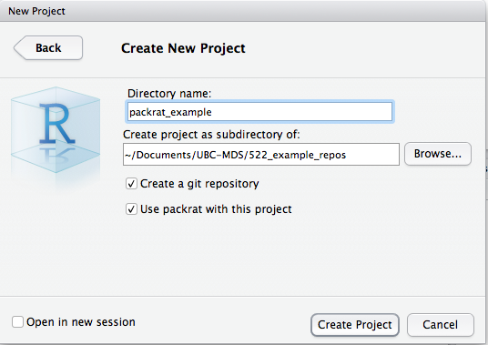
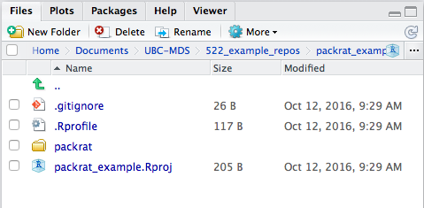
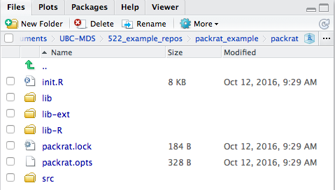

# DSCI 522


## Lecture 6 - Environment management (package dependencies, managing versions)


### 2016-10-13

# Learning Objectives

## By the end of the lecture, students should be able to:

- Correctly document analysis dependencies and load them in a logical place in the script/report
- Use language specific tools to manage package dependencies (packrat, conda, virtualenv)

## Documenting and loading dependencies

You've made some beautiful data analysis pipeline/project using make, R, and/or Python. It runs on your machine, but how easily can you, or someone else, get it working on theirs? The answer usually is, it depends...

What does it depend on?

1. Documenation
    - Does your README and your scripts make it blatantly obvious what programs and packages need to run your data analysis pipeline/project? 
    - Do you also document the version numbers of the programs and packages you used? This can have big consequences when it comes to replicability...

2. Did you use a package manager or environment management system that facilitates the shipping of dependencies along with your code?

## How do I find out what pacakges and versions I am using?

### R
Add `sessionInfo()` at the end of a script to print out all packages and versions (gives you the versions of R as well).

### Python 

From the command line, `pip freeze`, will list all installed packages and their versions.

To find the version of Python, from inside Python type:
```
import sys
print (sys.version)
```

## Tools for managing software and package dependencies
### Language specific:

- R
    - `packrat`
    
- Python
    - `conda`
    - `virtualenv`
    
### Language agnostic (polyglot):

- Docker

## `packrat` - a dependency management system for R

`packrat` creates a private package library (or just private library) for each R project:
    - packages installed from inside a packrat project are only available to that project
    - similarly, packages installed outside of the project are not available to the project

### Why use `packrat`

- When you are ready to ship your project, you can take a `snapshot` of your private library. 
- You can "ship" this snapshot along with your code. 
- From this snapshoy, you can easily `restore` **_all_** the libraries using a single command on the new machine and have your code up and running in a jiffy!

### Installing `packrat`

You install `packrat` like any other R package (from the R console):

```
install.packages("packrat")
```

### Setting up a R project with `packrat`

There are 2 ways to do this:

1. Set-up a new project using RStudio:

    

2. Set-up an existing project by typing the following in the R console:

    ```
    packrat::init("path_to_project)")
    ```

### `packrat` files:

A `packrat` project looks like this (*note - the .gitignore file is there because we selected the create git repository option*):



and inside `packrat` directory:



| `packrat` File | Function |
|---------------------|--------------------|
| `packrat/packrat.lock` | Lists the precise package versions that were used to satisfy dependencies, including dependencies of dependencies. (This file should never be edited by hand!) |
| `packrat/packrat.opts` | Project-specific packrat options. These can be queried and set with get_opts and set_opts; see ?"packrat-options" for more information. |
| `packrat/lib/` | Private package library for this project. |
| `packrat/src/` | Source packages of all the dependencies that packrat has been made aware of. |
| `.Rprofile` | Directs R to use the private package library (when it is started from the project directory). |

### Installing packages with `packrat`

You install packages in a `packrat` project, the same way you install any package in R, using `install.packages("package_name")`.

The **key difference** is that these packages will only be available to that specific R project where you installed the pacackage.

### Shipping your dependencies with `packrat`

You create a "shippable" version of your package dependencies using the `snapshot` function:

```
packrat::snapshot()
```

After creating a "snapshot", when this project is copied to a new computer and opened in R, `packrat` will automatically restore all the packages that are needed to run the project!

*note - I find that sometimes after I do `packrat::snapshot()` that I need to manually restore the packages to run my code again. This can be done via: `packrat::restore()`.*

### Exercise 1: Try cloning and running a `packrat` project

- Clone or download this `packrat`-managed R project: https://github.ubc.ca/ubc-mds-2016/packrat_example
- Discuss with your neighbour the pros and cons of using `packrat` with R projects.

## `conda` -  a tool to create isolated computing environments.

In addition to installing packages, `conda` is a tool to create isolated computing environments, which makes it easy to manage, record and ship dependencies. We will explore the use of conda in the context of Python, but since you can install R and R packages with conda, you can use it for this (and other) languages too.


With the virtual environment created by `conda` you can specify the version of Python you want to use, as well as the version of the Python packages.

You can easily share this virtual environment with others who might want to use your code (or yourself if you need to use the code on another machine) by creating and sharing an `environment.yml` file.

Similar to `packrat`, `conda` packages installed from inside the isolated environment are only available to that isolated environment, and packages installed outside of the isolated environment are not available to the isolated environment. 

### Setting up a virtual environment for a Python project with conda

To create a new virtual environment, you use the `conda` command along with the `--name` argument (to name the virtual environment) and you can specify the version of Python (2 or 3):

```
conda create --name <environment_name> python=3
```

When you do this, `conda` automatically installs the packages and/or programs listed below, and you will be prompted to choose whether to continue or not:

```
The following NEW packages will be INSTALLED:

    openssl:    1.0.2j-0     
    pip:        8.1.2-py35_0 
    python:     3.5.2-0      
    readline:   6.2-2        
    setuptools: 27.2.0-py35_0
    sqlite:     3.13.0-0     
    tk:         8.5.18-0     
    wheel:      0.29.0-py35_0
    xz:         5.2.2-0      
    zlib:       1.2.8-3      

Proceed ([y]/n)?
```

You can also pass `conda` a list of other packages to install when you create the environment. For example, to create an environment called `data_science` with the `numpy`, `pandas` and `altair` package installed you can do the following:

```
conda create --name data_science python=3 numpy pandas altair

```

### Activate the virtual environment to use it

To use the virtual environment, you need to activate it. Otherwise you computer will just use the default Python. To activate the environment, use the following commands:

**Linux, OS X:** `source activate <environment_name>`

**Windows:** `activate <environment_name>`

Once you are done working on the project, you need to deactivate the environment so you can again use the default Python, to do so, use the following commands:

**Linux, OS X:** `source deactivate`

**Windows:** `deactivate`

### Installing packages within a `conda` virtual environment

You can add install new/additional packages to a `conda` virtual environment, the same way you install any package in Python at the command line, using either:

```
pip install <package_name>
```
or
```
conda install <package_name>
```

*Reminder - the key difference is that these packages will only be available to that specific Python project where you installed the package.*

### Shipping your dependencies with a conda virtual environment

To get a record of all the packages you have in the isolated environment, you can use `conda env export`. It is advisable to re-direct the output of this command to a file called `environment.yml`.

```
conda env export > environment.yml
```

*note - this needs to be done from inside the activated virtual environment.*

This `environment.yml` file contains a list of all the packages in the current environment, and their respective versions. You (or someone else) can use this file to install the necessary packages to run the code by running:

```
conda env create -f environment.yml
```

### Where does the environment live on your computer?

Environments are installed by default into the envs directory in your conda directory. This makes it "easy" to know what to version control in your project - your code and the `environment.yml` file.

### Exercise 2: Try cloning and running a `conda` project

- Clone or download this `conda`-managed Python project: https://github.ubc.ca/ubc-mds-2016/conda_example
- Discuss with your neighbour the pros and cons of using `conda` with Python projects.

## `virtualenv` -  a tool to create isolated Python environments.

`virtualenv` is a tool to create isolated Python environments, which makes it easy to manage, record and ship dependencies.

`virtualenv` it works by creating a folder in the current directory (typically the project's root directory) which contains:
- necessary Python executable files to use the packages that a Python project would need
- a copy of the pip library which you can use to install other packages

Similar to `packrat`, `virtualenv` packages installed from inside the isolated environment are only available to that isolated environment, and packages installed outside of the isolated environment are not available to the isolated environment. 

Furthermore, you can use `virtualenv` to not only manage packages and package versions, but also the version of Python that the isolated environment uses.

### A sad note...

Anaconda's version of Python does not seem to play nice with `virtualenv`... This is likely because `conda` (a piece of the Anaconda package) has it's own package management system.

Thus, if you want to use `virtualenv` for a project, you need to use a different version of Python. I recommend downloading Python 3.5 from here: https://www.python.org/downloads/release/python-350/.

### Installing `virtualenv`

You install `virtualenv` like any other Python package (from the command line):

```
pip install virtualenv
```

### Setting up a Python project with `virtualenv`

Inside the terminal/Bash, navigate to your project's root directory and use the `virtualenv` command to create a new isolated Python environment:

```
virtualenv -p <path_to_python> <environment_name>
```

*You get to choose the `<environment_name>`. We recommend you name it something meaningful, for example `project_name_venv`.*

### `virtualenv` files:

Running the `virtualenv` commands to set-up a new isolated Python environment results in the creation of a directory with whatever you designated the `<environment_name>` to be. Inside that directory, several directories and files are created:

```
v/
bin/			lib/
include/		pip-selfcheck.json
```

Inside this `bin` directory are all the Python executable files to run Python, install packages, and use the packages that your Python project needs. When you install new packages, they will be installed here.

### Activate the isolated environment to use it

To use the isolated environment, you need to activate it. Otherwise you computer will just use the default Python (probably Anaconda's Python).

To activate the environment, use the following commands:
```
source <environment_name>/bin/activate
```


Once you are done working on the project, you need to deactivate the environment, to do so, use the following command:
```
deactivate
```

### Installing packages with  `virtualenv`

You install packages in a `virtualenv` project, the same way you install any package in Python at the command line:
```
pip install <package_name>
```

*Reminder - the key difference is that these packages will only be available to that specific Python project where you installed the package.*

### Shipping your dependencies with `virtualenv`

To get a record of all the packages you have in the isolated environment, you can use `pip freeze`. It is advisable to re-direct the output of this command to a file called `requirements.txt`.

```
pip freeze > requirements.txt
```

This `requirements.txt file` contains a list of all the packages in the current environment, and their respective versions. You (or someone else) can use this file to install the necessary packages to run the code by running:

```
pip install -r requirements.txt

```

### What to version control when using `virtualenv`

- The paths inside the virtual environment directory are absolute paths to places where things are installed on your computer, thus sharing the virtual environment directory is not really helpful. 
- Instead, version control, and share the `requirements.txt` file, and put the virtual environment directory in your `.gitignore`.

### Exercise 3: Try cloning and running a `virtualenv` project

- Clone or download this `virtualenv`-managed Python project: https://github.ubc.ca/ubc-mds-2016/virtualenv_example
- Discuss with your neighbour the pros and cons of using `virtualenv` with Python projects.

# Concept map wrap-up

- Documenting and loading dependencies
- Language specific tools for managing package dependencies
