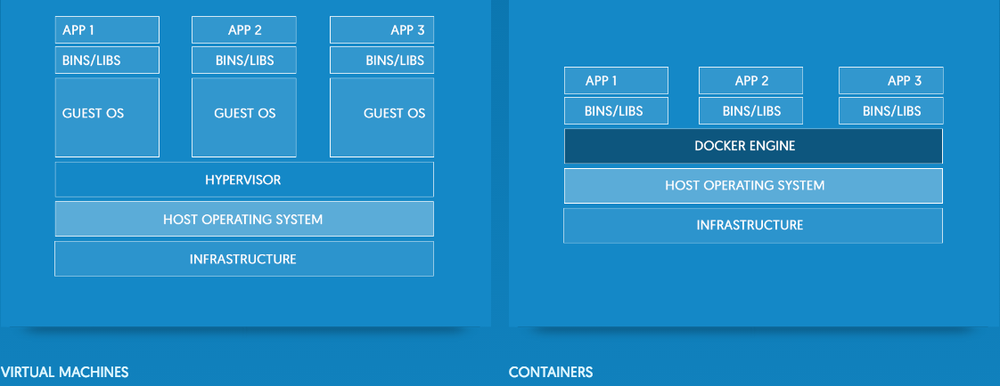

# DSCI 522


## Lecture 7 - Environment management: containerization with Docker


### 2016-10-18

# Learning Objectives

## By the end of the lecture, students should be able to:

-  Use pre-existing Docker images to perform read-eval-print-loop (REPL) analysis in a reproducible environment
- Batch run analysis scripts and reports in a Docker container
- Write dockerfiles to modify pre-existing containers
- Share containers on Docker Hub

## What is Docker?

*"Docker containers wrap a piece of software in a complete filesystem that contains everything needed to run: code, runtime, system tools, system libraries – anything that can be installed on a server. This guarantees that the software will always run the same, regardless of its environment."*

*Source: https://www.docker.com/what-docker*

## Container versus Virtual Machines


*Source: https://www.docker.com/what-docker*

## Using Docker to perform read-eval-print-loop (REPL) analysis in a reproducible environment

There are many ways to use Docker. We will start with an example of how to use it interactively via the terminal/Shell/Bash, and then graduate to using it with a GUI (e.g., R Studio), and then finally to running it non-interactively.

All of these workflows are useful, and it depends upon what you are trying to do (*e.g.*, developing some code vs running an automated data analysis pipeline).

### REPL with the Unix shell & Docker

- Once we have Docker installed on our computers, we can run a Docker container locally in interactive mode using [`docker run`](https://docs.docker.com/compose/reference/run/) using the `-it` flag (for interactive). 
- We will use a [trusted ubuntu image from Docker Hub](https://hub.docker.com/_/ubuntu/).
- If you do not yet have the image saved locally, when you call `docker run <image_name>`, Docker will automatically download/pull it for you. 

```
$ docker run --rm -it ubuntu
```

*note - the `--rm` flag ensures that when we quit the container, the container is deleted.* 

Once you launch Docker successfully, your prompt should change to look something like this:

```
root@1fc309a08883:/# 
```

`1fc309a08883` is the container ID. This will change everytime you launch a new container. 

##### What is the difference between a Docker image and a Docker container?

A Docker container is an instance of a Docker image. From one Docker image, you can run as many instances/copies of that as containers as you would like.

##### How to see what Docker images are installed?

To see the Docker images that you have installed locally, in another Shell window use [`docker images`](https://docs.docker.com/engine/reference/commandline/images/):

```
$ docker images
```

```
REPOSITORY      TAG      IMAGE ID      CREATED       SIZE
ubuntu          latest   f8d79ba03c00  9 weeks ago   126.4 MB
```

##### How to see what Docker containers are saved locally and/or running?

To see Docker containers are saved locally and/or running, in another Shell window use [`docker ps`](https://docs.docker.com/engine/reference/commandline/ps/):


```
CONTAINER ID   IMAGE   COMMAND      CREATED     STATUS         PORTS  NAMES
33ec08c4eff3   ubuntu  "/bin/bash"  4 days ago  Up 36 minutes         gigantic_wilson
```

##### How to stop a running container:
```
$ docker stop <container_id>
```

##### How to delete a stopped container:
```
$ docker rm <container_id>
```

##### How to stop & delete a running container:
```
$ docker rm -f <container_id>
```

##### Exiting a Docker container

To exit a container and go back to your regular Shell, you use the command `exit`:

```
root@1fc309a08883:/# exit
```

```
$ 
```

##### Working in the Shell inside Docker

We can use all the Shell commands available to the operating system run by our base image, in this case Ubuntu. We can for example, use `ls` to look around:

```
$ docker run --rm -it ubuntu

root@33ec08c4eff3:/# ls             
```

```
bin   dev  home  lib64  mnt  proc  run   srv  tmp  var
boot  etc  lib   media  opt  root  sbin  sys  usr
```

##### What if we want to do some programming, in R, for example?

If we want to run another program that is not included in our base image, we have to install it. We can do this interactively for now, but we will learn a better practice shortly, which is to build your Docker container using a Dockerfile.

```
root@33ec08c4eff3:/# R
```

```
bash: R: command not found
```

To install R on Ubuntu (*note - this takes several minutes*):

```
root@33ec08c4eff3:/# sh -c 'echo "deb http://cran.rstudio.com/bin/linux/ubuntu trusty/" >> /etc/apt/sources.list'
root@33ec08c4eff3:/# gpg --keyserver keyserver.ubuntu.com --recv-key E084DAB9
root@33ec08c4eff3:/# apt-get update
root@33ec08c4eff3:/# apt-get -y --force-yes install r-base
```

Now we can run R:

```
root@33ec08c4eff3:/# R
```

```
R version 3.3.1 (2016-06-21) -- "Bug in Your Hair"
Copyright (C) 2016 The R Foundation for Statistical Computing
Platform: x86_64-pc-linux-gnu (64-bit)

R is free software and comes with ABSOLUTELY NO WARRANTY.
You are welcome to redistribute it under certain conditions.
Type 'license()' or 'licence()' for distribution details.

R is a collaborative project with many contributors.
Type 'contributors()' for more information and
'citation()' on how to cite R or R packages in publications.

Type 'demo()' for some demos, 'help()' for on-line help, or
'help.start()' for an HTML browser interface to help.
Type 'q()' to quit R.

> 
```

##### Saving changes to a container

- It took us some time to install R, and I don't want to have that downtime again. To avoid this in the future, I am going to save an image of this container using [`docker commit`](https://docs.docker.com/engine/reference/commandline/commit/).
- Because I used the `--rm` flag the container will be deleted as soon as I exit it, so I need to keep the container open, and perform the following commands from another Shell window:

```
$ docker commit -m "installed base R" 33ec08c4eff3 ubuntu-r
```

```
sha256:a8c1850685e719a81a582ca91efb4587cb6bca82d80052ce361ed3205dddbd19
```

*note - Docker image names can only contain lower case letters (upper case throws an error)*

To see that we have a new Docker image on our computer, we can check with `docker images`:

```
$ docker images
```

```
REPOSITORY      TAG      IMAGE ID      CREATED       SIZE
ubuntu-r        latest   a8c1850685e7  4 days ago    696.4 MB
ubuntu          latest   f8d79ba03c00  9 weeks ago   126.4 MB
```

Next time if we want to launch the container with R installed, we would type:

```
$ docker run --rm -it ubuntu-r
```

##### Pushing images to Docker Hub

- [Docker Hub](https://hub.docker.com/) is a Cloud-based Docker image repository. 
- Once we have a Docker Hub account, we can push our images their for storage and sharing via [`docker push`](https://docs.docker.com/engine/reference/commandline/push/).


Before we `push`, we need to login:

```
$ docker login
```

Let's push our newly created Docker image, `ubuntu-r` to Docker Hub:

```
$ docker push ubuntu-r
```

### REPL with RStudio & Docker

Working with the `ubuntu-r` image will let us run our previously developed R code, and develop some simple R code, but it would be nice to be able to work inside RStudio for development of the code. 

Some kind souls have built the [Rocker](https://github.com/rocker-org/rocker/wiki) project, which is a collection of R docker images, including some with R Studio and commonly used packages installed!

##### Running an GUI IDE in Docker

To run RStudio in Docker, we need to add an argument to specify a [port](https://en.wikipedia.org/wiki/Port_(computer_networking)) so that we can launch RStudio inside a browser. We will use the [hadleyverse](https://github.com/rocker-org/hadleyverse) image:

```
docker run --rm -p 8787:8787 rocker/hadleyverse
```

The command above will lead RStudio-Server to launch invisibly. To connect to it, open a web browser and enter: ` http://localhost:8787` 

This should lead to you being greeted by the RStudio welcome screen. Log in using:

username: `rstudio` 

password: `rstudio`

Now you should be able to work with RStudio in your browser in much the same way as you would on your desktop.

##### Exiting a Docker container running a GUI

Go to the Shell window where you started running the Docker container from, and type: `Cntrl + C`

##### Docker Toolbox instructions
If you are running a Docker Toolbox (i.e., you needed to launch the Docker Quickstart Terminal to get Docker up and running), you will find the ip address on the first line of text that appeared in your terminal when you launched the Docker Quickstart Terminal. For example, you should see:

```
                        ##         .
                  ## ## ##        ==
               ## ## ## ## ##    ===
           /"""""""""""""""""\___/ ===
      ~~~ {~~ ~~~~ ~~~ ~~~~ ~~~ ~ /  ===- ~~~
           \______ o           __/
             \    \         __/
              \____\_______/


docker is configured to use the default machine with IP 192.168.99.100
For help getting started, check out the docs at https://docs.docker.com
```
Thus, you would enter `http://192.168.99.100:8787` in your browser as the url.

#### Exercise 1: Where are things saved in a Docker container?

1. Launch an RStudio instance inside the Docker `hadleyverse` image.

2. Create an R script, called `plot.R` with the following code, and test that it works in RStudio.

```
# make x the numbers from 1 to 5, and y the numbers from 6-10
x <- 1:5
y <- 6:10

# plot x against y
plot(x, y)
```

3. Save the script. 

4. Exit out of the container and try to find the script? If you can't find it, try opening the Docker image again and looking for it there. Can you find it?

##### Linking volumes to your Docker container

- How can we save our work if the container is deleted when we exit the container? One solution is to link a volume (for example your local hard drive) to the container so that you can access the data there as well as being able to save things there.

- We link volumes in the `docker run` command using the `-v` flag.

```
$ docker run --rm -p 8787:8787 -v /Users/timberst/Documents/UBC-MDS/522_example_repos:/home/rstudio/522_example_repos rocker/hadleyverse
```

*On the left hand side of the : is the path on your own computer. On the right hand side is the path on the container. This should almost always start with /home/rstudio/.*

##### Exercise 2: Saving and accessing things on your laptop to/from a Docker container?

- Repeat Exercise 1, but this time link the container to a volume on your laptop.
- Can you see the script on your laptop after you exit the container?

##### Installing R packages inside Docker

- R packages inside Docker can be installed as per usual using `install.packages(package_name)`. 
- Remember to commit a new image from the container if you want to use it again.
- This is not the recommended practice for reproducible research, we'll talk about the best practice (using Dockerfiles) soon... 

## Writing dockerfiles

We've learned how to update Docker base images interactively, but then we have no record of how we did this...

From a reproducibility standpoint, this is bad. This is also bad from a trust/security standpoint. I would be nervous to run someone else's Docker image without know what is in that image as it could have bad/malicious software installed on it that could hurt my machine.

Thus, enter the [`Dockerfile`](https://docs.docker.com/engine/reference/builder/)!

`Dockerfile`'s are files that: 
- specify how to build your Docker image
- set defaults as to how to run the image (e.g., automatically launch a Shell vs RStudio)
- can be used on Docker Hub to created trusted builds of your Docker image that others can feel safe using


##### Example `Dockerfile`

Below is a `Dockerfile` that builds a Docker image that can run the annoying to install program `makefile2graph`:


```
# Docker file for ubuntu-makefile2graph
# Tiffany Timbers, Oct 18, 2016

# use ubuntu:latest as base image
FROM ubuntu:latest

# get OS updates and install build tools
RUN apt-get update
RUN apt-get install -y build-essential

# install graphviz
RUN apt-get install -y graphviz

# install git
RUN apt-get install -y wget
RUN apt-get install -y make git

# clone, build makefile2graph,
# then copy key makefile2graph files to usr/bin so they will be in $PATH
RUN git clone https://github.com/lindenb/makefile2graph.git

RUN make -C makefile2graph/.

RUN cp makefile2graph/makefile2graph usr/bin
RUN cp makefile2graph/make2graph usr/bin
```

You can see all the commands inside a `Dockerfile` are familiar Unix/Linux commands, with Docker-specific commands preceeding them (*e.g.*, `FROM`, `RUN`).

To build the a Docker image from the `Dockerfile` you use the [`docker build`](https://docs.docker.com/engine/reference/commandline/build/) command:

```
docker build -t makefile2graph .
```

The `-t` flag let's you specify the image name for the Docker image, while the `.` says which directory Docker should look inside for a file called `Dockerfile` to build.

##### Exercise 3: Building a Docker image from a Dockerfile

- Clone [this repo](https://github.com/ttimbers/makefile2graph) and use `docker build` to make a Docker image from the `Dockerfile`. Name it `makefile2graph`.
- Test that it works, but cloning [this repo](https://github.ubc.ca/ubc-mds-2016/make_example), and running a Docker container from the `makefile2graph` that is linked to the downloaded repo so that you can use the `makefile2graph` in that container to create a dependency graph from the `Makefile`.

To create the dependency graph, use the following code inside the Docker repo (you need to be in the same directory as the `Makefile`):
```
makefile2graph > Makefile.dot
dot -Tpng Makefile.dot -o Makefile.png
```

## Running batch analysis scripts and reports in a Docker container

Working interactively is great for developing code, but there are times when you need to run a script in an automated fashion for efficiency and reproducibility. You can use Docker in this way too!

The general command is:
```
$ docker run --rm <docker_image> <shell_command_to_run>
```

Our first example will be to run the `ubuntu-makefile2graph` non-interactively and print the containers home directory: 

```
$ docker run --rm makefile2graph pwd
```

Next, we will get `ubuntu-makefile2graph` to run the shell script below to create a dependency graph from a Makefile:


Shell script to create dependency graph:
```
# makefile_to_png.sh
# create png from Makefile

cd $1
makefile2graph > Makefile2.dot
dot -Tpng Makefile.dot -o Makefile2.png
```

Run `makefile_to_png.sh` with non-interactive container:

```
$ docker run --rm -v /Users/tiffanytimbers/Desktop/make_example:/home/make_example makefile2graph bash /home/make_example/makefile_to_png.sh /home/make_example
```

## Running `make` from a different directory

When linking volumes, you will often have to drive the script or Makefile from a different directory. We have learned to do this with Shell, Python & R scipts, but here is how we do it with a Makefile:

```
make -C '/path/to/dir/containing/Makefile'
```

# Concept map wrap-up

- Using Docker to perform read-eval-print-loop (REPL) analysis in a reproducible environment
- Running batch analysis scripts and reports in a Docker container
- Writing dockerfiles
- Sharing Docker images on Docker Hub
