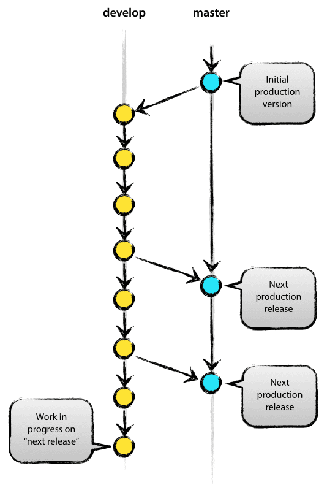

# DSCI 522


## Lecture 8 - Environment management: containerization with Docker


### 2016-10-20

# Learning Objectives

## By the end of the lecture, students should be able to:

- Install R packages inside a Dockerfile
- List good Docker base images for R and Python projects

## Installing R packages inside a Dockerfile

Technically, there are several ways to install R packages via a Dockerfile, but here is our recommended practice:

```
RUN R -e "install.packages('gapminder', repos='http://cran.us.r-project.org')"
```

The advantage of this strategy is that it automatically installs any R package depenedencies.

## Managing R package versions inside Docker

If your R project uses `packrat`, you can use `packrat` to manage the package versions. Another possibility is to use checkpoint/mran/snapshots from CRAN to lock-in the version:

```
RUN R -e "install.packages('gapminder', repos = 'https://mran.revolutionanalytics.com/snapshot/2016-10-19')"
```

## Running rocker Docker images from the Shell instead of RStudio

The default behaviour for the rocker Docker images, including the `rocker/hadleyverse` image is to launch RStudio. You can override this as follows:

```
docker run --rm -it --user rstudio rocker/hadleyverse /bin/bash

```

The key is to add `/bin/bash` after the you call the image. This should also work for other images that have other default start-up behaviours.

## Good base images to work from for R or Python projects!

| Image | Software installed | 
|-------|--------------------|
| [rocker/hadleyverse](https://hub.docker.com/r/rocker/hadleyverse/) | R, R packages (including the tidyverse), RStudio, make |
| [continuumio/anaconda3](https://hub.docker.com/r/continuumio/anaconda3/) | Python 3.5, Jupyter notebook, make(?) |


# Concept map wrap-up

- Install R packages inside a Dockerfile
- List good Docker base images for R and Python projects

## Extra's on branching in Git (for optional lab question)

Branching in Git is a great way to develop your code without breaking what you already have working! Here's a cartoon of what it is:


*Source: http://nvie.com/posts/a-successful-git-branching-model/*


#### Command line commands for branching:

| Task | Command |
|------|---------|
| Create a new branch| `git checkout -b <branch_name>` |
| Push changes to branch on Github | `git push origin <branch_name>`|
| Merge changes on branch with `master` | `git checkout master; git merge <branch_name>`|
| Push the changes to `master` on Github | `git push origin master` |
| View all branches | `git branch -v` |
| Delete a branch locally | `git branch -d <branch_name>`|
| Delete a branch on Github |  `git push origin --delete <branch_name>`|
