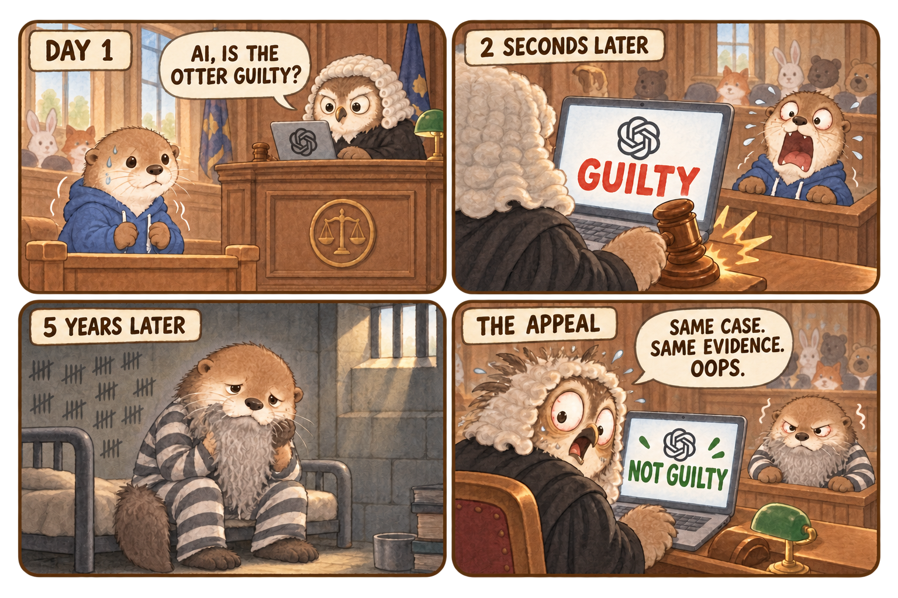
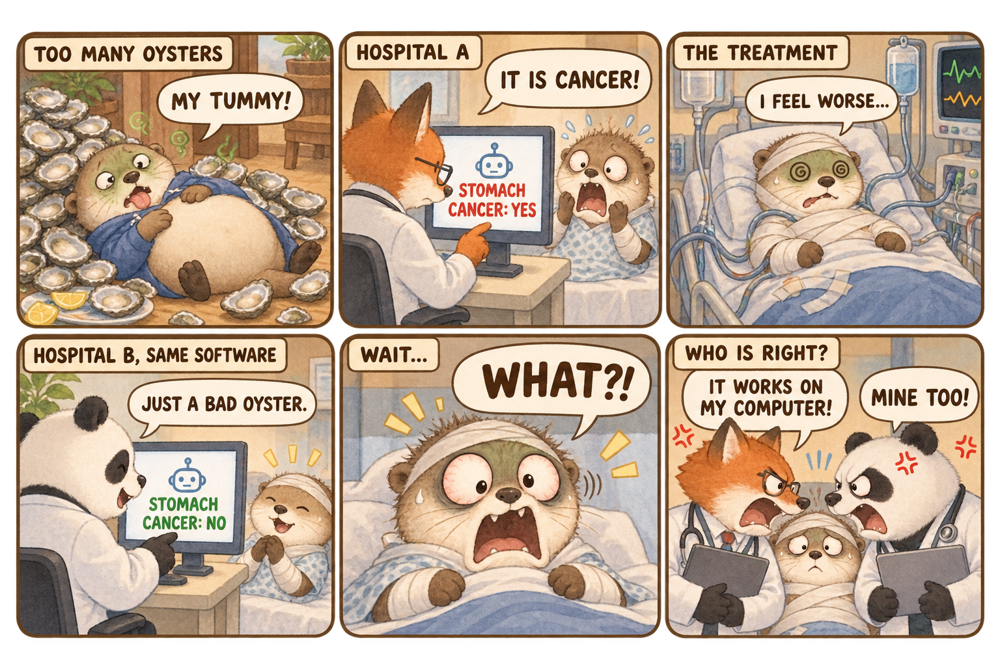
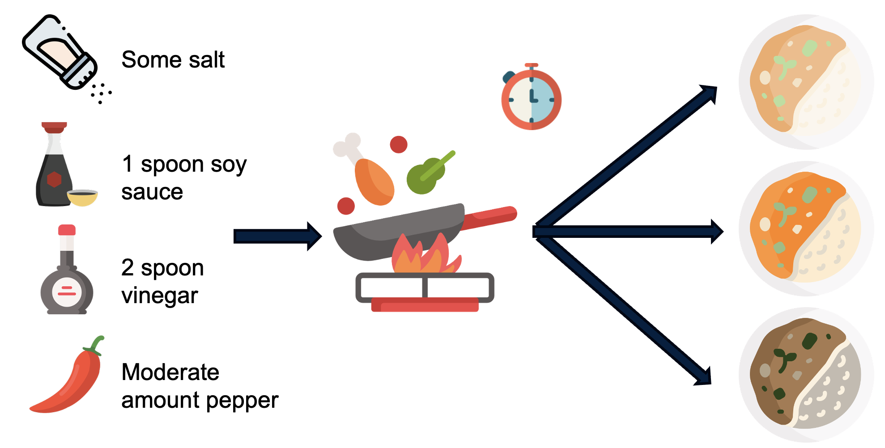
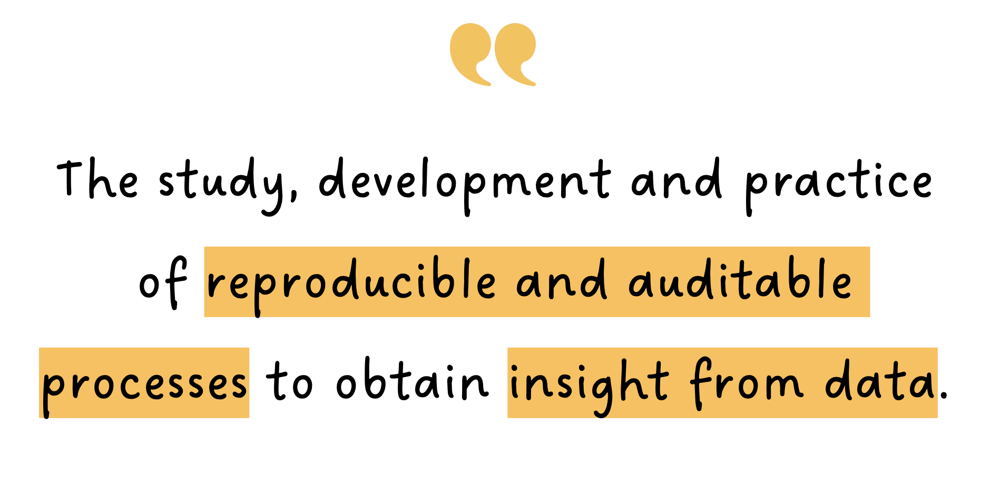
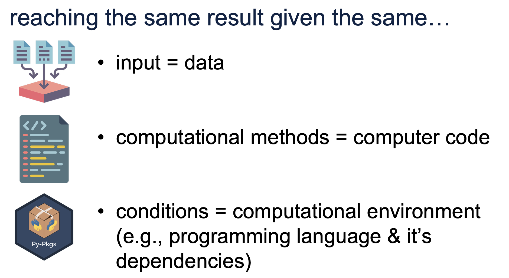
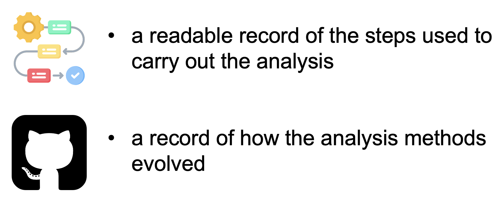

# Welcome Back! 🎉 {background-image="images/reading_background.png" background-size="cover" background-position="bottom right"}

Hope you had a nice readings week!

:::: {.columns style="margin-top: -50px; padding-top: -10;"}

::: {.column width="50%"}
::: {style="text-align: center; margin-top: 60px;"}
Join iClicker: <https://join.iclicker.com/VAVK>

{width="70%" style="margin-top: 0px; margin-bottom: 0px;"}
:::
:::

::::

::: footer
Image generated by OpenAI GPT-6
:::

## Meet your instructor

::::: columns
::: {.column width="38%"}
{width=370px fig-align="center"}
:::

::: {.column width="62%" style="font-size: 0.85em;"}
-   [Sky (Kehan) Sheng, PhD](https://www.skysheng.io/)
-   My research bridges AI fairness, animal welfare and data science.
-   Contact
    -   📧: skysheng\@cs.ubc.ca
    -   💼: ICCS Building Room 187
    -   💬: `@Sky` on Slack
    -   🕰️ [MDS calendar](https://ubc-mds.github.io/calendar/) for office hours.
:::
:::::

::: {.notes}
introduce TA parsa
:::

## Where do I find things? {style="font-size: 0.8em;"}

::: {.fragment}
- **Links you need!** bookmark on Slack channel `#522_dsci-workflows`
:::

::: {.fragment}
- **Deadlines** should be found in [MDS calendar](https://ubc-mds.github.io/calendar/) (Gradescope is struggling with daylight saving time change issues with US VS Canada)
:::

::: {.fragment}
| What | Where |
|---|---|
| Syllabus, schedule, assignments | [Course website](https://ubc-mds.github.io/DSCI_522_dsci-workflows_students/) |
| Cheatsheet | [Cheatsheet](https://ubc-mds.github.io/DSCI_522_dsci-workflows_students/cheatsheets/command_line.html) |
| Lecture slides | [Slides website](https://skysheng7.github.io/DSCI_522-001-slides/) |
| Course notes | [Textbook](https://ubc-dsci.github.io/reproducible-and-trustworthy-workflows-for-data-science) |
| Questions | Slack channel [`#522_dsci-workflows`](https://ubc-mds.slack.com/messages/522_dsci-workflows) |
| Lectures, labs, office hours | [MDS calendar](https://ubc-mds.github.io/calendar/) |
| Submitting your work | [Gradescope](https://www.gradescope.ca/courses/42925) |
| Find your teammates and group | [Block 3 Lab Section](https://github.ubc.ca/mds-2026-27/lab-sections/blob/main/lab_section_block3_2026-27.csv) |
:::

::: {.notes}
Open the course website and scroll through it once, so students see where the syllabus, the schedule and the assignment pages are.

Each lecture has required readings in the schedule table.
:::

## This is a project course

::::: columns
::: {.column .incremental width="48%" style="font-size: 0.8em;"}
-   Lab attendance is **mandatory**, and we take attendance at the start!
-   Each week:
    -   an **individual assignment** to practise the new skill **yourself**
    -   a **milestone** where your group applies the new skills to the group project
-   Submit links on [Gradescope](https://www.gradescope.ca/courses/42925). We grade what is on GitHub.
:::

::: {.column width="52%" style="font-size: 0.75em;"}
::: {.fragment}
| Assessment | Weight |
|---|---|
| 4 individual assignments | 2% each |
| Milestones 1, 2, 3 | 20% each |
| Milestone 4 | 24% |
| Peer review | 5% |
| Team work reflection | 3% |
| Team work multiplier | final grade × multiplier |
:::
:::
:::::

## iClicker: Do we still need to learn reproducible workflows in the AI era? {style="font-size: 0.7em;"}

::::: columns
::: {.column width="50%" style="text-align: center; font-size: 0.9em;"}
{width=250px height=180px fig-align="center" style="margin-bottom: -0.8em;"}

\(A) YES! AI can't replace my brain!
:::

::: {.column width="50%" style="text-align: center; font-size: 0.9em;"}
{width=250px height=180px fig-align="center" style="margin-bottom: -0.8em;"}

\(B) NO! My bestie ChatGPT can set up my environment and write my Dockerfile!
:::
:::::

::::: columns
::: {.column width="50%" style="text-align: center; font-size: 0.9em;"}
{width=250px height=180px fig-align="center" style="margin-bottom: -0.8em;"}

\(C) Strategically indecisive: "It depends..."
:::

::: {.column width="50%" style="text-align: center; font-size: 0.9em;"}
{width=250px height=180px fig-align="center" style="margin-bottom: -0.8em;"}

\(D) It works on my computer, so it's reproducible, right?
:::
:::::

::: footer
GIFs from [GIPHY](https://giphy.com)
:::

## Would you trust this judge?

{height=490px fig-align="center" style="margin-bottom: 0px;"}

::: {.fragment style="text-align: center;"}
Same case, same evidence, but we got **different answer.**
:::

::: footer
Image generated by OpenAI gpt-image-2.5-sunburst
:::

## Which hospital is right?

{height=490px fig-align="center" style="margin-bottom: 0px;"}

::: {.fragment style="text-align: center;"}
Same record, same software, only **different computer!**
:::

::: footer
Image generated by OpenAI gpt-image-2.5-sunburst
:::

## 👩‍🍳 Who loves cooking?

{style="margin-bottom: 0px;"}

## 💥 Consequences of Untested Systems

Untested system for radiation therapy: Terac-25

{style="margin-bottom: 0px;"}

::: footer
Source: [Cleveland Clinic](https://en.wikipedia.org/wiki/Therac-25)
:::

::: {.notes}
The Therac-25 was a radiation therapy machine controlled by software, built by Atomic Energy of Canada Limited and used in hospitals in Canada and the United States.

Between 1985 and 1987 it gave at least six patients a massive overdose of radiation, in some cases around 100 times the intended dose. Some patients were badly injured and at least three died.

What went wrong:

- Older models had hardware safety locks that physically stopped an overdose. The Therac-25 removed them and trusted the software to do that job.
- The software was reused from the older models, written by one programmer, and never properly tested or reviewed by anyone independent.
- It had a bug that only showed up when an experienced operator typed quickly and corrected a setting within a few seconds. Slow testers never triggered it.
- When it happened, the screen only said "MALFUNCTION 54". Nobody knew what that meant, the machine showed such messages often, and operators could press one key to continue.
- The manufacturer first insisted an overdose was impossible, so the accidents kept happening.

Ask: the code ran, and it worked most of the time. Was that enough?

Takeaway: code that runs is not the same as code we can trust. This is why we write tests in this course.
:::

## 👩‍💻 Data Science is…

{style="display: block; margin-left: auto; margin-right: auto; margin-bottom: 0px;"}

## 👩‍💻 Data Science is…

{style="display: block; margin-left: auto; margin-right: auto; margin-bottom: 0px;"}

::: footer
Source: [Timbers, T. A., Ostblom, J., D'Andrea, F., Lourenzutti, R., & Chen, D. Reproducible and Trustworthy Workflows for Data Science
](https://ubc-dsci.github.io/reproducible-and-trustworthy-workflows-for-data-science/lectures/data-science-workflows.html)
:::

## 💡 Reproducible analysis: 

{style="display: block; margin-left: auto; margin-right: auto; margin-bottom: 80px;"}

::: footer
Source: [Timbers, T. A., Ostblom, J., D'Andrea, F., Lourenzutti, R., & Chen, D. Reproducible and Trustworthy Workflows for Data Science
](https://ubc-dsci.github.io/reproducible-and-trustworthy-workflows-for-data-science/lectures/data-science-workflows.html)
:::

## 🧐 Auditable/transparent analysis: 

{style="display: block; margin-left: auto; margin-right: auto; margin-bottom: 0px;"}

::: footer
Source: [Timbers, T. A., Ostblom, J., D'Andrea, F., Lourenzutti, R., & Chen, D. Reproducible and Trustworthy Workflows for Data Science
](https://ubc-dsci.github.io/reproducible-and-trustworthy-workflows-for-data-science/lectures/data-science-workflows.html)
:::

## 🔥 Roast my repo!

::: {style="font-size: 1.5em; text-align: left; margin: 0 auto; display: block;"}
<https://shorturl.at/QSv7M>
:::

:::: {.columns style="margin-top: -50px; padding-top: -10;"}

::: {.column width="50%"}
::: {style="display: flex; justify-content: bottom; align-items: flex-start; margin-top: 0; padding-top: 0;"}
{style="margin-bottom: 0px;"}
:::
:::

::: {.column width="50%"}
::: {style="display: flex; justify-content: bottom; align-items: flex-start; margin-top: 0; padding-top: 0;"}
{style="margin-bottom: 0px;"}
:::
:::

::::

##

:::: {.columns}

::: {.column width="50%"}
::: {style="background-color: #f9e6a3; padding: 30px; border-radius: 20px; position: relative;"}
::: {style="position: absolute; top: -30px; left: 50%; transform: translateX(-50%);"}
😟
:::

::: {style="font-size: 0.7em;"}
- It does not run anymore! 😱
- It was saved only on my computer, no version control!
- Different code chunks run on different computers with different operating systems
- Different code chunks take in different data sources (stored in various locations on my computer)
- No modular scripts/functions, hard to reuse
- Not tested at all
- Heavy cognitive load for new user (my poor biology colleagues)
- The file name is long & not intuitive
:::
:::
:::

::: {.column width="50%"}
::: {style="background-color: #b8d98f; padding: 30px; border-radius: 20px; position: relative;"}
::: {style="position: absolute; top: -30px; left: 50%; transform: translateX(-50%);"}
😊
:::

- Well documented
- Organized into different "chapters"
- "It run on my computer at that time"
:::
:::

::::

::: {.notes}

in 2027: please cut this short, we need to either cut break time from 10 minutes to 5 minutes, or cut another 5 minutes from this part, to save 10 minutes for the second part of IA 1 walk through.
:::

## 💭 Share your story {style="font-size: 0.8em;"}

* Think and write down a non-reproducible, or non-auditable, workflow you have used before at work, on a personal project, or in course work, that negatively impacted your work somehow (make sure to include this in the story).

* **Share your story in the [Google Doc](https://docs.google.com/document/d/1Eo5zS1CdFjaXv8tfohn6Nry3YMaCrnPnel1Kjyki7Q0/edit?usp=sharing)** 

* Activity in [textbook](https://ubc-dsci.github.io/reproducible-and-trustworthy-workflows-for-data-science/lectures/data-science-workflows.html)

{width="85%" style="display: block; margin: 0px auto;"}

## What is version control?

* [An example of collaborative version control: `moo4feed` R package development](https://github.com/skysheng7/moo4feed.git)

* [Going back in time with Git](https://ubc-dsci.github.io/reproducible-and-trustworthy-workflows-for-data-science/lectures/git-history.html)

* [Git branches](https://ubc-dsci.github.io/reproducible-and-trustworthy-workflows-for-data-science/lectures/git-branches.html)

::: {.notes}

1.  landing page, functions, tutorials etc
2.  Travel back in time: `commits` --> time to "April 2025" --> `< >`
3.  **issues** for communication --> "labels", "assignees", "@someone"
4.  **project** for organizing issues 
5.  **branches** for developing new features --> meaningful name (what are you doing), not your own name
6.  **PR** show number 83 --> communication, human review, cursor bugbot review double check 
7.  show the branch history and merge history on cursor for `moo4feed`
8.  `.gitignore` file
:::

{width=120 fig-align="center"}

# Demo: version control and merge conflicts {style="font-size: 0.8em;"}

[Individual assignment 1](https://ubc-mds.github.io/DSCI_522_dsci-workflows_students/assignments/individual1.html)

::: {.notes}
make those changes, then locally

* **Part 1:**

- `git log` --> use arrow keys to navigate, `q` to quit, use `/` and a word to search, then use `n` to jump to the next match 

- `git status` to check the changes

1. `git add .`

2. `git commit -m "commit locally"`

3. `git push` --> error 

4. `git pull`

5. `git config pull.rebase false` --> solve merge conflict manually 

6. `git add .`

7. `git commit -m "solve merge conflict manually"`

8. `git push` --> success!

*Optional: show going back to history with :*

1. `git log` --> find the first commit

2. `git checkout <commit hash>` to go back in time

3. `git switch main` to go back to the real head of the main branch

* **Part 2:** 

1. `git switch -c "opinions"` or `git checkout -b "opinions"`  to create a new branch locally
2. `git branch -v` to see all branches, v is verbose mode
3. `git branch -a` to see all branches, a is all mode
4.  after you make all the changes, `git add .` and `git commit -m "make all the changes"`
5. `git push` --> error 
6. `git push -u origin opinions` to set upstream to the remote branch 
7. `git branch -a` to check all branches, or just use GitHub to check 
8. `git switch main` --> **what we added in the other branch is NOT in the main branch!**
9. create PR --> show **code review** use **"+"** to add comments
10. `git pull` locally
11. `git branch -d opinions` but only deleted local branch
12. `git push origin -d opinions` will remove the remote branch or just use the **trash can icon** on GitHub
:::
