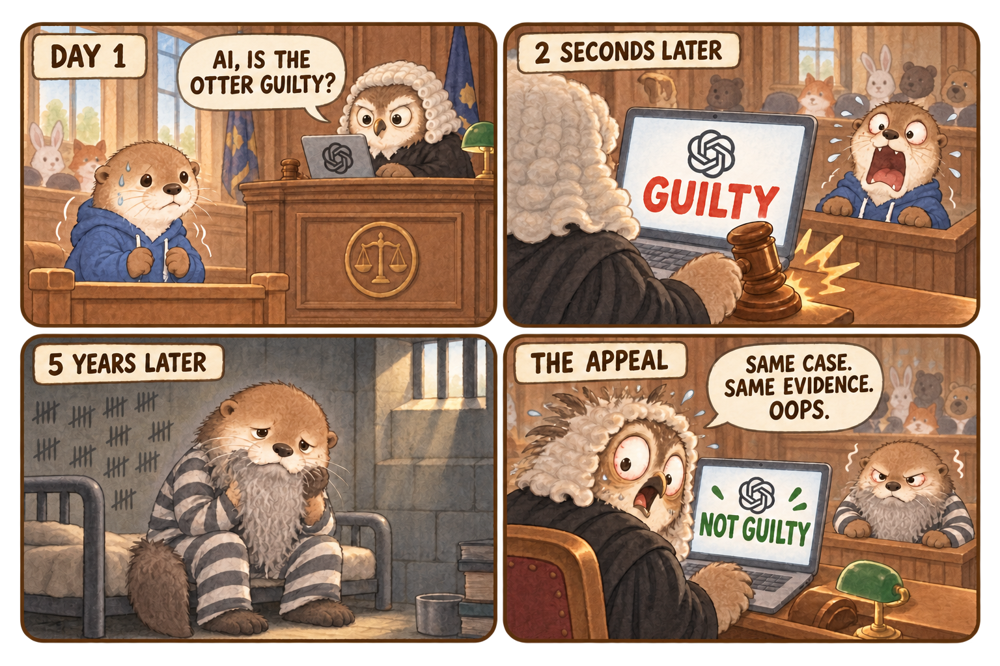
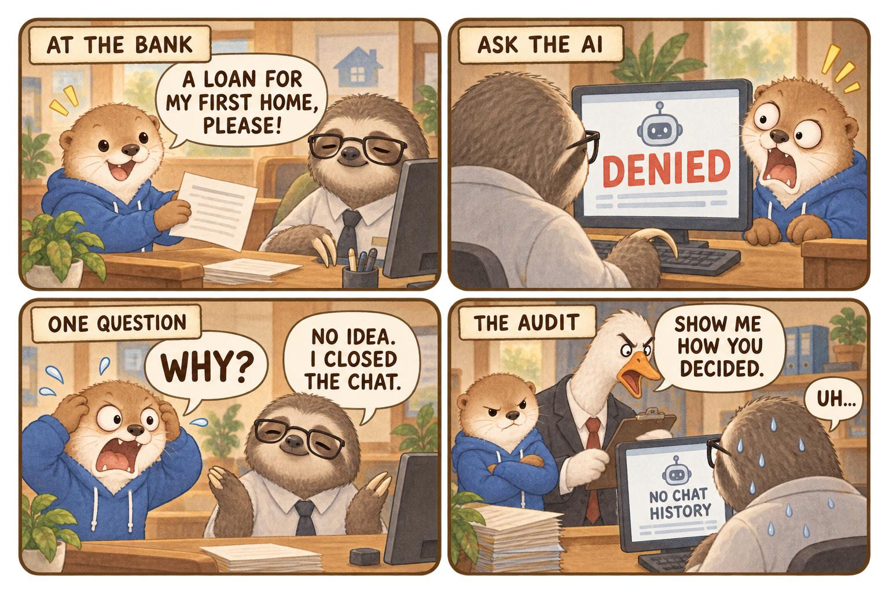
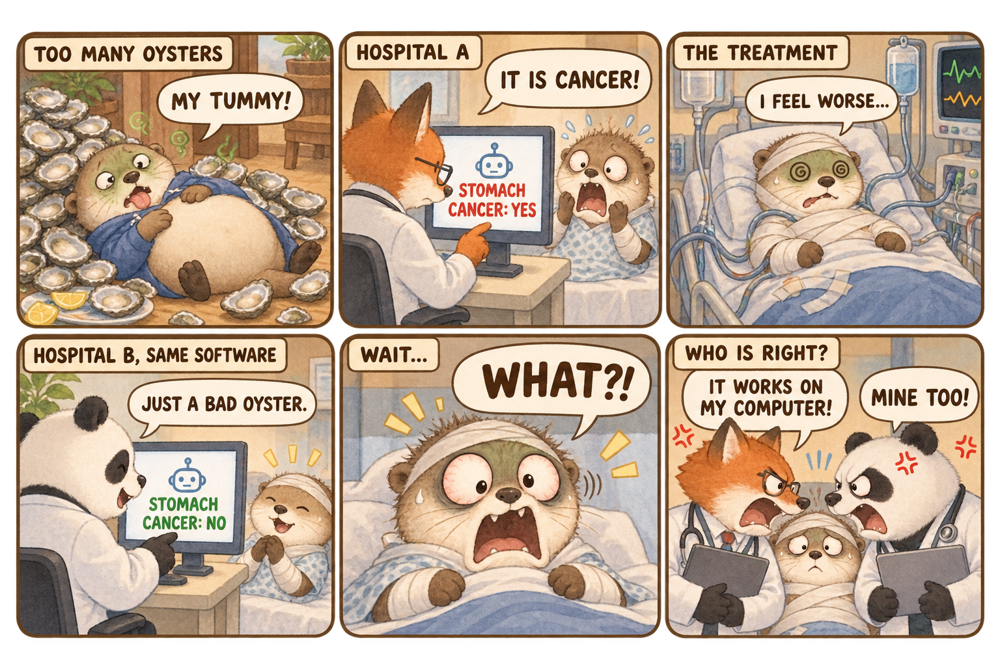
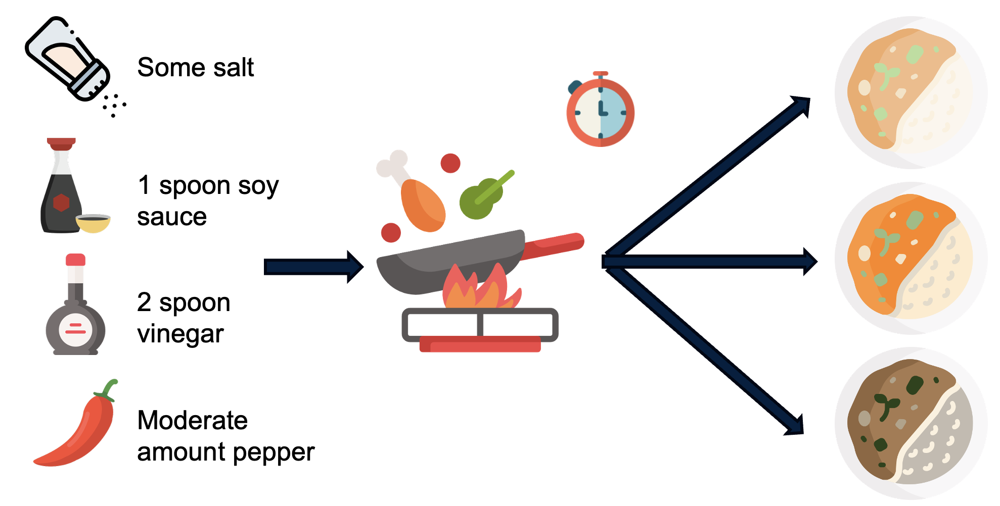
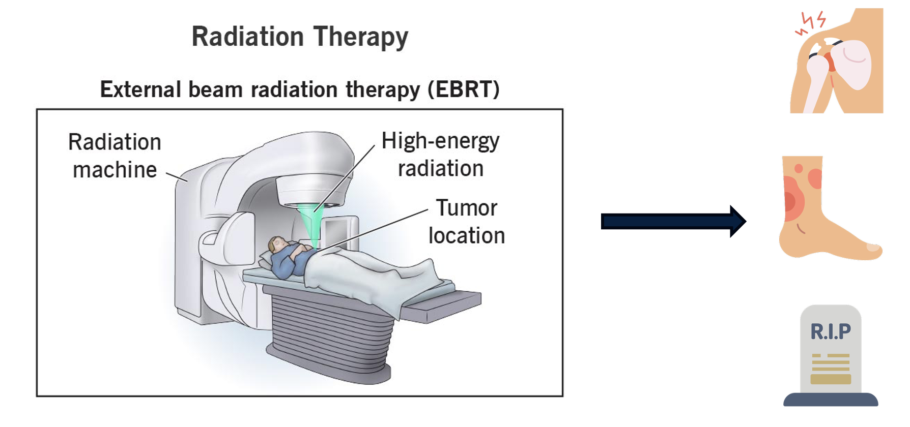
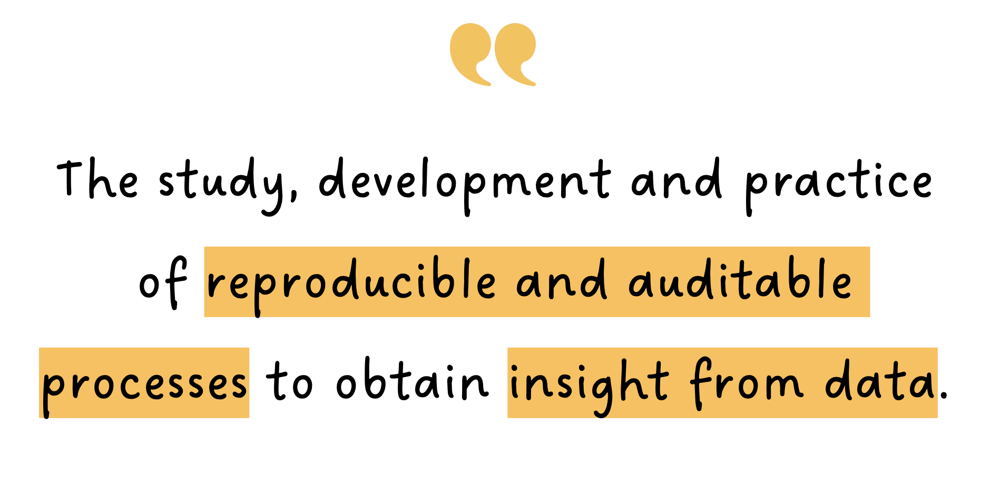
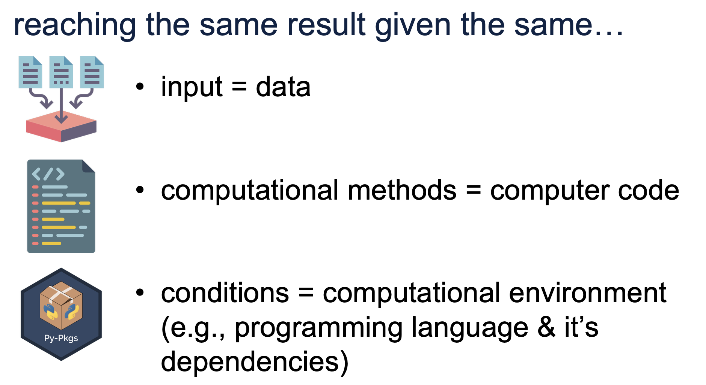
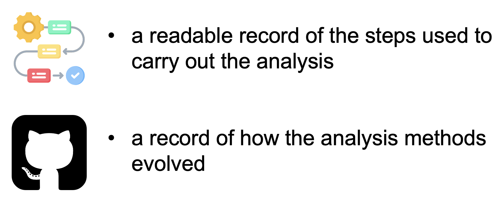
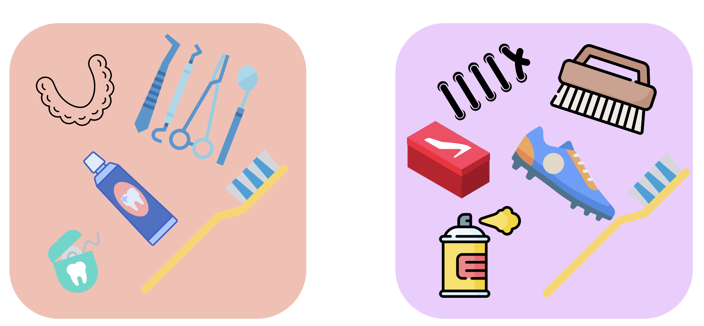

# Welcome Back! 🎉 {background-image="images/reading_background.png" background-size="cover" background-position="bottom right"}

Hope you had a nice readings week!

:::: {.columns style="margin-top: -50px; padding-top: -10;"}

::: {.column width="50%"}
::: {style="text-align: center; margin-top: 60px;"}
Join iClicker: <https://join.iclicker.com/VAVK>

{width="70%" style="margin-top: 0px; margin-bottom: 0px;"}
:::
:::

::::

::: footer
Image generated by OpenAI GPT-6
:::

## Meet your instructor

::::: columns
::: {.column width="38%"}
{width=370px fig-align="center"}
:::

::: {.column width="62%" style="font-size: 0.85em;"}
-   [Sky (Kehan) Sheng, PhD](https://www.skysheng.io/)
-   My research bridges AI fairness, animal welfare and data science.
-   Contact
    -   📧: skysheng\@cs.ubc.ca
    -   💼: ICCS Building Room 187
    -   💬: `@Sky` on Slack
    -   🕰️ [MDS calendar](https://ubc-mds.github.io/calendar/) for office hours.
:::
:::::

## Where do I find things? {style="font-size: 0.8em;"}

**Links you need!** bookmark on Slack channel `#522_dsci-workflows`
The **deadline** is the most accurate based on [MDS calendar](https://ubc-mds.github.io/calendar/) (Gradescope is struggling with daylight saving time change issues with US VS Canada)

| What | Where |
|---|---|
| Syllabus, schedule, assignments | [Course website](https://ubc-mds.github.io/DSCI_522_dsci-workflows_students/) |
| Lecture slides | [Slides website](https://skysheng7.github.io/DSCI_522-001-slides/) |
| Course notes | [Textbook](https://ubc-dsci.github.io/reproducible-and-trustworthy-workflows-for-data-science) |
| Questions | Slack channel [`#522_dsci-workflows`](https://ubc-mds.slack.com/messages/522_dsci-workflows) |
| Lectures, labs, office hours | [MDS calendar](https://ubc-mds.github.io/calendar/) |
| Submitting your work | [Gradescope](https://www.gradescope.ca/courses/42925) |
| Find your teammates and group | [Block 3 Lab Section](https://github.ubc.ca/mds-2026-27/lab-sections/blob/main/lab_section_block3_2026-27.csv) |

::: {.notes}
Open the course website and scroll through it once, so students see where the syllabus, the schedule and the assignment pages are.

Each lecture has required readings in the schedule table.
:::

## This is a project course

::::: columns
::: {.column width="48%" style="font-size: 0.85em;"}
-   One data analysis project, built over 4 weeks
-   Groups of 3 (or 4), randomly assigned
-   Each week:
    -   an **individual assignment** to practise the new skill **yourself**
    -   a **milestone** where your group applies the new skills to the group project
-   Submit links on [Gradescope](https://www.gradescope.ca/courses/42925). We grade what is on GitHub.
:::

::: {.column width="52%" style="font-size: 0.75em;"}
| Assessment | Weight |
|---|---|
| 4 individual assignments | 2% each |
| Milestones 1, 2, 3 | 20% each |
| Milestone 4 | 24% |
| Peer review | 5% |
| Team work reflection | 3% |
| Team work multiplier | final grade × multiplier |
:::
:::::

## What happens in the lab?

::: {style="font-size: 0.9em;"}
-   ⚠️ Lab attendance is **mandatory**, and we take attendance at the start.
    -   Cannot attend? Please send the academic concession form ahead of time.
    -   Missing more than 20% of lab hours without a concession: the course grade is capped at 50%, an "F".
-   Weekly oral check-in with the teaching team
    -   About 5 minutes: walk us through a part of your project.
    -   **Not graded.** Think of it as practice for a technical interview.
:::

## Can I use AI in this course?

::: {.fragment}
Yes! But you will show how you used it.
:::

::: {.incremental style="font-size: 0.85em;"}
-   **Disclose** AI use for every deliverable, even when you used none.
    -   Milestones: an `AI_USAGE.md` file in your project repository
-   You are responsible for everything you submit: do not merge code you cannot explain.
-   A human opens, reviews and merges every pull request.
-   Issues, reviews and reflections are in your own words.
-   Do not share private information with AI tools.
:::

## iClicker: Do we still need to learn reproducible workflows in the AI era? {style="font-size: 0.7em;"}

::::: columns
::: {.column width="50%" style="text-align: center; font-size: 0.9em;"}
{width=250px height=180px fig-align="center" style="margin-bottom: -0.8em;"}

\(A) YES! AI can't replace my brain!
:::

::: {.column width="50%" style="text-align: center; font-size: 0.9em;"}
{width=250px height=180px fig-align="center" style="margin-bottom: -0.8em;"}

\(B) NO! My bestie ChatGPT can set up my environment and write my Dockerfile!
:::
:::::

::::: columns
::: {.column width="50%" style="text-align: center; font-size: 0.9em;"}
{width=250px height=180px fig-align="center" style="margin-bottom: -0.8em;"}

\(C) Strategically indecisive: "It depends..."
:::

::: {.column width="50%" style="text-align: center; font-size: 0.9em;"}
{width=250px height=180px fig-align="center" style="margin-bottom: -0.8em;"}

\(D) It works on my computer, so it's reproducible, right?
:::
:::::

::: footer
GIFs from [GIPHY](https://giphy.com)
:::

::: {.notes}
*Hint: There is no correct answer for this question.*

Show of hands for each option.

AI can write code fast, but someone still has to check it. An analysis that AI helped write is only trustworthy if others can rerun it, see every change in version control, and trust that it was tested. That is what this course is about.
:::

## Would you trust this judge?

{height=490px fig-align="center" style="margin-bottom: 0px;"}

::: {.fragment style="text-align: center;"}
Same case. Same evidence. **Different answer.**
:::

::: footer
Image generated by OpenAI gpt-image-2.5-sunburst
:::

::: {.notes}
Give students a few seconds to read the comic, then ask: what went wrong here?

The judge asked the same question about the same evidence twice and got two different answers. Nothing about the case changed, only the day the question was asked.

Ask: has anyone asked ChatGPT the same question twice and got two different answers? That is fine for a dinner recipe. It is not fine when the answer decides five years of someone's life.

The problem is not that the judge used a computer. The problem is that nobody can rerun the analysis and get the same result.
:::

## Why was the loan denied?

{height=490px fig-align="center" style="margin-bottom: 0px;"}

::: {.fragment style="text-align: center;"}
A decision was made. **Nobody can show how.**
:::

::: footer
Image generated by OpenAI gpt-image-2.5-sunburst
:::

::: {.notes}
This time the answer might even be correct. We cannot tell, and that is the problem.

Ask: what would the bank officer need in order to answer the auditor?

Let students suggest things: the data that went in, the code or the prompt that was used, the version of the model, a record of who changed what and when. Everything they list is something we will learn to keep in this course.

A chat window that was closed leaves no record. The otter cannot appeal a decision that nobody can trace.
:::

## Which hospital is right?

{height=490px fig-align="center" style="margin-bottom: 0px;"}

::: {.fragment style="text-align: center;"}
Same record. Same software. **Different computer.**
:::

::: footer
Image generated by OpenAI gpt-image-2.5-sunburst
:::

::: {.notes}
Both doctors are telling the truth: the analysis really does work on each of their computers.

Ask: the otter's record is the same and both doctors used the same software, so what could be different?

Possible answers: a different version of the software, a different version of a package it depends on, a different operating system, a different random seed.

The cost here is real: the otter went through a treatment it never needed.

This is option (D) from the iClicker question. "It works on my computer" is not the same as reproducible. Come back to this story later in the lecture when we reach virtual environments.

Link the three stories: a result we cannot repeat, a decision we cannot trace, and an analysis that only works on one computer. These three problems are what this course teaches us to fix.
:::

## 👩‍🍳 Who loves cooking?

{style="margin-bottom: 0px;"}

## 💥 Consequences of Untested Systems

Untested system for radiation therapy: Terac-25

{style="margin-bottom: 0px;"}

::: footer
Source: [Cleveland Clinic](https://en.wikipedia.org/wiki/Therac-25)
:::

::: {.notes}
The Therac-25 was a radiation therapy machine controlled by software, built by Atomic Energy of Canada Limited and used in hospitals in Canada and the United States.

Between 1985 and 1987 it gave at least six patients a massive overdose of radiation, in some cases around 100 times the intended dose. Some patients were badly injured and at least three died.

What went wrong:

- Older models had hardware safety locks that physically stopped an overdose. The Therac-25 removed them and trusted the software to do that job.
- The software was reused from the older models, written by one programmer, and never properly tested or reviewed by anyone independent.
- It had a bug that only showed up when an experienced operator typed quickly and corrected a setting within a few seconds. Slow testers never triggered it.
- When it happened, the screen only said "MALFUNCTION 54". Nobody knew what that meant, the machine showed such messages often, and operators could press one key to continue.
- The manufacturer first insisted an overdose was impossible, so the accidents kept happening.

Ask: the code ran, and it worked most of the time. Was that enough?

Takeaway: code that runs is not the same as code we can trust. This is why we write tests in this course.
:::

## 👩‍💻 Data Science is…

{style="display: block; margin-left: auto; margin-right: auto; margin-bottom: 0px;"}

## 👩‍💻 Data Science is…

{style="display: block; margin-left: auto; margin-right: auto; margin-bottom: 0px;"}

::: footer
Source: [Timbers, T. A., Ostblom, J., D'Andrea, F., Lourenzutti, R., & Chen, D. Reproducible and Trustworthy Workflows for Data Science
](https://ubc-dsci.github.io/reproducible-and-trustworthy-workflows-for-data-science/lectures/010-intro-to-ds-workflows.html)
:::

## 💡 Reproducible analysis: 

{style="display: block; margin-left: auto; margin-right: auto; margin-bottom: 80px;"}

::: footer
Source: [Timbers, T. A., Ostblom, J., D'Andrea, F., Lourenzutti, R., & Chen, D. Reproducible and Trustworthy Workflows for Data Science
](https://ubc-dsci.github.io/reproducible-and-trustworthy-workflows-for-data-science/lectures/010-intro-to-ds-workflows.html)
:::

## 🧐 Auditable/transparent analysis: 

{style="display: block; margin-left: auto; margin-right: auto; margin-bottom: 0px;"}

::: footer
Source: [Timbers, T. A., Ostblom, J., D'Andrea, F., Lourenzutti, R., & Chen, D. Reproducible and Trustworthy Workflows for Data Science
](https://ubc-dsci.github.io/reproducible-and-trustworthy-workflows-for-data-science/lectures/010-intro-to-ds-workflows.html)
:::

## 🔥 Roast my repo!

::: {style="font-size: 1.5em; text-align: left; margin: 0 auto; display: block;"}
<https://shorturl.at/QSv7M>
:::

:::: {.columns style="margin-top: -50px; padding-top: -10;"}

::: {.column width="50%"}
::: {style="display: flex; justify-content: bottom; align-items: flex-start; margin-top: 0; padding-top: 0;"}
{style="margin-bottom: 0px;"}
:::
:::

::: {.column width="50%"}
::: {style="display: flex; justify-content: bottom; align-items: flex-start; margin-top: 0; padding-top: 0;"}
{style="margin-bottom: 0px;"}
:::
:::

::::

---

:::: {.columns}

::: {.column width="50%"}
::: {style="background-color: #f9e6a3; padding: 30px; border-radius: 20px; position: relative;"}
::: {style="position: absolute; top: -30px; left: 50%; transform: translateX(-50%);"}
😟
:::

::: {style="font-size: 0.7em;"}
- It does not run anymore! 😱
- It was saved only on my computer, no version control!
- Different code chunks run on different computers with different operating systems
- Different code chunks take in different data sources (stored in various locations on my computer)
- No modular scripts/functions, hard to reuse
- Not tested at all
- Heavy cognitive load for new user (my poor biology colleagues)
- The file name is long & not intuitive
:::
:::
:::

::: {.column width="50%"}
::: {style="background-color: #b8d98f; padding: 30px; border-radius: 20px; position: relative;"}
::: {style="position: absolute; top: -30px; left: 50%; transform: translateX(-50%);"}
😊
:::

- Well documented
- Organized into different "chapters"
- "It run on my computer at that time"
:::
:::

::::

## what is version control?

* [Version control (for transparency and collaboration)](https://ubc-dsci.github.io/reproducible-and-trustworthy-workflows-for-data-science/lectures/050-version-control-2.html)

{width=120 fig-align="center"}

## 💭 Share your story

* Think and write down a non-reproducible, or non-auditable, workflow you have used before at work, on a personal project, or in course work, that negatively impacted your work somehow (make sure to include this in the story).

* **Share your story in the [Google Doc](https://docs.google.com/document/d/1VzhEGG2NF6d-SSoslFrSNqe1cHDYa1Mc2t8N5XnCkPU/edit?usp=sharing)** 

* Activity in [textbook](https://ubc-dsci.github.io/reproducible-and-trustworthy-workflows-for-data-science/lectures/010-intro-to-ds-workflows.html)

## ✨ Clean, well documented and distributable code

| **Practice** | **Benefit** |
|--------------|-------------|
| Well-documented | Easily understandable |
| Modular code | Easy to reuse |
| Well-tested code | Reliable |
| Portable across machines | Easily accessible |

::: footer
Source: Ma, E. J. (2024, October 25). The Human Dimension to Clean, Distributable, and Documented Data Science Code.
:::

## Why do we need virtual environment?

{style="display: block; margin-left: auto; margin-right: auto; margin-bottom: 0px;"}

## 🦷 Toothbrushes for different “projects”

{style="display: block; margin-left: auto; margin-right: auto; margin-bottom: 0px;"}

## Which toothbrush should I use for my oral hygiene??

{style="display: block; margin-left: auto; margin-right: auto; margin-bottom: 0px;"}

## 📦 Organize tools into separate boxes

{style="display: block; margin-left: auto; margin-right: auto; margin-bottom: 0px;"}

## Organize programming language & packages into separate virtual environments

{style="display: block; margin-left: auto; margin-right: auto; margin-bottom: 0px;"}

## 🔧 Different virtual environment management tools

:::: {.columns}

::: {.column width="50%"}
### For R:

- uv
- packrat
- renv
- conda
:::

::: {.column width="50%"}
### For Python:

- uv
- venv
- virtualenv
- conda
- mamba
- poetry
- pipenv
- ...
:::

::::

