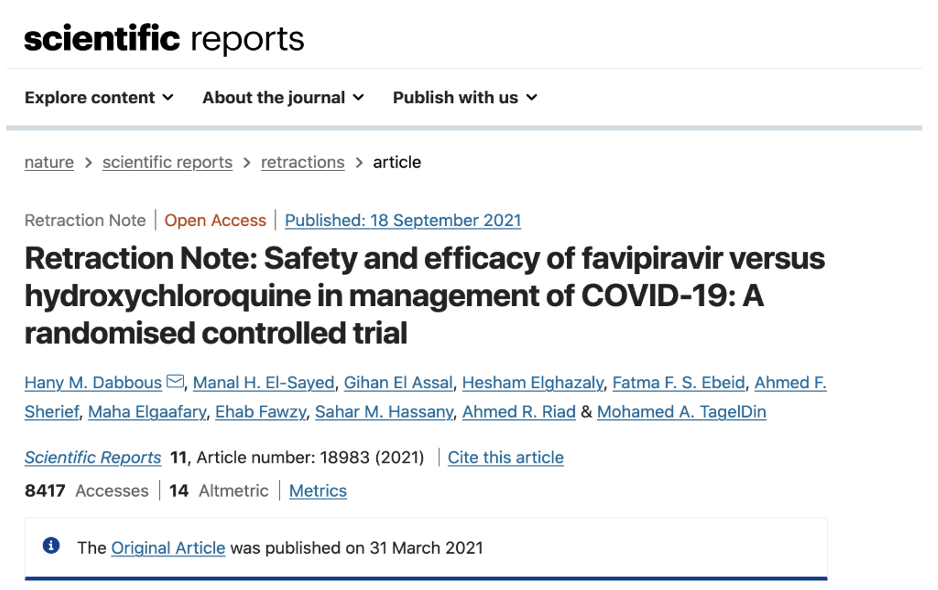
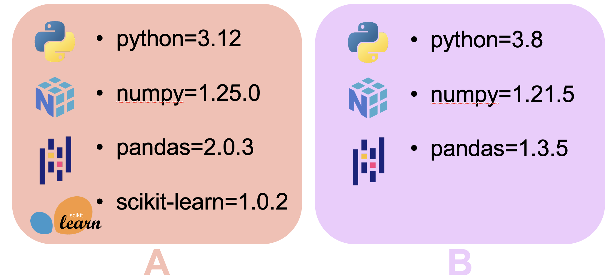

# Welcome Back! 🎉

Hope you had a nice readings week!

:::: {.columns style="margin-top: -50px; padding-top: -10;"}

::: {.column width="50%"}
::: {style="text-align: center; margin-top: 60px;"}
Join iClicker: <https://join.iclicker.com/VAVK>

{width="60%" style="margin-top: 0px; margin-bottom: 0px;"}
:::
:::

::: {.column width="50%"}
::: {style="display: flex; justify-content: bottom; align-items: flex-start; margin-top: 0; padding-top: 0;"}
{style="margin-bottom: 0px;"}

Image generated by OpenAI GPT-5
 
:::
:::

::::

## 👩‍🍳 Who loves cooking?

{style="margin-bottom: 0px;"}

## 💥 Consequences of Untested Systems

Untested system for radiation therapy: Terac-25

{style="margin-bottom: 0px;"}

::: {style="position: absolute; bottom: 10px; right: 20px; font-size: 0.5em;"}
Source: [Cleveland Clinic](https://en.wikipedia.org/wiki/Therac-25)
:::

## 💥 Consequences of Untrustworthy and non-reproducible Paper

{style="display: block; margin-left: auto; margin-right: auto; margin-bottom: 80px;"}

::: {style="position: absolute; bottom: 0px; right: 0px; font-size: 0.5em;"}
Source: [Timbers, T. A., Ostblom, J., D'Andrea, F., Lourenzutti, R., & Chen, D. Reproducible and Trustworthy Workflows for Data Science
](https://ubc-dsci.github.io/reproducible-and-trustworthy-workflows-for-data-science/lectures/010-intro-to-ds-workflows.html)
:::

## 👩‍💻 Data Science is…

{style="display: block; margin-left: auto; margin-right: auto; margin-bottom: 0px;"}

## 👩‍💻 Data Science is…

{style="display: block; margin-left: auto; margin-right: auto; margin-bottom: 0px;"}

::: {style="position: absolute; bottom: 0px; right: 0px; font-size: 0.5em;"}
Source: [Timbers, T. A., Ostblom, J., D'Andrea, F., Lourenzutti, R., & Chen, D. Reproducible and Trustworthy Workflows for Data Science
](https://ubc-dsci.github.io/reproducible-and-trustworthy-workflows-for-data-science/lectures/010-intro-to-ds-workflows.html)
:::

## 💡 Reproducible analysis: 

{style="display: block; margin-left: auto; margin-right: auto; margin-bottom: 80px;"}

::: {style="position: absolute; bottom: 0px; right: 0px; font-size: 0.5em;"}
Source: [Timbers, T. A., Ostblom, J., D'Andrea, F., Lourenzutti, R., & Chen, D. Reproducible and Trustworthy Workflows for Data Science
](https://ubc-dsci.github.io/reproducible-and-trustworthy-workflows-for-data-science/lectures/010-intro-to-ds-workflows.html)
:::

## 🧐 Auditable/transparent analysis: 

{style="display: block; margin-left: auto; margin-right: auto; margin-bottom: 0px;"}

::: {style="position: absolute; bottom: 0px; right: 0px; font-size: 0.5em;"}
Source: [Timbers, T. A., Ostblom, J., D'Andrea, F., Lourenzutti, R., & Chen, D. Reproducible and Trustworthy Workflows for Data Science
](https://ubc-dsci.github.io/reproducible-and-trustworthy-workflows-for-data-science/lectures/010-intro-to-ds-workflows.html)
:::

## 🔥 Roast my repo!

::: {style="font-size: 1.5em; text-align: left; margin: 0 auto; display: block;"}
<https://shorturl.at/QSv7M>
:::

:::: {.columns style="margin-top: -50px; padding-top: -10;"}

::: {.column width="50%"}
::: {style="display: flex; justify-content: bottom; align-items: flex-start; margin-top: 0; padding-top: 0;"}
{style="margin-bottom: 0px;"}
:::
:::

::: {.column width="50%"}
::: {style="display: flex; justify-content: bottom; align-items: flex-start; margin-top: 0; padding-top: 0;"}
{style="margin-bottom: 0px;"}
:::
:::

::::

---

:::: {.columns}

::: {.column width="50%"}
::: {style="background-color: #f9e6a3; padding: 30px; border-radius: 20px; position: relative;"}
::: {style="position: absolute; top: -30px; left: 50%; transform: translateX(-50%);"}
😟
:::

::: {style="font-size: 0.7em;"}
- It does not run anymore! 😱
- It was saved only on my computer, no version control!
- Different code chunks run on different computers with different operating systems
- Different code chunks take in different data sources (stored in various locations on my computer)
- No modular scripts/functions, hard to reuse
- Not tested at all
- Heavy cognitive load for new user (my poor biology colleagues)
- The file name is long & not intuitive
:::
:::
:::

::: {.column width="50%"}
::: {style="background-color: #b8d98f; padding: 30px; border-radius: 20px; position: relative;"}
::: {style="position: absolute; top: -30px; left: 50%; transform: translateX(-50%);"}
😊
:::

- Well documented
- Organized into different "chapters"
- "It run on my computer at that time"
:::
:::

::::

## what is version control?

* [Version control (for transparency and collaboration)](https://ubc-dsci.github.io/reproducible-and-trustworthy-workflows-for-data-science/lectures/050-version-control-2.html)

{width=120 fig-align="center"}

## 💭 Share your story

* Think and write down a non-reproducible, or non-auditable, workflow you have used before at work, on a personal project, or in course work, that negatively impacted your work somehow (make sure to include this in the story).

* **Share your story in the [Google Doc](https://docs.google.com/document/d/1VzhEGG2NF6d-SSoslFrSNqe1cHDYa1Mc2t8N5XnCkPU/edit?usp=sharing)** 

* Activity in [textbook](https://ubc-dsci.github.io/reproducible-and-trustworthy-workflows-for-data-science/lectures/010-intro-to-ds-workflows.html)

## ✨ Clean, well documented and distributable code

| **Practice** | **Benefit** |
|--------------|-------------|
| Well-documented | Easily understandable |
| Modular code | Easy to reuse |
| Well-tested code | Reliable |
| Portable across machines | Easily accessible |

::: {style="position: absolute; bottom: 0px; right: 0px; font-size: 0.5em;"}
Source: Ma, E. J. (2024, October 25). The Human Dimension to Clean, Distributable, and Documented Data Science Code.
:::

## Why do we need virtual environment?

{style="display: block; margin-left: auto; margin-right: auto; margin-bottom: 0px;"}

## 🦷 Toothbrushes for different “projects”

{style="display: block; margin-left: auto; margin-right: auto; margin-bottom: 0px;"}

## Which toothbrush should I use for my oral hygiene??

{style="display: block; margin-left: auto; margin-right: auto; margin-bottom: 0px;"}

## 📦 Organize tools into separate boxes

{style="display: block; margin-left: auto; margin-right: auto; margin-bottom: 0px;"}

## Organize programming language & packages into separate virtual environments

{style="display: block; margin-left: auto; margin-right: auto; margin-bottom: 0px;"}

## 🔧 Different virtual environment management tools

:::: {.columns}

::: {.column width="50%"}
### For R:

- uv
- packrat
- renv
- conda
:::

::: {.column width="50%"}
### For Python:

- uv
- venv
- virtualenv
- conda
- mamba
- poetry
- pipenv
- ...
:::

::::

# 🤩 Let's create our own virtual environment!