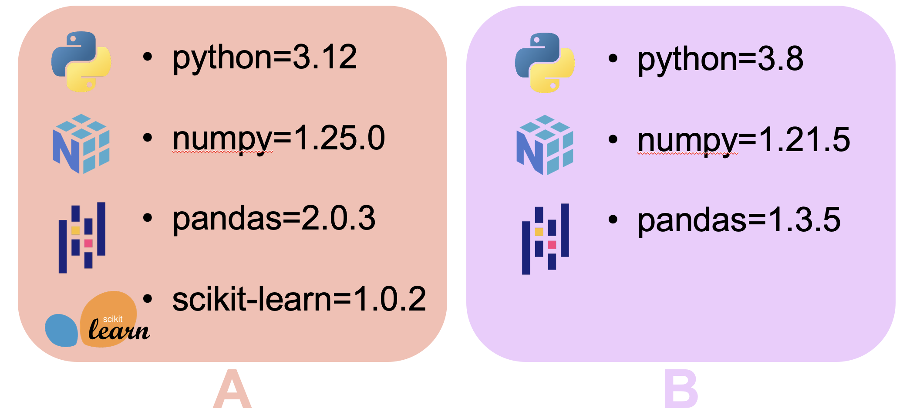
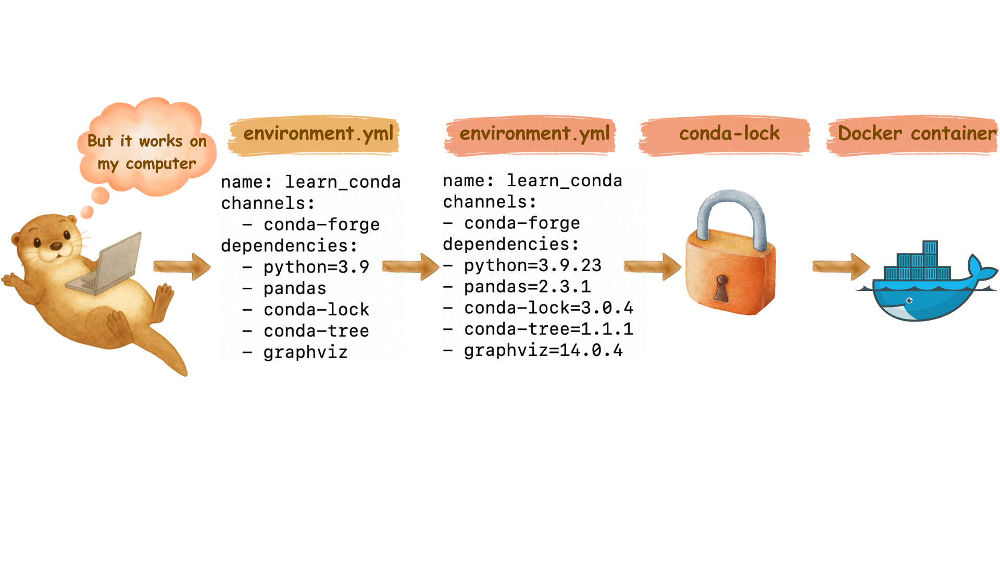
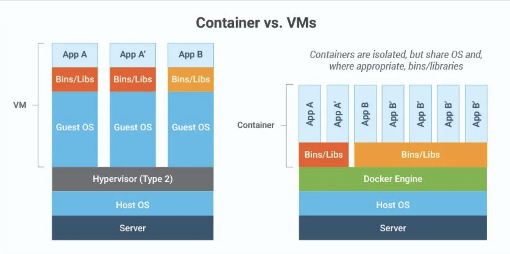

# Recap: Branches and Pull Requests (PR) {style="font-size: 0.8em;"}

[Individual assignment 1](https://ubc-mds.github.io/DSCI_522_dsci-workflows_students/assignments/individual1.html)

::: {.notes}
make those changes, then locally

* **Part 1:**

- `git log` --> use arrow keys to navigate, `q` to quit, use `/` and a word to search, then use `n` to jump to the next match 

- `git status` to check the changes

1. `git add .`

2. `git commit -m "commit locally"`

3. `git push` --> error 

4. `git pull`

5. `git config pull.rebase false` --> solve merge conflict manually 

6. `git add .`

7. `git commit -m "solve merge conflict manually"`

8. `git push` --> success!

*Optional: show going back to history with :*

1. `git log` --> find the first commit

2. `git checkout <commit hash>` to go back in time

3. `git switch main` to go back to the real head of the main branch

* **Part 2:** 

1. `git switch -c "opinions"` or `git checkout -b "opinions"`  to create a new branch locally
2. `git branch -v` to see all branches, v is verbose mode
3. `git branch -a` to see all branches, a is all mode
4.  after you make all the changes, `git add .` and `git commit -m "make all the changes"`
5. `git push` --> error 
6. `git push -u origin opinions` to set upstream to the remote branch 
7. `git branch -a` to check all branches, or just use GitHub to check 
8. `git switch main` --> **what we added in the other branch is NOT in the main branch!**
9. create PR --> show **code review** use **"+"** to add comments
10. `git pull` locally
11. `git branch -d opinions` but only deleted local branch
12. `git push origin -d opinions` will remove the remote branch or just use the **trash can icon** on GitHub
:::

## ✨ Clean, well documented and distributable code

| **Practice** | **Benefit** |
|--------------|-------------|
| Well-documented | Easily understandable |
| Modular code | Easy to reuse |
| Well-tested code | Reliable |
| Portable across machines | Easily accessible |

::: footer
Source: Ma, E. J. (2024, October 25). The Human Dimension to Clean, Distributable, and Documented Data Science Code.
:::

## Why do we need virtual environment?

{style="display: block; margin-left: auto; margin-right: auto; margin-bottom: 0px;"}

## 🦷 Toothbrushes for different “projects”

{style="display: block; margin-left: auto; margin-right: auto; margin-bottom: 0px;"}

## Which toothbrush should I use for my oral hygiene??

{style="display: block; margin-left: auto; margin-right: auto; margin-bottom: 0px;"}

## 📦 Organize tools into separate boxes

{style="display: block; margin-left: auto; margin-right: auto; margin-bottom: 0px;"}

## Organize programming language & packages into separate virtual environments

{style="display: block; margin-left: auto; margin-right: auto; margin-bottom: 0px;"}

## 🔧 Different virtual environment management tools {style="font-size: 0.8em;"}

:::: {.columns}

::: {.column width="50%"}
### For R:

- uv
- packrat
- renv
- conda
:::

::: {.column width="50%"}
### For Python:

- uv
- venv
- virtualenv
- conda
- mamba
- poetry
- pipenv
- ...
:::

::::

# 🤩 Let's create our own virtual environment!

## `environment.yml` file

{style="margin-bottom: 0px;"}

## `environment.yml` file with package versions listed

The python script is here: [GitHub repo: append_version_to_environment_yml](https://github.com/skysheng7/append_version_to_environment_yml.git)

{style="margin-bottom: 0px;"}

## Conda-lock

{style="margin-bottom: 0px;"}

# 🧐 Why do we need Conda-lock?

::: {style="font-size: 0.8em;"}
* Conda-lock solves the dependency for all platforms (Linux, Windows, MacOS)
* [Here is a conda tree](https://github.com/skysheng7/DSCI_522-001-slides/blob/main/support_files/tree.pdf) showing how Conda solves dependencies for a simple conda environment.
* Below is the code I used to generate the conda tree:
::: 

```{bash}
#| eval: false
conda activate myenv
conda install -c conda-forge graphviz conda-tree
conda-tree deptree --dot > file.dot
dot -Tpdf file.dot -o tree.pdf
```
## Docker

{style="margin-bottom: 0px;"}

## Docker Container

{style="margin-bottom: 0px;"}

## Virtual Machine vs. Container

{style="margin-bottom: 0px;"}

::: footer
Source: [eG innovations](https://www.eginnovations.com/blog/containers-vs-vms/)
:::
