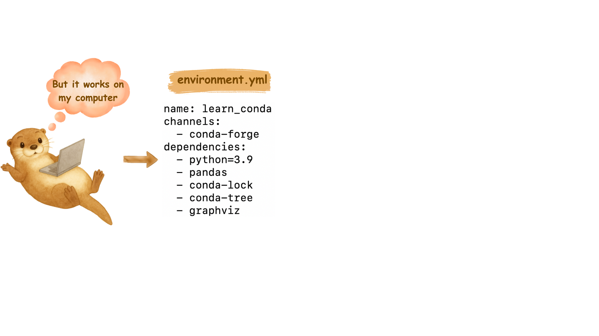
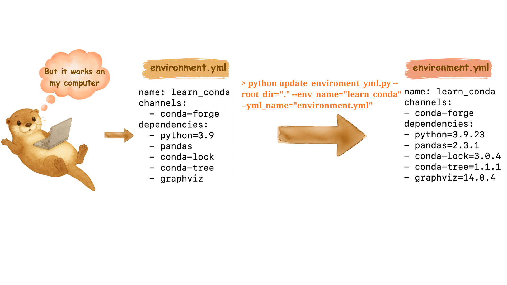
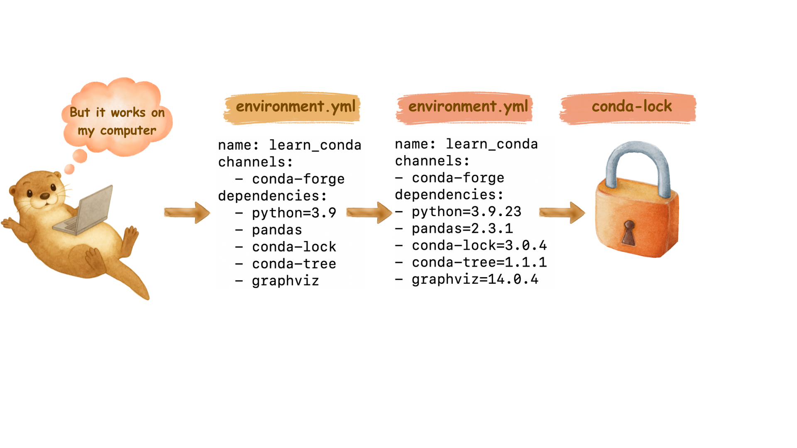

# 🤩 Let's create our own virtual environment!

## `environment.yml` file

{style="margin-bottom: 0px;"}

## `environment.yml` file with package versions listed

The python script is here: [GitHub repo: append_version_to_environment_yml](https://github.com/skysheng7/append_version_to_environment_yml.git)

{style="margin-bottom: 0px;"}

## Conda-lock

{style="margin-bottom: 0px;"}

# 🧐 Why do we need Conda-lock?

::: {style="font-size: 0.8em;"}
* Conda-lock solves the dependency for all platforms (Linux, Windows, MacOS)
* [Here is a conda tree](https://github.com/skysheng7/DSCI_522-001-slides/blob/main/support_files/tree.pdf) showing how Conda solves dependencies for a simple conda environment.
* Below is the code I used to generate the conda tree:
::: 

```{bash}
#| eval: false
conda activate myenv
conda install -c conda-forge graphviz conda-tree
conda-tree deptree --dot > file.dot
dot -Tpdf file.dot -o tree.pdf
```
## Docker

{style="margin-bottom: 0px;"}

## Docker Container

{style="margin-bottom: 0px;"}

## Virtual Machine vs. Container

{style="margin-bottom: 0px;"}

::: footer
Source: [eG innovations](https://www.eginnovations.com/blog/containers-vs-vms/)
:::
