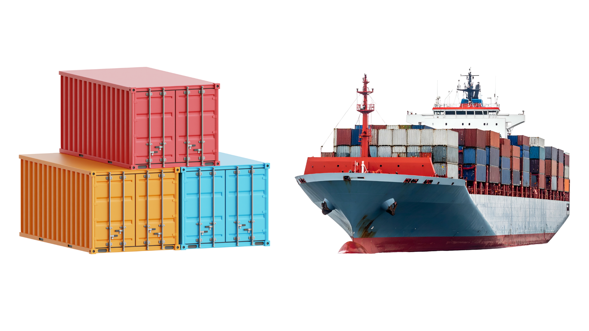

## Before we start: pull today's Docker images {style="font-size: 0.75em;"}

Open **Docker Desktop**, then run this in your terminal. Leave it running. 

```{.bash}
# 1. pull the two images we use today
docker pull python:3.14-slim
docker pull ollama/ollama:0.40.16
```

```{.bash}
# 2. download the qwen2.5-coder:1.5b model into a demo folder (about 1 GB)
mkdir -p ~/Desktop/llm_demo
cd ~/Desktop/llm_demo
docker run -d --rm --name llm \
    -v "/$(pwd)/models":/root/.ollama \
    ollama/ollama:0.40.16
docker exec llm ollama pull qwen2.5-coder:1.5b
docker stop llm
```

::: {.notes}
Windows: run it in Git Bash. The `/` before `$(pwd)` is for Git Bash and does no harm on Mac.

:::

# Recap: Branches and Pull Requests (PR) {style="font-size: 0.8em;"}

[Individual assignment 1](https://ubc-mds.github.io/DSCI_522_dsci-workflows_students/assignments/individual1.html)

::: {.notes}
make those changes, then locally

* **Part 1:**

- `git log` --> use arrow keys to navigate, `q` to quit, use `/` and a word to search, then use `n` to jump to the next match

- `git status` to check the changes

1. `git add .`

2. `git commit -m "commit locally"`

3. `git push` --> error

4. `git pull`

5. `git config pull.rebase false` --> solve merge conflict manually

6. `git add .`

7. `git commit -m "solve merge conflict manually"`

8. `git push` --> success!

*Optional: show going back to history with :*

1. `git log` --> find the first commit

2. `git checkout <commit hash>` to go back in time

3. `git switch main` to go back to the real head of the main branch

* **Part 2:**

1. `git switch -c "opinions"` or `git checkout -b "opinions"`  to create a new branch locally
2. `git branch -v` to see all branches, v is verbose mode
3. `git branch -a` to see all branches, a is all mode
4.  after you make all the changes, `git add .` and `git commit -m "make all the changes"`
5. `git push` --> error
6. `git push -u origin opinions` to set upstream to the remote branch
7. `git branch -a` to check all branches, or just use GitHub to check
8. `git switch main` --> **what we added in the other branch is NOT in the main branch!**
9. create PR --> show **code review** use **"+"** to add comments
10. `git pull` locally
11. `git branch -d opinions` but only deleted local branch
12. `git push origin -d opinions` will remove the remote branch or just use the **trash can icon** on GitHub
:::

## Commands we ran in class: merge conflicts {style="font-size: 0.7em;"}

```{.bash}
# 1. look at the history (arrow keys to scroll, / to search, n for next match, q to quit)
git log

# 2. see what changed, then commit locally
git status
git add .
git commit -m "commit locally"

# 3. push is rejected: GitHub has commits you do not have yet
git push

# 4. tell Git to merge when it pulls, then pull
git pull
git config pull.rebase false
git pull

# 5. fix the conflict in the file, then commit the fix and push
git add .
git commit -m "solve merge conflict manually"
git push

# 6. (optional) go back in time to an old commit, then come back to main
git checkout <commit hash>
git switch main
```


## Commands we ran in class: branches and pull requests {style="font-size: 0.75em;"}

```{.bash}
# 1. create a new branch called "opinions" and switch to it
git switch -c opinions

# 2. list your branches (-v: with their last commit, -a: also the ones on GitHub)
git branch -v
git branch -a

# 3. commit your changes on the new branch
git add .
git commit -m "make all the changes"

# 4. the first push of a new branch must say where it goes on GitHub
git push -u origin opinions

# 5. back on main: the changes from "opinions" are not here yet
git switch main

# 6. open a pull request on GitHub, review it, merge it, then bring the merge home
git pull

# 7. delete the branch on your computer, then on GitHub
git branch -d opinions
git push origin -d opinions
```

::: {.notes}
you can see the deleted branches on github through activity page: 
github.com/OWNER/REPO/activity, set the activity filter to “Branch deletions”
:::

## Clean, well documented and distributable code

| **Practice** | **Benefit** |
|--------------|-------------|
| Well-documented | Easily understandable |
| Modular code | Easy to reuse |
| Well-tested code | Reliable |
| Portable across machines | Easily accessible |

::: footer
Source: Ma, E. J. (2024, October 25). The Human Dimension to Clean, Distributable, and Documented Data Science Code.
:::

## Why do we need virtual environment?

{style="display: block; margin-left: auto; margin-right: auto; margin-bottom: 0px;"}

## Toothbrushes for different "projects"

{style="display: block; margin-left: auto; margin-right: auto; margin-bottom: 0px;"}

## Which toothbrush should I use for my oral hygiene??

{style="display: block; margin-left: auto; margin-right: auto; margin-bottom: 0px;"}

## Organize tools into separate boxes

{style="display: block; margin-left: auto; margin-right: auto; margin-bottom: 0px;"}

## Organize programming language & packages into separate virtual environments

{style="display: block; margin-left: auto; margin-right: auto; margin-bottom: 0px;"}

## Different virtual environment management tools {style="font-size: 0.8em;"}

:::: {.columns}

::: {.column width="50%"}
### For R:

- uv
- packrat
- renv
- conda
:::

::: {.column width="50%"}
### For Python:

- uv
- venv
- conda
- poetry
- pipenv
- ...
:::

::::


# Recap: uv

## MDS is sending you abroad {style="font-size: 0.9em;"}

MDS sponsors three of you to teach data science for a term: in **Zurich**, **Jakarta** and **Sydney**.

MDS already bought each of you a laptop, a kettle and an electric toothbrush in Vancouver.

::: {.fragment}
Should MDS just ship you the box?
:::

## MDS otters arriving abroad {style="font-size: 0.9em;"}

{width=100% fig-align="center" style="margin-bottom: 0px;"}

::: {.fragment}
In Zurich, Jakarta, Sydney, the Vancouver plugs do not fit!
:::

::: footer
Image generated by OpenAI gpt-image-2.5-sunburst.
:::


## A shopping list and a receipt {style="font-size: 0.9em;"}

::: {.incremental}
- `pyproject.toml` is the **shopping list**: what you asked for (e.g., "pandas")
- `uv.lock` is the **receipt**: the exact models, charger and cable included, with a plug for every country (pandas 3.1.1, numpy 2.5.5, ...)
- `.python-version` says which Python to use (3.14)
- `.venv/` is the box bought in Vancouver, it only has one Canadian plug that only works here!
:::

::: {.fragment}
MDS **should** send you the list, the receipt and the Python version.

Never ship the box (`.venv/`)!
:::

::: {.notes}
If MDS sends only the shopping list ("a laptop"), the Zurich office buys an Apple laptop in iOS system and the Jakarta office buys a Lenovo laptop in Windows system. Everyone teaches with a different setup.

With the receipt, every office buys exactly the same models. The receipt also lists what came in the box that nobody asked for, like the charger and the cable: I asked for pandas and also got numpy.

The receipt names each model with the plug for every country. That is really what `uv.lock` does: it records the right files for macOS, Windows and Linux, so one lock file works for everyone. 
:::

## Demo: create a uv project

Live demo in the terminal: create the environment, add a package, look inside the files.

- DSCI 521 notes: [Virtual environments with uv](https://ubc-mds.github.io/DSCI_521_platforms-dsci_book/lectures/virtual-environments-uv.html)
- Textbook: [Python + uv projects](https://ubc-dsci.github.io/reproducible-and-trustworthy-workflows-for-data-science/lectures/virtual-environments-python-uv-projects.html), [sharing a uv environment](https://ubc-dsci.github.io/reproducible-and-trustworthy-workflows-for-data-science/lectures/virtual-environments-python-uv-sharing.html)

::: {.notes}
Terminal, step by step:

1. `mkdir -p ~/Desktop/uv_demo`
2. `cd ~/Desktop/uv_demo`
3. `uv init --bare` → creates only `pyproject.toml`. (Without `--bare` uv also makes a `main.py`, a `README.md` and a Git repo, which we do not need.)
4. `cat pyproject.toml` → point at `dependencies = []`: the shopping list is empty.
5. `uv python pin 3.14` → creates `.python-version`
6. `cat .python-version` → one line: `3.14`
7. `uv add pandas` → watch the output: "Creating virtual environment at: .venv", "Resolved 5 packages", "+ numpy, + pandas, + python-dateutil, + tzdata". I asked for one package and got four.
8. `cat pyproject.toml` → `"pandas>=3.1.1"` appeared in `dependencies`.
9. `ls -a` → `.python-version`, `.venv`, `pyproject.toml`, `uv.lock`
10. `cat .venv/.gitignore` → just `*`: uv tells Git to ignore the whole folder.
11. `uv run python -c "import pandas; print(pandas.__version__)"` → prints `3.1.1`. `uv run` runs the command inside the environment, no need to activate it.
12. Open `uv.lock` in VS Code (`code uv.lock`) and scroll to the `pandas` block. Then go to the next slides.
:::

## Commands we ran in class: create a uv project {style="font-size: 0.8em;"}

```{.bash}
# 1. make a new folder for the project and move into it
mkdir -p ~/Desktop/uv_demo
cd ~/Desktop/uv_demo

# 2. create the project: this only makes pyproject.toml
uv init --bare

# 3. choose the Python version: this makes .python-version
uv python pin 3.14

# 4. add a package: this updates pyproject.toml, writes uv.lock and builds .venv/
uv add pandas

# 5. look at what we got
ls -a
cat pyproject.toml
cat .python-version

# 6. run Python inside the environment
uv run python -c "import pandas; print(pandas.__version__)"
```

## What you asked for

:::: {.columns}

::: {.column width="45%"}
`.python-version`

```{.text}
3.14
```
:::

::: {.column width="55%"}
`pyproject.toml`

```{.toml code-line-numbers="5-7"}
[project]
name = "uv-demo"
version = "0.1.0"
requires-python = ">=3.14"
dependencies = [
    "pandas>=3.1.1",
]
```
:::

::::

::: {.fragment}
Only the packages **you** asked for. Short enough to read and edit by hand.
:::

::: {.notes}
`>=3.1.1` means "pandas 3.1.1 or newer". So the shopping list alone does not say which pandas you will get. That is the job of the lock file.
:::

## What you got: `uv.lock` {style="font-size: 0.8em;"}

::: {style="font-size: 0.85em;"}
```{.toml code-line-numbers="1-3|5-9|8|10-15"}
[[package]]
name = "pandas"
version = "3.1.1"
source = { registry = "https://pypi.org/simple" }
dependencies = [
    { name = "numpy" },
    { name = "python-dateutil" },
    { name = "tzdata", marker = "... or sys_platform == 'win32'" },
]
sdist = { url = ".../pandas-3.1.1.tar.gz", hash = "sha256:05fed3e3..." }
wheels = [
    { url = ".../pandas-3.1.1-...-macosx_11_0_arm64.whl", hash = "sha256:862f6fbe..." },
    { url = ".../pandas-3.1.1-...-manylinux_2_28_x86_64.whl", hash = "sha256:326459d8..." },
    { url = ".../pandas-3.1.1-...-win_amd64.whl", hash = "sha256:fdd87cf4..." },
]
```
:::

This is a shortened version of the real `uv.lock` file, which lists 32 pandas wheels, one per operating system and chip.

::: {.notes}
1. Exact version: 3.1.1, not "3.1.1 or newer".
2. What pandas itself needs: numpy and python-dateutil. Each of those has its own `[[package]]` block further down.
3. The marker: tzdata is only installed on Windows (and in the browser). One lock file covers every operating system. This is why we no longer need one lock file per OS like we did with conda-lock.
4. Download links and hashes, one per OS and chip. The hash is a fingerprint of the file: if anyone tampers with the download, the fingerprint no longer matches and uv refuses to install it.

Never edit `uv.lock` by hand. uv writes it, Git tracks it.
:::

```{python}
#| echo: false
# Prepares the "You asked for 11 packages" slide: reads the breast cancer predictor's uv.lock
# (a copy of the class example project's lock file) and works out, for every package listed in
# pyproject.toml, which other packages it pulls in.
import tomllib

with open("data/breast_cancer_uv.lock", "rb") as f:
    lock = tomllib.load(f)

lock_packages = {p["name"]: p for p in lock["package"]}
lock_project = next(p for p in lock["package"] if "virtual" in p["source"])
lock_asked = sorted(d["name"] for d in lock_project["dependencies"])
lock_pinned = sorted(name for name in lock_packages if name != lock_project["name"])


def pulled_in(name):
    """Every package that `name` needs, directly or through other packages (not `name` itself)."""
    seen = set()
    todo = [d["name"] for d in lock_packages[name].get("dependencies", [])]
    while todo:
        dep = todo.pop()
        if dep not in seen:
            seen.add(dep)
            todo.extend(d["name"] for d in lock_packages[dep].get("dependencies", []))
    return sorted(seen)


lock_pulls = {name: pulled_in(name) for name in lock_asked}

# Packages only some operating systems install: every edge into them has a sys_platform marker
os_names = {"darwin": "macOS", "win32": "Windows"}
incoming = {}
for p in lock["package"]:
    for d in p.get("dependencies", []):
        incoming.setdefault(d["name"], []).append(d.get("marker", ""))
lock_os_only = {}
for name, markers in incoming.items():
    for code, os_name in os_names.items():
        if all(f"sys_platform == '{code}'" in m for m in markers):
            lock_os_only[name] = os_name

# One readout sentence per package you can pick
lock_readout = {}
for name in lock_asked:
    n = len(lock_pulls[name])
    if n == 0:
        lock_readout[name] = f"<b>{name}</b> pulls in <span class='match'>no other packages</span>"
    else:
        word = "package" if n == 1 else "packages"
        lock_readout[name] = f"<b>{name}</b> pulls in <span class='match'>{n} more {word}</span>"

lock_summary = {
    "asked": len(lock_asked),
    "pinned": len(lock_pinned),
    "most": max(lock_asked, key=lambda name: len(lock_pulls[name])),
}

ojs_define(
    lock_asked=lock_asked,
    lock_pinned=lock_pinned,
    lock_pulls=lock_pulls,
    lock_os_only=lock_os_only,
    lock_readout=lock_readout,
    lock_summary=lock_summary,
)
```

## How many packages did you actually get?

The breast cancer predictor's `pyproject.toml` vs its `uv.lock`:

```{ojs}
//| echo: false
viewof lock_pick = Inputs.select(lock_asked, {label: "Pick a package you asked for:", value: "pandas"})
```

```{ojs}
//| echo: false
html`<div class="lock-head"><span class="asked">${lock_summary.asked} asked for</span> in pyproject.toml, <span class="pinned">${lock_summary.pinned} pinned</span> in uv.lock</div>
<div class="ojs-readout" style="text-align: center;">${Object.assign(document.createElement("span"), {innerHTML: lock_readout[lock_pick]})}</div>
<div class="lock-grid">${lock_pinned.map(name => {
  const kind = [
    "lock-chip",
    lock_asked.includes(name) ? "asked" : "",
    name === lock_pick ? "pick" : "",
    lock_pulls[lock_pick].includes(name) ? "on" : "",
    name in lock_os_only ? "os" : ""
  ].join(" ");
  const tag = name in lock_os_only ? html`<small> ${lock_os_only[name]} only</small>` : "";
  return html`<span class="${kind}">${name}${tag}</span>`;
})}</div>
<div class="lock-key"><span class="c-blue">blue</span>: in pyproject.toml, <span class="c-orange">orange</span>: pulled in by your pick, dashed: only installed on one operating system</div>`
```

::: {.notes}
1. Start on pandas: it pulls in only a few packages.
2. Pick altair, then ipykernel: ipykernel pulls in the most (it brings the whole Jupyter machinery).
3. Point at the dashed chips: appnope is only installed on macOS, colorama only on Windows. One `uv.lock` holds the answer for every operating system.

Q: if your `pyproject.toml` lists only 11 packages, who decides the versions of the other ones? Answer: without a lock file, whatever is newest on the day you install. With `uv.lock`, everyone gets the same ones.
:::

## Make `uv add` write exact versions {style="font-size: 0.85em;"}

By default `uv add` writes "this version **or newer**" into the shopping list:

```{.toml}
dependencies = [
    "pandas>=3.1.1",
]
```

::: {.fragment}
Add these two lines to `pyproject.toml`

```{.toml}
[tool.uv]
add-bounds = "exact"
```

Every `uv add` from now on will write the exact version using `==`:

```{.toml}
dependencies = [
    "pandas>=3.1.1",       # added before the setting
    "requests==2.34.2",    # added after the setting
]
```
:::

::: {.callout-tip}
Your milestone 1 should use exact versions too!
:::

::: {.notes}
Why bother if `uv.lock` already pins everything? Because the lock file gets rebuilt sometimes: someone deletes it, or runs `uv lock --upgrade`. With `>=` the versions can then jump. With `==` the shopping list itself says exactly which version the analysis was written with.

:::

## Your teammate's side: `uv sync`

::: {.incremental}
- Your teammate clones the repository: they get the list, the receipt and the Python version, but no `.venv/`
- `uv sync` builds `.venv/` from `uv.lock`, exactly as on your computer
- `uv run ...` runs any command inside that environment
:::

::: {.notes}
Demo, in the same `uv_demo` folder, pretend I am my teammate, or the Sydney office:

1. `rm -rf .venv` → no box, only the shopping list and the receipt arrived.
2. `ls -a` → only the three text files left.
3. `uv sync` → rebuilt in under a second, because uv keeps a cache of everything it downloaded before.
4. `uv tree` → shows what pulls in what: pandas → numpy, python-dateutil.
5. `uv run python -c "import pandas; print(pandas.__version__)"` → 3.1.1 again.

Say: add packages with `uv add`, never `uv pip install`. `uv sync` removes anything that is not in `uv.lock`, so a package installed with pip disappears at the next sync.
:::

## Commands we ran in class: rebuild the environment {style="font-size: 0.75em;"}

```{.bash}
# 1. pretend we just cloned the repository: delete the environment
rm -rf .venv

# 2. rebuild it from uv.lock
uv sync

# 3. see which package pulls in which
uv tree

# 4. check it works
uv run python -c "import pandas; print(pandas.__version__)"
```

::: {.fragment}
| You want to... | Command |
|---|---|
| add a package | `uv add pandas` |
| remove a package | `uv remove pandas` |
| rebuild the environment from `uv.lock` | `uv sync` |
| run something in the environment | `uv run python script.py` |
:::

# From virtual environments to containers

## iClicker: What can still go wrong? {style="font-size: 0.85em;"}

Your teammate cloned your project and ran `uv sync`. The report **still** does not render on their laptop. What could still be different?

- \(A) The Python packages
- \(B) The operating system and its system libraries
- \(C) Other software, like Quarto or `make`
- \(D) Both B and C

::: {.notes}
Answer: (D).

(A) is covered: `uv.lock` pins every Python package, and `.python-version` pins Python.

But a data analysis needs more than Python packages. Some examples students may have hit already:

- Quarto is not installed, or is a different version, so the report renders differently.
- A package needs a system library (for example geopandas needs GDAL) that `uv` cannot install.
- The analysis runs on Linux on the server, but was written on a Mac.
:::

## Meanwhile, in Shanghai {style="font-size: 0.8em;"}

A fourth student goes to **Shanghai**...

::: {.fragment}
{width=90% fig-align="center" style="margin-bottom: 0px;"}
:::

::: footer
Image generated by OpenAI gpt-image-2.5-sunburst.
:::

::: {.notes}
Good news first: Chinese sockets take our canadian blades, and phone and laptop chargers work on any voltage. The receipt worked: same models, they charge fine.

Bad news: Google, ChatGPT and Claude do not open, many shops do not take Visa, and people pay with Alipay or WeChat Pay. The electronics are fine. Everything is different.

our project is the same. `uv` got the packages right, but the computer around them can still be different. 
:::

## What `uv.lock` covers, and what it does not {style="font-size: 0.8em;"}

The breast cancer predictor needs:

| | Pinned by `uv`? |
|---|:---:|
| Python 3.14 | ✅ |
| pandas, scikit-learn, altair, ... | ✅ |
| Quarto, to render the report | ❌ |
| `make`, to run the whole pipeline (lecture 7) | ❌ |
| The operating system and its system libraries | ❌ |


::: {.fragment style="text-align: center;"}
We need to ship the **whole computer setup**, not just the Python packages.
:::

::: {.notes}
the electronics are the Python packages. Quarto, `make` and the operating system's libraries are the apps and services around them, like the payment apps in Shanghai. `uv` never sets those up.
:::

## A container is a shipping container for software

{height=350px fig-align="center" style="margin-bottom: 0px;"}

::: {.notes}
before shipping containers, every cargo (sacks of coffee, barrels, cars) was loaded differently, by hand. The standard box made it possible to move anything with the same cranes and trucks.

MDS turns a shipping container into a classroom: laptop, kettle, projector, its own wall sockets, and every app already installed and set up. Every city just needs a crane and one standard power cable to the outside.

Map it: the room inside is Linux, so the same sockets everywhere. The one standard cable is Docker Desktop: on a Mac or Windows laptop it runs a small Linux behind the scenes, so the container always finds the same "country" inside. That is why the same image runs the same way on every laptop.

Docker is the most common software to build and run containers. Its logo is a whale carrying containers.
:::


## Virtual environment vs container vs virtual machine {style="font-size: 0.75em;"}

| | Virtual environment | Container | Virtual machine |
|---|---|---|---|
| Isolates | Python and packages | ... plus **other software, the operating system's libraries, files and ports** | ... plus a whole **operating system** |
| Example | `uv` | Docker | VirtualBox |
| Size | Extremely light | Light | Heavy |

::: {.notes}
The kernel is the core of the operating system that talks to the hardware.

On a Mac or Windows laptop, Docker Desktop quietly runs one small Linux virtual machine, and all containers share that Linux kernel. That is why Docker Desktop must be running before any `docker` command works.
:::

## Image vs container

::: {.incremental}
- An **image** is like the Chrome app installed on your computer
- A **container** is like a Chrome window you open from it
- You can open many windows from one app, and closing a window does not uninstall Chrome
:::

::: {.fragment}
| | List them | Delete one |
|---|---|---|
| Images | `docker images` | `docker rmi <image>` |
| Containers | `docker ps -a` | `docker rm <container_id>` |
:::

::: footer
[textbook](https://ubc-dsci.github.io/reproducible-and-trustworthy-workflows-for-data-science/lectures/containers.html#image-vs-container)
:::

## Where do images come from? {style="font-size: 0.9em;"}

From a **registry**, which is like GitHub but for images. [Docker Hub](https://hub.docker.com/) is the default.

::: {.fragment}
::: {style="text-align: center; margin: 0.6em 0;"}
[<span class="reg">quay.io/</span><span class="img">jupyter/datascience-notebook</span>:<span class="tag">2025-03-14</span>]{.img-name}

[<span class="img">ollama/ollama</span>:<span class="tag">0.40.16</span>]{.img-name}

[<span class="img">python</span>:<span class="tag">3.14-slim</span>]{.img-name}
:::

<span style="color: #8a8880;">registry</span> (none means Docker Hub), <span class="c-blue">image name</span>, <span class="c-orange">tag</span> (the version)
:::

::: {.fragment}
⚠️ Never use the tag `latest`. Docker will not update a `latest` you already have, so you and your teammate can end up with different images.
:::

::: {.notes}
Open in the browser and show the "Tags" tab of each:

1. <https://hub.docker.com/r/ollama/ollama> → Tags tab, search 0.40.16. Point out `latest` is also there, and why we do not use it.
2. <https://hub.docker.com/_/python> → Tags tab, search 3.14-slim. "slim" is a smaller image without extra Linux tools.
3. <https://quay.io/repository/jupyter/datascience-notebook?tab=tags>

Other registries: GitHub (`ghcr.io`), Amazon (ECR).
:::

# Demo: run your first container

## Demo: run a container and look around

Textbook: [Using and running containers](https://ubc-dsci.github.io/reproducible-and-trustworthy-workflows-for-data-science/lectures/containers-running.html)

::: {.notes}
Before typing anything: open Docker Desktop (Launchpad on Mac, Start menu on Windows). Show the whale icon in the menu bar. No `docker` command works without it.

Terminal, step by step:

1. `docker pull python:3.14-slim` → already pulled before class, so it says "Image is up to date".
2. `docker images` → the image is on my laptop.
3. `python3 --version` → my laptop's Python (3.9.6 on my Mac).
4. `docker run -it python:3.14-slim` → a Python prompt opens INSIDE the container. `-it` = interactive, so I can type into it.
5. In that Python prompt: `import sys`, then `sys.version` → 3.14. Different from my laptop.
6. `exit()` → back on my laptop.
7. `docker ps -a` → the stopped container is still hanging around. Copy its CONTAINER ID.
8. `docker rm <container_id>` → paste the ID. Then `docker ps -a` again → gone. The image is still there (`docker images`).
9. `docker run --rm -it python:3.14-slim bash` → `--rm` deletes the container when I leave. `bash` at the end replaces the default command (Python) with a shell.
10. In the container shell: `cat /etc/os-release` → Debian Linux, on my Mac!
11. `ls /` and `ls /home` → this is the container's file system, not my laptop's. My Desktop files are not here.
12. `exit` → back on my laptop. `docker ps -a` → nothing left behind, thanks to `--rm`.
:::

## Commands we ran in class: run a container {style="font-size: 0.8em;"}

```{.bash}
# 0. Mac and Windows: open Docker Desktop first

# 1. download an image from Docker Hub, then list the images on your computer
docker pull python:3.14-slim
docker images

# 2. Python on your laptop vs Python in the container
# (in the container's Python: import sys, then sys.version; leave with exit())
python3 --version
docker run -it python:3.14-slim

# 3. a stopped container still hangs around: find it and remove it
docker ps -a
docker rm <container_id>

# 4. --rm deletes the container when you leave, bash opens a shell instead of Python
docker run --rm -it python:3.14-slim bash
cat /etc/os-release    # Debian Linux, even on a Mac
ls /
exit
```

## How does the container see my files?

It cannot, unless you **mount** a folder with `-v`:

```{.bash}
docker run --rm \
    -v "/$(pwd)":/home/project \
    python:3.14-slim \
    python /home/project/hello.py
```

::: {.fragment}
`-v` <span class="c-blue">`"/$(pwd)"`</span>`:`<span class="c-orange">`/home/project`</span>: <span class="c-blue">this folder on your laptop</span> shows up as <span class="c-orange">`/home/project` inside the container</span>
:::

::: {.notes}
Terminal, step by step:

1. `mkdir -p ~/Desktop/docker_demo`
2. `cd ~/Desktop/docker_demo`
3. `nano hello.py`, paste the three lines from the next slide, Ctrl + X, Y, Enter to save.
4. `cat hello.py`
5. `python3 hello.py` → on my laptop it says Darwin (macOS).
6. `docker run --rm -v "/$(pwd)":/home/project python:3.14-slim python /home/project/hello.py` → "Hello from Linux running Python 3.14". The same file, run by the container's Python.

Point out the order: `docker run`, the flags, the image, then the command to run instead of the default.

Why `"/$(pwd)"` and not just `$(pwd)`: the extra `/` makes the same command work in Git Bash on Windows, and the quotes protect folder names with spaces.

7. The cliffhanger: `docker run --rm python:3.14-slim python -c "import pandas"` → `ModuleNotFoundError: No module named 'pandas'`. This image has Python but none of our packages. Next lecture we build our own image with our `uv.lock` inside.
:::

## Commands we ran in class: mount a folder {style="font-size: 0.8em;"}

```{.bash}
# 1. make a folder for the demo and move into it
mkdir -p ~/Desktop/docker_demo
cd ~/Desktop/docker_demo

# 2. write a tiny script (paste the 3 lines below, then Ctrl + X, Y, Enter)
nano hello.py

# 3. run it on your laptop, then inside the container
python3 hello.py
docker run --rm \
    -v "/$(pwd)":/home/project \
    python:3.14-slim \
    python /home/project/hello.py

# 4. the image has Python, but not our packages
docker run --rm python:3.14-slim python -c "import pandas"
```

```{.python}
import sys
import platform
print("Hello from", platform.system(), "running Python", sys.version.split()[0])
```


## Start the model server in the background

```{.bash}
docker run -d --rm --name llm \
    -p 11434:11434 \
    -v "/$(pwd)/models":/root/.ollama \
    ollama/ollama:0.40.16
```

::: {.incremental style="font-size: 0.8em;"}
- `-d` (detach): run in the background, give me my terminal back
- `--name llm`: a name we choose, so we do not need the container ID
- `-v "/$(pwd)/models":/root/.ollama`: downloaded models are saved in `models/` on your laptop
:::

::: {.fragment}
A server inside a container. How does your laptop talk to it?
:::

::: {.notes}
Terminal, step by step:

1. `cd ~/Desktop/llm_demo` (made before class, the model is already in `models/`).
2. `ls models` → there is already something in there. Do not explain yet.
3. `docker run -d --rm --name llm -p 11434:11434 -v "/$(pwd)/models":/root/.ollama ollama/ollama:0.40.16` → prints a long container ID and gives me my terminal back.
4. `docker ps` → `llm` is running, PORTS column shows `0.0.0.0:11434->11434/tcp`.

Leave the `-p` explanation for the next slide.
:::

## Talk to the container through a port

`-p` <span class="c-blue">`11434`</span>`:`<span class="c-orange">`11434`</span>: <span class="c-blue">http://localhost:11434 on your laptop</span> goes to <span class="c-orange">port 11434 in the container</span>

::: {.fragment}
```{.bash}
curl http://localhost:11434
```

```{.text}
Ollama is running
```
:::

::: {.fragment}
Chat with the model **inside** the container (`-it`, like the Python prompt earlier):

```{.bash}
docker exec -it llm ollama run qwen2.5-coder:1.5b
```
:::

::: {.notes}
A port is like a door number on your computer: each server listens behind its own door. Ollama listens behind door 11434 inside the container. Without `-p`, that door is closed to the outside. The image's page on Docker Hub tells you which door.

Step by step:

1. `curl http://localhost:11434` → "Ollama is running". My laptop just talked to the container.
2. Browser: open <http://localhost:11434> → the same "Ollama is running" text.
3. `docker exec -it llm ollama run qwen2.5-coder:1.5b` → `docker exec` runs a new command in a container that is already running. A `>>>` prompt appears.
4. Ask it: "Write a Python function that loads a CSV with pandas and returns the number of rows." It is a coding model, so code questions show it best. Then ask a class member for a question.
5. Type `/bye` to leave the chat. The container keeps running (`docker ps`).
:::

## Same question, same answer?

```{.bash}
curl http://localhost:11434/api/generate -d '{
  "model": "qwen2.5-coder:1.5b",
  "prompt": "Give a name for a pet otter. Reply with the name only.",
  "stream": false
}'
```

::: {.fragment}
Run it three times: Otterly, Smokey, Puddle... **NOT** reproducible!
:::

::: {.fragment}
Fix the random seed, turn off the randomness:

```{.bash}
  "options": {"seed": 522, "temperature": 0}
```

Otterly, Otterly, Otterly ✅
:::

::: {.notes}
This is the judge comic from lecture 1: same case, same evidence, different verdict.

Step by step:

1. Paste the first curl command (from the commands slide) and run it 3 times (arrow up, Enter). Point at `"response":"..."` near the start of the output: a different name each time.
2. Ask: "how would we make this reproducible?" Someone may say "set a seed", like `np.random.seed` or `random_state` in scikit-learn.
3. Run the second curl command (with `"options"`) 3 times: the same name every time.

Say: the container pins the software, the seed pins the randomness. Reproducibility needs both. (Same idea as `random_state` in scikit-learn.)

The names on the slide came from my test run; the class may see different ones, the point is only that they change.
:::

## Where is the model?

::: {.incremental}
- The model was downloaded **before class**, by a container that no longer exists
- `-v` saved it in `models/` on my laptop, so every new container finds it again
:::

::: {.fragment}
`-e`: set an environment variable inside the container. By default Ollama unloads the model after 5 minutes of quiet, and the next answer is slow again:

```{.bash code-line-numbers="4"}
docker run -d --rm --name llm \
    -p 11434:11434 \
    -v "/$(pwd)/models":/root/.ollama \
    -e OLLAMA_KEEP_ALIVE=1h \
    ollama/ollama:0.40.16
```
:::

::: {.notes}
Step by step:

1. `docker exec llm ollama ps` → qwen2.5-coder:1.5b is loaded, UNTIL "4 minutes from now".
2. `du -sh models` → about 1 GB on my laptop.
3. `docker stop llm` → stops it, and `--rm` deletes it.
4. `docker ps -a` → nothing left.
5. Start it again, this time with `-e OLLAMA_KEEP_ALIVE=1h` (command on the slide).
6. `docker exec llm ollama list` → qwen2.5-coder:1.5b is still there, no download. That is the mount.
7. `docker exec -it llm ollama run qwen2.5-coder:1.5b`, ask one question, `/bye`.
8. `docker exec llm ollama ps` → UNTIL "59 minutes from now". That is the environment variable.
9. `docker stop llm` when done.

What would happen without `-v`? The model lives inside the container, and `--rm` deletes it with the container: we would download 1 GB again every time.
:::

## Commands we ran in class: run a local LLM (1/3) {style="font-size: 0.75em;"}

```{.bash}
# 0. at home, NOT on classroom wifi (about 4 GB): get the image and the model
mkdir -p ~/Desktop/llm_demo
cd ~/Desktop/llm_demo
docker run -d --rm --name llm \
    -v "/$(pwd)/models":/root/.ollama \
    ollama/ollama:0.40.16
docker exec llm ollama pull qwen2.5-coder:1.5b
docker stop llm

# 1. start the model server in the background
docker run -d --rm --name llm \
    -p 11434:11434 \
    -v "/$(pwd)/models":/root/.ollama \
    ollama/ollama:0.40.16
docker ps

# 2. talk to it through the port, then chat inside the container (/bye to leave)
curl http://localhost:11434
docker exec -it llm ollama run qwen2.5-coder:1.5b
```

## Commands we ran in class: run a local LLM (2/3) {style="font-size: 0.75em;"}

```{.bash}
# 3. ask the same question 3 times, then 3 times with a fixed seed
curl http://localhost:11434/api/generate -d '{
  "model": "qwen2.5-coder:1.5b",
  "prompt": "Give a name for a pet otter. Reply with the name only.",
  "stream": false
}'

curl http://localhost:11434/api/generate -d '{
  "model": "qwen2.5-coder:1.5b",
  "prompt": "Give a name for a pet otter. Reply with the name only.",
  "stream": false,
  "options": {"seed": 522, "temperature": 0}
}'
```

## Commands we ran in class: run a local LLM (3/3) {style="font-size: 0.75em;"}

```{.bash}
# 4. stop it (--rm deletes it), start it again with an environment variable
docker exec llm ollama ps
docker stop llm
docker run -d --rm --name llm \
    -p 11434:11434 \
    -v "/$(pwd)/models":/root/.ollama \
    -e OLLAMA_KEEP_ALIVE=1h \
    ollama/ollama:0.40.16

# 5. the model is still there, and now stays loaded for 1 hour
docker exec llm ollama list
docker exec llm ollama ps
docker stop llm
```

## Anatomy of `docker run`

```{.bash code-line-numbers="1|2|3|4|5|6|7|8"}
docker run \
    -d \
    --rm \
    --name llm \
    -p 11434:11434 \
    -v "/$(pwd)/models":/root/.ollama \
    -e OLLAMA_KEEP_ALIVE=1h \
    ollama/ollama:0.40.16
```

::: {style="font-size: 0.55em;"}
| Flag | What it does |
|---|---|
| `-d` | run in the background (detach) |
| `--rm` | delete the container when it stops |
| `--name` | give the container a name |
| `-it` | interactive: let me type into it (not needed for servers) |
| `-p laptop:container` | connect a port |
| `-v laptop:container` | mount a folder |
| `-e NAME=value` | set an environment variable |
:::

::: {.notes}
Click through the highlights line by line and say what each one does.

Order matters: flags go between `docker run` and the image name. Anything after the image name is the command to run inside the container (like `bash` or `python hello.py`).

`docker exec` is the partner of `-d`: it runs a command in a container that is already running.

⚠️ The command line is very sensitive to spaces and quotes. A space after `\` breaks the line continuation.
:::

## Where to find things {style="font-size: 0.85em;"}

| What | Where |
|---|---|
| uv | [DSCI 521 notes](https://ubc-mds.github.io/DSCI_521_platforms-dsci_book/lectures/virtual-environments-uv.html), [uv cheatsheet](https://ubc-mds.github.io/DSCI_522_dsci-workflows_students/cheatsheets/uv.html) |
| Containers | Textbook: [Introduction to containerization](https://ubc-dsci.github.io/reproducible-and-trustworthy-workflows-for-data-science/lectures/containers.html), [Using and running containers](https://ubc-dsci.github.io/reproducible-and-trustworthy-workflows-for-data-science/lectures/containers-running.html) |
| Docker commands | [Docker cheatsheet](https://ubc-mds.github.io/DSCI_522_dsci-workflows_students/cheatsheets/docker.html) |

## {background-image="images/move_u.jpg" background-size="contain" background-position="center"}

## (Bonus) Virtual Machine vs. Container

{style="margin-bottom: 0px;"}

::: footer
Source: [eG innovations](https://www.eginnovations.com/blog/containers-vs-vms/)
:::


## (Bonus) You can explore other models on your own laptop!

- Check out [Ollama](https://hub.docker.com/r/ollama/ollama), it is a platform that serves lots of capable open-weight models! You can run your local LLM for coding on your own laptop!

- Use [LLM Arena leaderboard](https://arena.ai/leaderboard/agent/code?license=open-source) to find the best model for different tasks.