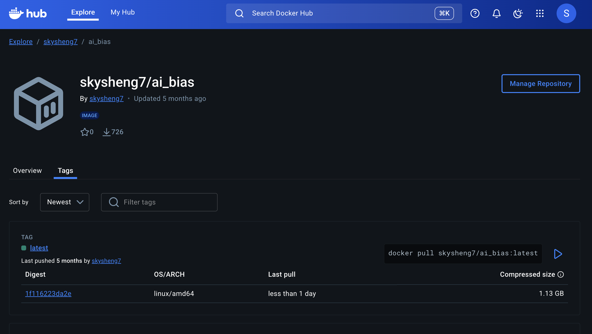
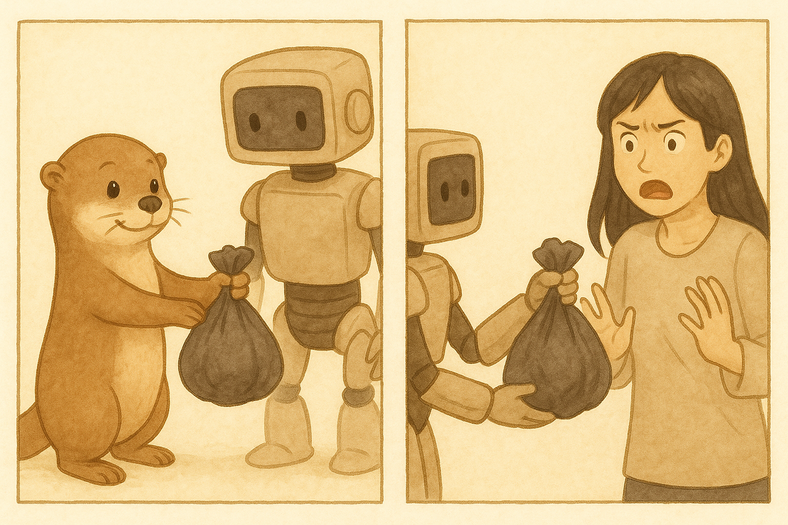

## Recap: Docker image on Docker Hub, then what?? 🤷‍♀️

* Check out this [docker image for AI bias work](https://hub.docker.com/r/skysheng7/ai_bias/tags)

{fig-align="center" style="margin-bottom: 0px;"}

## Next steps after Docker image on DockerHub

::: {.smaller style="font-size: 1em;"}
1. To access the docker image manually: 
* `docker pull username/image:tag`
* Example: `docker pull ttimbers/breast-cancer-predictor:3f8675c`
* Run the docker image using the following command 
```bash
docker run \
--rm \
-it \
-p 8887:8888 \
ttimbers/breast-cancer-predictor:3f8675c
```
:::

## Next steps after Docker image on DockerHub

::: {.smaller style="font-size: 1em;"}

2. To access the docker image using Docker Compose: 
* Create a `docker-compose.yml` file
* `docker compose up`
* `docker compose rm`

3. Update your documentation (README, CONTRIBUTING, etc.) about how others should use your docker image.
::: 

## 🤩 Let's organize our complete workflow!
::: {.smaller style="font-size: 0.8em;"}
::: {.columns}
::: {.column width="50%"}
**🔧 Local Development**

1. `uv init --bare` & `uv python pin`
2. Set `add-bounds = "exact"`
3. `uv add` packages
4. Commit `pyproject.toml`, `uv.lock`, `.python-version`
5. Write `Dockerfile`
6. Create `docker-compose.yml`
7. Push to GitHub
:::

::: {.column width="50%"}
**☁️ CI/CD & Deployment**

8. Add GitHub Actions workflow yml file
9. Add Docker Hub Personal Access Token (PAT)
10. Configure GitHub Secrets
11. Workflow runs (auto/manual)
12. Check Docker Hub for new image
13. Locally, `docker pull` new image
14. Locally, command line `docker run`
:::
:::
:::

## 🐳 New GitHub Actions Workflow yml file

* Check out this new [GitHub Actions workflow yml file](https://github.com/ttimbers/breast-cancer-predictor/blob/main/.github/workflows/docker-publish.yml) Tiffany created
* Now you can replace steps 13 + 14 to: `git pull` locally to extract updated `docker-compose.yml` file
* run `docker compose up` locally to start the container
* run `docker compose rm` locally to stop the container

## Let's breakdown the GitHub Action workflow!

* Inspect a [workflow output](https://github.com/skysheng7/AI_bias_in_farming/actions/workflows/docker-publish.yml)

## 🙋‍♀️ What is `&& \` in Dockerfile? 

::: {.smaller style="font-size: 0.8em;"}

```{.dockerfile code-line-numbers="3-6|8-9|11-16"}
FROM python:3.14-slim

# install command-line tools in one layer, then delete the download cache
RUN apt-get update \
    && apt-get install --yes --no-install-recommends make git \
    && rm -rf /var/lib/apt/lists/*

# copy uv from its official image
COPY --from=ghcr.io/astral-sh/uv:0.13.7 /uv /uvx /usr/local/bin/

# install the Python packages from uv.lock into /opt/venv
WORKDIR /home/project
ENV UV_PROJECT_ENVIRONMENT=/opt/venv
COPY pyproject.toml uv.lock .python-version ./
RUN uv sync --locked
ENV PATH="/opt/venv/bin:$PATH"
```
:::

::: {.notes}
`\` at the end of a line: the command continues on the next line. `&&`: run the next command only if the previous one worked.

Why chain them into one `RUN`? Every `RUN` makes a new layer of the image. If `rm -rf /var/lib/apt/lists/*` were its own `RUN`, the download cache would already be saved in the layer before it, and the image would not get smaller.

The uv part is the same as the lecture 3 Dockerfile. Tested: builds with Docker 29.7.2, and `make`, `git` and pandas all work inside the container.
:::

## Today: Data Validation!

{fig-align="center" style="margin-bottom: 20px;"}

::: footer
Image generated by OpenAI GPT-5
:::

## Remember this roast my repo? 🔥 

::: {style="font-size: 1.5em; text-align: left; margin: 0 auto; display: block;"}
<https://shorturl.at/QSv7M>
:::

:::: {.columns style="margin-top: -50px; padding-top: -10;"}

::: {.column width="50%"}
::: {style="display: flex; justify-content: bottom; align-items: flex-start; margin-top: 0; padding-top: 0;"}
{style="margin-bottom: 0px;"}
:::
:::

::: {.column width="50%"}
::: {style="display: flex; justify-content: bottom; align-items: flex-start; margin-top: 0; padding-top: 0;"}
{style="margin-bottom: 0px;"}
:::
:::

::::

# Data validation in action

Check out this [data cleaning script](https://www.skysheng.io/moo4feed/articles/data_cleaning.html) I created for the Moo4Feed R package

# ✅ Data validation [checklist](https://ubc-dsci.github.io/reproducible-and-trustworthy-workflows-for-data-science/lectures/data-validation.html)

* Group Milestone 3: Make sure you check all the boxes!

## 💻 Let's work with [Pandera](https://github.com/skysheng7/DSCI522_data_validation_demo.git)!

{fig-align="center" style="margin-bottom: 20px;"}

::: footer
Image generated by OpenAI GPT-5
:::

## 💬 Discuss with your group: How will you conduct data validation for your data to check all the boxes?

* ✅ Data validation [checklist](https://ubc-dsci.github.io/reproducible-and-trustworthy-workflows-for-data-science/lectures/data-validation.html)

## Readings for this lecture {style="font-size: 0.85em;"}

| What | Where |
|---|---|
| Required | Textbook: [Data validation](https://ubc-dsci.github.io/reproducible-and-trustworthy-workflows-for-data-science/lectures/data-validation.html) |
| Pandera | Textbook: [Data validation in Python with Pandera](https://ubc-dsci.github.io/reproducible-and-trustworthy-workflows-for-data-science/lectures/data-validation-python-pandera.html) |
| Commands | [Docker cheatsheet](https://ubc-mds.github.io/DSCI_522_dsci-workflows_students/cheatsheets/docker.html), [uv cheatsheet](https://ubc-mds.github.io/DSCI_522_dsci-workflows_students/cheatsheets/uv.html) |

::: {.notes}
Readings come from the schedule table in the course syllabus. The Pandera chapter is extra (not in the syllabus), for students who want the full walkthrough of today's demo.
:::

## {background-image="images/move_u.jpg" background-size="contain" background-position="center"}
