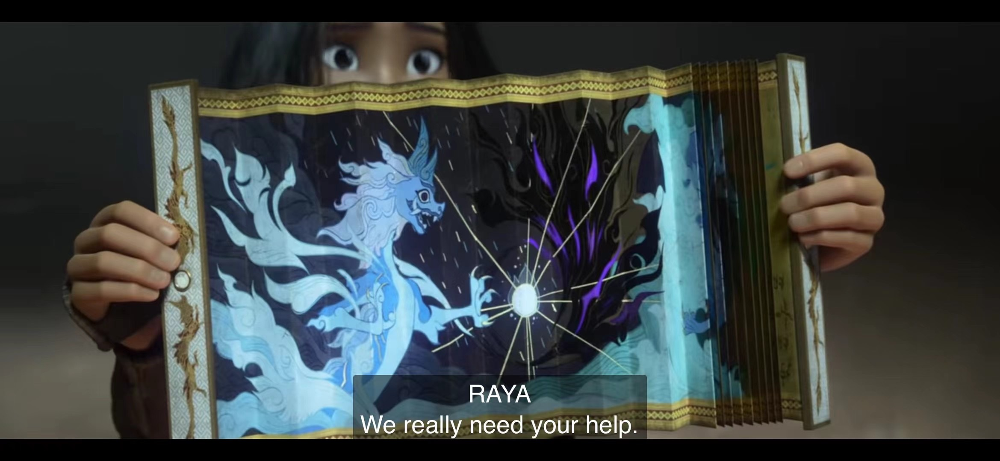
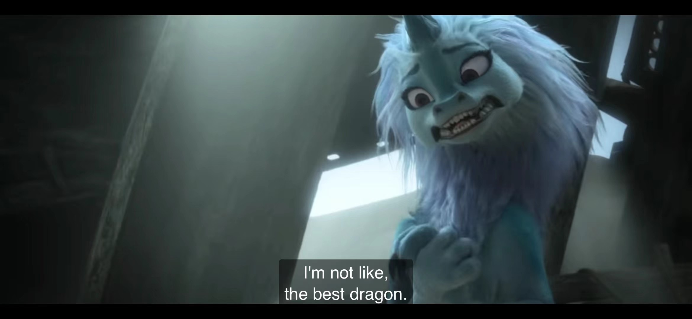
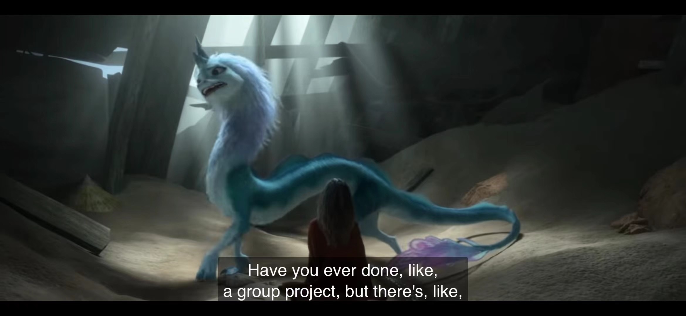
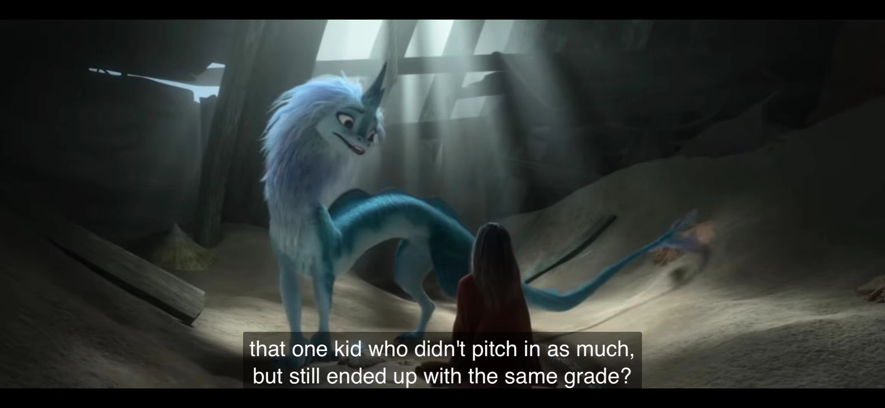
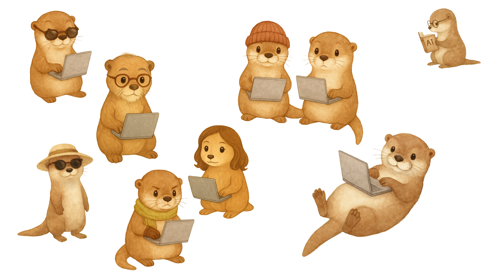
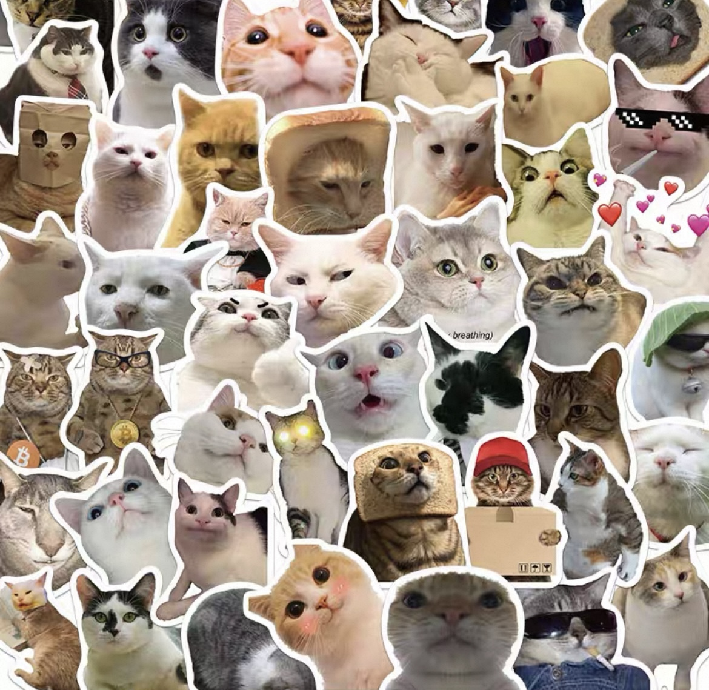
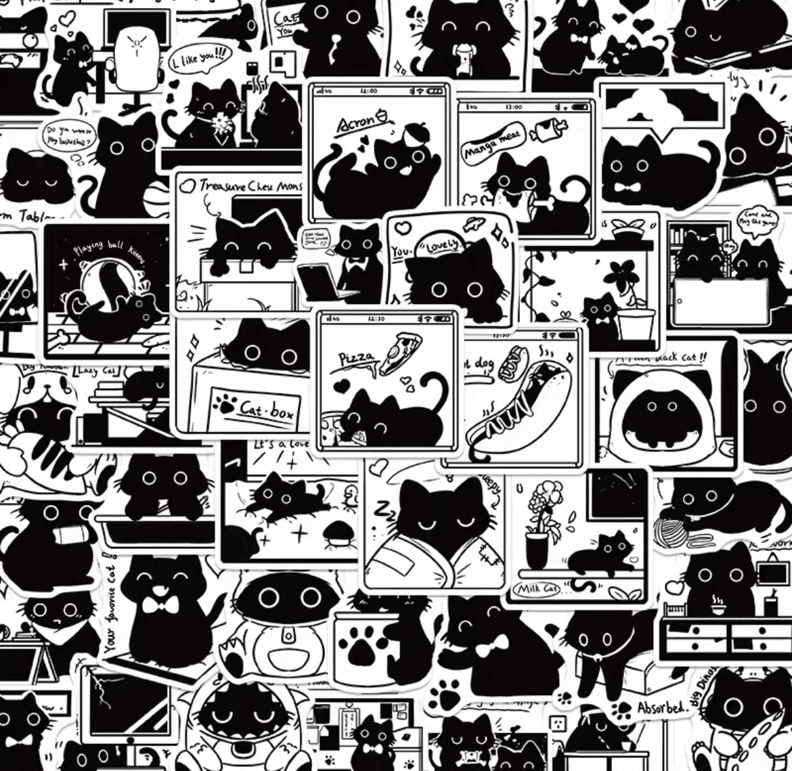
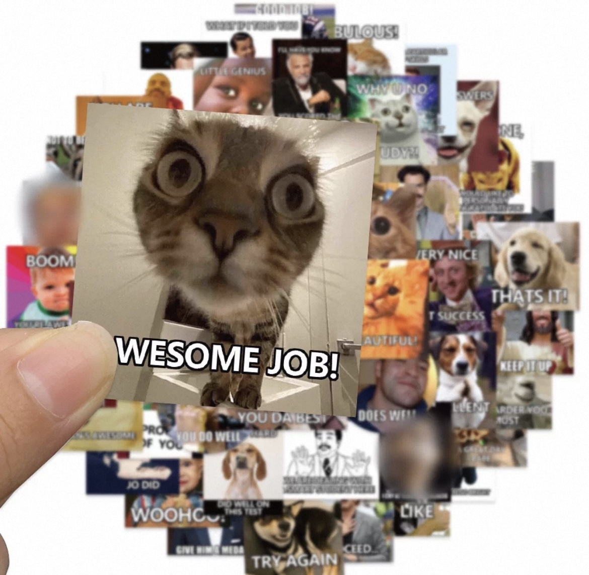

# Welcome to Lab 1! 🎉

## ⚠️  Lab Attendence Policies

- Lab attendance is mandatory!

::: {style="font-size: 0.75em;"}
> ‼️ Students are expected to attend 100% of their scheduled lab hours and attendance will be taken at the beginning of each lab session. Students must make formal requests for academic concession in the event that they cannot attend a lab session by filling out the academic concession form and sending it to the course instructor. Applying for academic concession does not promise the granting of academic concession. Each application will be evaluated in the context of UBC's Academic concession policy. Students missing **more than 20% of the total scheduled lab hours** for a course without having received an academic concession will receive a possible maximum course grade of 50% and an "F" standing for the course on the transcript. For all other policies, please see the general MDS policies.
:::

## AI Tools Policy🤖

::: {.callout-important}
## Important Guidelines
- AI tools are allowed, but you must include proper acknowledgement.
- Document:
  - which tool you used?
  - how you interacted with it?
  - what is your prompts? e.g., `CLAUDE.md` or `AGENTS.md` files
  - how do you verify the output?
  - ...
- Everyone in your team holds the **equal responsibility** for the code and documentation you submit as a group.
- If genAI tool is used but not acknowledged, everyone in your team will face consequences of **academic misconduct**.
:::

## 🧚🏻 Once upon a time... 

📜 Legend says there is a super powerful dragon...

::: footer
Source: [Raya and the Last Dragon](https://www.imdb.com/title/tt5109280/)
:::

## 🐉

::: footer
Source: [Raya and the Last Dragon](https://www.imdb.com/title/tt5109280/)
:::

## 🐉

::: footer
Source: [Raya and the Last Dragon](https://www.imdb.com/title/tt5109280/)
:::

## 🐉

::: footer
Source: [Raya and the Last Dragon](https://www.imdb.com/title/tt5109280/)
:::

## 🐉

::: footer
Source: [Raya and the Last Dragon](https://www.imdb.com/title/tt5109280/)
:::

## Don't be this dragon! 🐉 

**Equal Contribution**

* Everyone should contribute equally to all aspects of the project (e.g., code, writing, project management). This should be evidenced by a roughly equal number of commits, pull request reviews and participation in communication via GitHub issues.

* The full expectations are written out at the end of your [milestone 1 assignment](https://ubc-mds.github.io/DSCI_522_dsci-workflows_students/assignments/milestone1.html).

## 🗣️ Communications

* **English only** in all group discussions to ensure everyone is involved!

* ❌ Do NOT use these platforms: *Below is just a list of examples, not exhaustive list:*

::: {layout-ncol=3}
{width=95}

{width=95}

{width=95}

{width=95}

{width=95}
:::

## ✅ Use GitHub Issues for Communication

::: {style="position: absolute; top: 5px; right: 50px;"}
{width=120}
:::

::: {style="font-size: 0.95em;"}
::: {.callout-tip}

## Why GitHub Issues?
- Transparent and trackable: TAs and instructors can see communications and contributions
- Everyone is **included** in the loop
:::

::: {.callout-warning}
## No Mini Groups!
**EVERYONE** must be involved in conversations. Do not create smaller subgroups within your team. 

💙 It's ok you have your favorite person, but this is a professional setting. Please be fair, collaborative, and inclusive for the group project! Nobody wants to feel left behind or isolated 😢.
:::
:::

# Group Building 👥

## Different Work Styles 

- Learn from each other. The smartest person in the room is the room itself. 

::: {style="text-align: center;"}

:::

::: footer
Image generated by OpenAI GPT-5
:::

## 🙏 SIMPLE, SIMPLE, SIMPLE!!

::: {style="font-size: 0.8em;"}
- Focus on building a **simple project** first
- **Classification OR regression** only
- Don't use crazy models
- This is NOT for job interviews
- Groups that achieve a MVP (**M**inimum **V**iable **P**roduct) at the end of the lab will get stickers!
:::

::: {layout-ncol=3}

:::

## Ice Breaking Activity ❄️

Time to get to know each other!

- Share your name and background
- One fun fact about yourself

::: {.callout-tip}
## What do you expect from your team?
- Are you a last-minute genius? procrastinator? planner?
- What is your strength (e.g., planning, leadership, proof-reading, etc)?
- Share your experience when a group project went horribly wrong
- Share your experience when a group project went extremely well
- Do you prefer written or verbal communication?
:::

## Some Tips 💡

::: {style="font-size: 0.85em;"}
- Include **estimated computation time** if analysis is expected to take long
- Round numbers to 2 decimal places when appropriate
- Do not copy and paste data description from the internet, that would be plagiarism. Write your own descriptions, and cite the source you used.
- How to cite packages? 
  - R : `citation(package = "<package_name>")`
  - Python : `uv pip show <package_name>` (then use the author, version and home page to write the citation)
:::

# Questions? 

Feel free to ask for help throughout the lab!

{width="600"}

::: footer
[GIPHY](https://media.giphy.com/media/v1.Y2lkPTc5MGI3NjExeGtmcWw5dWZvN2VwNHhhaW80eG1wM2hld3RyOWZyYjE5empuY2RtayZlcD12MV9naWZzX3NlYXJjaCZjdD1n/NS7gPxeumewkWDOIxi/giphy.gif)
:::
